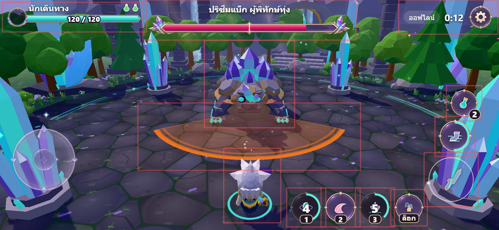

# DES-008 · เลขดาเมจลูเมน — หนา เด้ง อ่านชัด และหลบวงเตือน

**DES-008 ฉบับ 3 · ทีม A (Codex) · 27 พฤศจิกายน 2026 · ตรวจรอบ 2 `489bbdb` / รายงาน `5d77d0b` · สถานะ: รับบางส่วนบน PC / แก้ตาม §14 แล้วส่งรอบ 3 / ยังไม่ปิดงานทั้งหมด**

เจ้าของอนุมัติ DES-008 วันที่ 27 พ.ย. 2026 ว่า “อนุมัติ ลงมือได้” ฉบับ 2 เปลี่ยนเฉพาะการหาช่องวางใน §6.2 และการแยกเกณฑ์ QA/perf ใน §10 ตามผลรอบ 1; คำตอบและเหตุผลอยู่ §13 เก็บรายงาน §12.1 ของทีม B ไว้ตามเดิม ไม่แก้ตัวเลขย้อนหลัง คงสี/ฟอนต์/ขนาด/ขอบ/อายุ/เส้นทาง/merge/caps/พื้นที่ป้องกันเดิม ไม่มี asset ใหม่ ไม่เปลี่ยนกล้องหรือ sim

**ฉบับ 3:** ใช้ §14 เป็นคำตัดสินล่าสุด เพิ่มการเลือก y ที่เผื่อความเคลื่อนไหวภายในช่วงว่างเดิมตาม §6.2 และระบุเวลา event/หลักฐานอ่านต่อเนื่องให้ชัด; §12.1–12.2 และ §13 คงเป็นรายงาน/คำตัดสินประวัติ ไม่ได้แก้ผลย้อนหลัง ทุกข้อที่ไม่เปลี่ยนในฉบับนี้ยังใช้ค่าเดิม ไม่มี asset/กล้อง/กติกาต่อสู้ใหม่

รอบนี้ออกแบบและเขียนเฉพาะ DES-008 ไม่ผลิต asset ไม่แก้โค้ด/กติกา ไม่ใช้ Blender MCP บัญชีหรือเครดิต และไม่ commit/push ไม่แก้ DES-007 เพราะอ้างผ่านลิงก์ได้

## 1. เป้าหมาย หลักฐาน และขอบเขต

อ่าน `REQ-008-damage-numbers.md`, `CLAUDE.md` ข้อ 0, `PROJECT_SYNES.md` ข้อ 1–3, ขั้นตอน REQ→DES, asset pipeline/contract และ [DES-007](DES-007-hero-ninja.md) โดยเฉพาะ §3.4 แล้ว ตรวจแบบอ่านอย่างเดียวที่ `src/ui/hud.ts` ช่วง event/floater, `src/style.css`, `src/ui/buttonFade.ts` และ `shared/sim/world.ts` ช่วง damageEnemy

**ข้อเท็จจริง:** ของเดิมเป็น DOM เหนือ canvas, ใช้ฟอนต์ระบบ ไม่ฝังฟอนต์; ค่า `hit.amount/crit/byPlayer` มาจาก sim; crit เดิมรวมกรณีโบนัสต่อศัตรูเสียหลักด้วย ไม่ได้แปลว่ามีการสุ่มคริติคอลเสมอ รอบนี้เปลี่ยนภาพของ event เท่านั้น ไม่มีการคำนวณดาเมจ/โอกาสคริติคอลใหม่

**แนวที่เลือก:** เลขหนาไล่สีบนตัวอักษร ขอบสว่างบางกับขอบหมึกเข้มที่หนากว่า เงาเหลื่อมลงสั้น เด้งหนึ่งครั้งแล้วเคลื่อนเป็นโค้งสั้น รูปแบบลูเมนของ Synes ใช้ **CSS + DOM และฟอนต์ระบบเดิม** ไม่ใช้ sprite/canvas ตัวเลขหรือฟอนต์ใหม่

ภาพที่เจ้าของแนบใช้เฉพาะความรู้สึก “ตัวเลขมีน้ำหนัก โผล่ชัด กระแทกแล้วอ่านทัน” ไม่คัดรูป glyph การไล่สี ประกายดาวหรือองค์ประกอบจากภาพ และ **ไม่บันทึก/ฝัง/แนบภาพอ้างอิงจากเกมอื่นใน repo**

ลำดับความสำคัญ: **วงเตือนและการอ่านตัวละคร/ศัตรู > การควบคุม/HUD > ข้อความสำคัญ > เลขโบนัส > เลขปกติ > ประกายตกแต่ง** เลขดาเมจเป็นข้อมูลเสริม เมื่อไม่มีพื้นที่ปลอดภัยให้ละเลขนั้นตาม §6 ไม่วาดทับคำเตือนเพื่อบังคับแสดงให้ครบ

## 2. Q1 — ชนิดที่เปลี่ยนและรูปแบบข้อมูล

เปลี่ยนรูปแบบ floater ทุกชนิดให้เป็นครอบครัวเดียวกัน แต่ **เฉพาะเลขจำนวน** ใช้ขอบสองชั้นและ gradient ข้อความไทย/สถานะใช้สีทึบและขอบบางกว่าเพื่อรักษาวรรณยุกต์ แยกชนิด `interrupt` กับ `stagger` จาก `crit/perfect` ในชั้นแสดงผล ไม่จำเป็นต้องเปลี่ยน sim event ของเก่า

| ชนิดใหม่ใน view | แหล่ง event / ตัวอย่างข้อความ | รูปแบบ/ความหมาย |
|---|---|---|
| `damage` | hit: byPlayer=true, crit=false → `12` | เลขฐานสีเงินอมม่วง ไม่เติมเครื่องหมาย |
| `bonus` | hit: byPlayer=true, crit=true → `28` | เลขใหญ่สีทองอมม่วง ใช้กับโบนัสที่ sim ระบุจริง รวม counter/เสียหลักตาม ruleset ไม่สุ่มเพิ่มเอง |
| `hurt` | hit: byPlayer=false → `−18` | เลขติดเครื่องหมายลบ สี blossom ขอบหมึกเข้ม ไม่เปลี่ยนเป็นสีแดงเตือนแม้ e.crit=true |
| `heal` | heal → `+45` | เลขติดบวก สี mint/teal ใช้ค่ารักษาจริงจาก event |
| `perfect` | perfect → `PERFECT!` | คำสี lumen ไม่ใช่ตัวเลขดาเมจ ไม่แสดงตัวคูณที่ view คาดเดาเอง |
| `stagger` | stun → `เสียหลัก` | คำสี violet; แสดงทั้ง long/short stun ถ้า actor ยังอยู่บนจอ ไม่เพิ่ม banner ซ้ำกับ banner ชนเสาที่มีอยู่ |
| `interrupt` | interrupt → `ขัดจังหวะ!` | คำสี lumen อมขาว ไม่มีสไตล์ crit/ประกายโบนัส หลักฐานว่ามี interrupt ต้องมาจาก sim |
| `early` | dodge-early → `หลบเร็วไป` | ข้อความ blossom บนแคปซูลเข้มขนาดกะทัดรัด คงเงื่อนไขเตือน/ช่วงเว้นของ ruleset เดิม ไม่วินิจฉัยจากภาพหลบเอง |

- แสดง `amount` ที่ sim ส่งตรง ๆ ไม่คูณซ้ำ ไม่ใช้ยอด HP ที่ลดจริงแทน ไม่ clamp ตาม HP ที่เหลือ และไม่เพิ่มคำ MISS/0/คริติคอลที่ไม่มี event จำนวนเป็นเลขอารบิกเต็ม ไม่ย่อ K/M และไม่ใส่ comma ในรุ่นนี้
- ค่า hit/heal ที่เป็น 0 ไม่สร้างเลข; ค่าติดลบ/ไม่เป็นจำนวนเต็ม/ไม่ finite ให้รายงานใน QA และไม่สร้าง label ไม่เดาแก้เป็นเลขอื่น ไม่มีดาเมจศัตรูต่อศัตรูหรือรางวัลเพิ่มในขอบเขตนี้
- `−` เป็นเครื่องหมายลบ U+2212, `+` เป็นบวกปกติ; รวม event ได้ตาม §5 โดยเพิ่มคำกำกับว่า `รวม N` ไม่เขียน `28×3` ซึ่งทำให้เข้าใจผิดว่าแต่ละครั้งเท่ากับ 28
- deduplicate เฉพาะ event ที่ถูกส่งให้ view ซ้ำ ด้วย run/world identity + sim tick + event index ห้าม deduplicate จาก amount/target อย่างเดียว เพราะสอง hit จริงอาจมีค่าเท่ากัน

## 3. Q2/Q3 — สี ฟอนต์ ขอบ เงา และวิธีวาด

### 3.1 ค่าที่จอ 844×390

ทุกค่าต่อไปนี้เป็น **CSS px** หลังหัก safe area, ค่า font-size คือขนาดตัวอักษร ไม่ใช่ความสูง glyph จริง ไม่คูณ devicePixelRatio ซ้ำ

| ชนิด | Font size / weight | Fill gradient บน→กลาง→ล่าง (ตำแหน่ง 0/50/100%) | ขอบนอก / ขอบใน | อายุ Medium |
|---|---|---|---|---|
| damage | **32 px / 900** | `#F8FCFF` → `#DDD5FF` → `#A78BFA` | stroke **8 px** `#231D42` / **3 px** `#F7F5FF` | **650 ms** |
| bonus | **40 px / 900** | `#FFF3B0` → `#FFC857` → `#E4B2F4` | **9 px** `#231D42` / **3 px** `#FFF9E8` | **850 ms** |
| hurt | **30 px / 900** | `#FFE8F4` → `#FFC7E2` → `#FF9EC7` | **8 px** `#30213F` / **2 px** `#FFF5FB` | **800 ms** |
| heal | **28 px / 900** | `#E8FFF5` → `#A5F3D2` → `#2BB3A3` | **7 px** `#18363B` / **2 px** `#F3FFF9` | **750 ms** |
| perfect | **24 px / 800** | ทึบ `#5CF2E6` | stroke **3 px** `#182B3C`, ไม่มีขอบใน | **900 ms** |
| stagger | **22 px / 800** | ทึบ `#D7C8FF` | **3 px** `#231D42`, ไม่มีขอบใน | **900 ms** |
| interrupt | **22 px / 800** | ทึบ `#C6FAF6` | **3 px** `#182B3C`, ไม่มีขอบใน | **800 ms** |
| early | **22 px / 800** | ทึบ `#FF9EC7` | **2 px** `#231D42`, ไม่มีขอบใน | **1,300 ms** |

**stroke width คือความกว้างเต็มที่วาดคร่อมขอบ glyph** ไม่ใช่ความหนาที่เห็นข้างละเท่ากัน เช่น stroke 8 px ขยายออกด้านนอกประมาณ 4 px ขอบในที่วาดทับต้องไม่ทำให้ช่องกลางเลข 8/9 ตัน

ตัวเลขทุกชนิดใช้เงาแข็ง `0 3px 0 #120D24` เฉพาะชั้นขอบนอก ไม่มี blur/glow; ข้อความสถานะใช้ `0 2px 0 rgba(18,13,36,0.65)` ไม่มี blur แคปซูล early ใช้พื้น `rgba(24,21,45,0.84)`, padding แนวนอน 8 px/แนวตั้ง 3 px, radius 8 px และเส้น 1 px `#796183` ข้อความชนิดอื่นไม่มีพื้นทึบ

**ผู้เล่นโดนแยกจากวงเตือน:** ใช้ blossom อ่อน เครื่องหมายลบ และโค้งการเคลื่อนสั้นอยู่ข้าง/เหนือผู้เล่น ไม่ใช้แดงสด สีส้ม พื้นแดง การ pulse เตือน หรือวงบนพื้น ห้าม `#FF3355` และ `#FF7A1A` ใน fill/stroke/shadow/ประกายทุกชนิดของ DES นี้ สีทองของ bonus เป็น `#FFC857` ไม่ไล่ไปส้ม

### 3.2 วิธีวาดที่ทีม B ใช้

- DOM wrapper หนึ่งอันต่อ label, `pointer-events:none`, `user-select:none`, `white-space:nowrap`; ไม่มี hit target/เสียงเพิ่ม/การแย่ง focus ติด `aria-hidden` กับข้อความตกแต่งและชั้นซ้ำ ไม่ทำ live announcement ของแต่ละ hit
- เลขใช้ **3 ชั้นข้อความตำแหน่งและ font ตรงกัน**: ชั้นล่าง fill/stroke สีขอบนอกพร้อมเงา → ชั้นกลาง fill/stroke สีขอบใน → ชั้นบน fill เป็น `linear-gradient(180deg, ...)` clip ที่ text และไม่มี stroke เงาอยู่เฉพาะชั้นล่าง ไม่ใช้ drop-shadow หลายชุด
- ข้อความสถานะใช้ glyph ชั้นเดียว `paint-order: stroke fill` ตามค่าขอบของตัวเอง เพื่อไม่ให้สระ/วรรณยุกต์ดูหนาเกิน; early เพิ่ม wrapper แคปซูล ไม่ใช้พื้นสองแผ่นซ้อน
- ฟอนต์เดิม `system-ui, -apple-system, "Segoe UI", "Noto Sans Thai", "Thonburi", sans-serif`; ตัวเลขใช้ weight 900, ข้อความ 800, letter-spacing 0; เปิด tabular/lining numerals หากฟอนต์รองรับ แต่ต้อง measure ความกว้างจริง ไม่สมมติว่าเครื่องทุกเครื่องได้ glyph เหมือนกัน
- line-height ตัวเลข **1.0**, สถานะไทย/อังกฤษ **1.3**; ขอบกล่องต้องเผื่อ stroke เงา และวรรณยุกต์ ไม่ตัดบน/ล่าง wrapper ของแต่ละ layer ไม่ใช้ overflow hidden ที่ตัดขอบเลข
- หาก gradient clip ไม่รองรับ ใช้สีบนสุดของชนิดนั้นเป็น fill ทึบ; หาก text-stroke ไม่รองรับ สำหรับเลขให้ใช้ text-shadow 8 ทิศรัศมี 4 px สีขอบนอกและ 8 ทิศรัศมี 1 px สีขอบในของชั้นกลาง (แนวนอน/ตั้ง/ทแยง) และคงเงาลง 3 px; สถานะใช้ shadow 8 ทิศรัศมี 1.5 px สีขอบของตัวเอง (early 1 px) แทน stroke ไม่โหลดฟอนต์/ภาพเป็น fallback ต้องผ่านเกณฑ์อ่านออกเช่นกัน
- cache การวัดข้อความตาม font/size/text; measure ใหม่เฉพาะข้อความเปลี่ยน ไม่อ่าน layout ของ label ทุกอันสลับกับเขียน style ต่อเฟรม; pool wrapper/ชั้นข้อความตามจำนวนสูงสุด ไม่สร้าง interval/setTimeout ใหม่ต่อ hit ใช้ UI animation clock ที่ pause ไปกับเกม

### 3.3 การปรับขนาดจอ

กำหนด `S = clamp(0.85, min(safeWidth/844, safeHeight/390), 1.25)` คูณ font/stroke/shadow/path/gap/ประกาย/padding ด้วย S ตัวเลขต่ำสุด **24 px**, สถานะต่ำสุด **18 px** เมื่อย่อจอ; อายุแสดงไม่คูณตามจอ ที่ 844×390, S=1 ได้ค่าตารางตรง ๆ

ความกว้างปกติรวมขอบ/ป้ายรวมไม่เกิน **180×S px** ถ้าเลขยาวให้ลด font เฉพาะ label จนพอดีแต่ไม่ต่ำกว่า 24 px; ห้ามย่อเป็น K/M/ตัดท้าย/ตัดบรรทัด ถ้ายังไม่พอดีให้ละ label ตามข้อจำกัดพื้นที่และเก็บค่า event เดิมไว้ ข้อความสถานะไม่เกิน **170×S px**, ไม่ตัดคำไทย

## 4. Q4 — จังหวะเด้ง เส้นโค้ง และอายุ

ใช้ age จาก clock ของการเล่นภาพ ไม่อิง Date/เวลาเครื่อง, pause แล้วหยุดอายุและการเคลื่อน; resume ไม่ปล่อย backlog จากช่วง pause เป็นพรวน ถ้าเปลี่ยนด่าน/เริ่ม run/retry ให้ clear pool และตัวรวมทั้งหมด

ฉบับ 3: พัก batch จนถึงเฟรมที่จะ paint เพื่อใช้ geometryปัจจุบันได้ แต่ต้องเก็บเวลาของแต่ละ eventตั้งแต่รับตาม §14.3 ไม่ให้ eventต่าง tickได้เวลาเดียวกัน คิวส่งต่อไปเฟรมถัดไปนี้ไม่ใช่คิวรอหาที่ว่าง: ถ้าวางไม่ได้หรือหมดอายุแล้วต้องละ ไม่ปล่อยย้อนหลังเมื่อช่องเปิด

### 4.1 Scale และ opacity

เลข damage/heal: scale **0.72 → 1.14 → 1.00** ที่เวลา **0/80/150 ms**; bonus: **0.68 → 1.18 → 1.00** ที่ **0/90/170 ms**; hurt: **0.80 → 1.10 → 1.00** ที่ **0/70/140 ms**; perfect/stagger/interrupt: **0.94 → 1.04 → 1.00** ที่ **0/80/150 ms**; early scale=1 ตลอด ไม่มี bounce ซ้ำ

ช่วงขยายใช้ `Eout(v)=1−(1−v)^3`; ช่วงคืน scale ใช้ `EinOut(v)=3v²−2v³`; v คือเวลา normalized ในช่วงนั้น หลัง key สุดท้ายคง scale 1 ไม่หมุน ไม่สั่นกล้องและไม่ทำ squash แยกแกน

Opacity: 0→1 แบบ linear ใน **40 ms แรก**, คง 1 จน **70% ของอายุ**, แล้ว fade 1→0 แบบ linear ถึงจบ; early คง 1 ถึง **85%** ก่อน fade จึงอ่านเต็มได้นานกว่า 0.9 s ตามเจตนาเดิม

### 4.2 เส้นทางการเคลื่อน

กำหนด u=clamp(age/life,0,1), x เป็นบวกไปขวา/y บวกลง, ทุกจุดคูณ S ใช้ cubic Bézier **B(u)=(1−u)³P0+3(1−u)²uP1+3(1−u)u²P2+u³P3** ไม่ใส่ ease ซ้ำใน u ของ path เลือกเครื่องหมาย s=−1/+1 สลับตามลำดับ label ของ actor (เริ่มขวา) ไม่มี Math.random

| กลุ่ม | P0 | P1 | P2 | P3 |
|---|---|---|---|---|
| damage | (0,0) | (18s,−30) | (28s,−42) | (32s,−20) |
| bonus | (0,0) | (24s,−44) | (34s,−58) | (38s,−30) |
| hurt | (0,0) | (0,−12) | (12s,−20) | (16s,−8) |
| heal | (0,0) | (0,−14) | (0,−28) | (0,−36) |
| perfect/stagger/interrupt | (0,0) | (0,−6) | (0,−12) | (0,−14) |
| early | (0,0) | (0,−2) | (0,−4) | (0,−6) |

อายุและ path กำหนดแยกกัน เลขจึงโค้งสั้นแล้วยุบจาง ไม่เด้งไกลตาม reference ใช้ transform/opacity กับ wrapper เดียว ห้าม animate left/top หรือ gradient ทุกเฟรมเพื่อความรู้สึกแรงเพิ่ม

## 5. Q4 — การรวม ซ้อน และจำนวนสูงสุด

### 5.1 รวม hit ที่ถี่โดยไม่เปลี่ยนข้อมูล sim

- ตัวรวม keyed ด้วย **target actor + ชนิดเลข + source owner ถ้ามี**; damage กับ bonus แยกกัน, hurt/heal แยกจากกัน, ต่าง actor ไม่รวม ห้ามเอาดาเมจหลายมอนไปรวมบนหัวมอนตัวเดียว
- Medium รวม event ใหม่เข้า label เดิมถ้าอยู่ภายใน **120 ms จาก event แรกของกลุ่ม**; Low ใช้ **160 ms** นับจากแรกเช่นกัน ไม่เลื่อนหน้าต่างต่อไปเรื่อย ๆ แสดงยอดบวกของ amount จริง เมื่อ N≥2 เพิ่มป้าย `รวม N` ขนาด **14 px/weight 700** สี `#F7F5FF` ขอบ 2 px `#231D42` มี gap 5 px อยู่ขวาล่างของเลข ป้ายเป็นส่วนหนึ่งของ bounds
- อัปเดตยอดทัน event ไม่รอ debounce ไม่ restart pop/life ไม่ขยายตัวอีกครั้ง และไม่ใช้ crit style แทนกลุ่มที่ปน normal/bonus เพราะแยกกลุ่มตั้งแต่ต้น ถ้าข้อความกว้างขึ้นต้องทดสอบพื้นที่ใหม่ตาม §6 ก่อนแสดง
- สถานะไม่รวมเป็นตัวเลข dedup ข้อความชนิดเดียว/actor เดียวภายใน **180 ms**; early ยังคง throttle ตาม sim/HUD เดิม, ไม่ลดช่วงเว้นเพื่อให้เห็นข้อความบ่อยขึ้น

### 5.2 เพดานและการเลือกเลข

| รายการ | Medium | Low |
|---|---|---|
| จำนวน label ทั้งจอ | **12** | **8** |
| ในจำนวนนั้นเป็นเลข | **≤8** | **≤6** |
| ในจำนวนนั้นเป็นสถานะ | **≤4** | **≤2** |
| ต่อ actor | **≤2 เลข + 1 สถานะ** | **≤1 เลข + 1 สถานะ** |
| ขนาดตัวเลข/สถานะ | ตาม §3 | **เท่ากัน** ไม่ลดจนอ่านยาก |
| อายุ damage/bonus/hurt/heal | 650/850/800/750 ms | **600/750/750/700 ms** |
| อายุสถานะ | ตาม §3 | **เท่ากัน** |
| Scale | ตาม §4 | peak ทุกเลขไม่เกิน **1.10**, เวลา key เดิม |
| ระยะ path | ตาม §4 | **0.75×** ทุกจุดของเลข; สถานะเท่าเดิม |
| ประกาย CSS | ตาม §7 | **ปิดทั้งหมด** |

ประมวล event ที่เข้าใน tick เดียวเป็น batchก่อนเลือก label เพื่อไม่สร้าง/ไล่ทิ้งตามลำดับมาอย่างไร้เหตุผล ลำดับสำคัญคือ **hurt > perfect > early > heal > stagger > interrupt > bonus > damage** ภายในชนิดเดียวเลือก actor ใกล้ผู้เล่นกว่าในโลก แล้ว actor ID, event index เป็นตัวตัดสินระยะเสมอ

ถ้าถึงเพดาน: รวมเข้ากลุ่มเดิมที่ยังเข้า window ก่อน; หากต้องสร้างใหม่ให้แทน labelสำคัญต่ำกว่าที่ **มี paint opportunity จริงที่ opacity>0 ครั้งแรกแล้วอย่างน้อย180ms** โดยเลือกเวลาเกิดเก่าสุดก่อน คงลำดับสำคัญเดิม ไม่ใช้ event ageที่เก่าจากคิวแทนเวลาที่มีโอกาสเห็น และไม่แทน labelที่ยังไม่เคยวาดด้วยการอ้างว่าเกิดมานานแล้ว ถ้าไม่มีตัวที่แทนได้ให้ละ labelใหม่ ไม่มีคิวรอระบาย เมื่อเต็มเพดานต่อactorใช้เกณฑ์เดียวกันก่อนเพดานรวม กรณีหมดอายุยังคืน poolก่อนรับของใหม่ ค่า180msนี้เป็นขั้นต่ำก่อนแทนที่ ไม่ใช่ counterอ่านได้ที่ต้องopacity≥0.8ต่อเนื่อง180ms

ข้อยกเว้นเดียวที่ลบก่อน 180 ms ได้คือ **การหลีกวงเตือน/ร่าง/HUD ตาม §6**, actor หายหลัง reset หรือข้อมูลไม่ valid ป้าย `รวม N`/ประกายเป็นลูก ไม่เพิ่มจำนวน label ในเพดาน แต่รวมอยู่ใน bounds และงบ DOM

งบ DOM ภายใน overlay ไม่รวม root: Medium **≤52 elements** (12 wrappers + 24 ชั้นเลข + 4 ชั้นสถานะ + 8 ป้ายรวม + 4 ขีดประกาย), Low **≤34** (8+18+2+6) pool ที่ยังไม่ใช้ต้องอยู่ภายในเพดานนี้และไม่ paint ไม่เปิดประกายเพิ่มหลัง cap เต็ม

## 6. Q5 — ตำแหน่งและการไม่บังวงเตือน/ร่าง/HUD

### 6.1 ข้อมูลตำแหน่งที่ทีม B ต้องเตรียม

ไม่ใช้ค่า y=1.6/2.0/2.3 แบบเดียวกับทุกโมเดลอย่างเดิม ให้ view ส่ง **screen rectangle ที่ครอบร่างทั้งหมดซึ่งมองเห็น** ของผู้เล่น/ศัตรู รวมผม/ท่ากางแขน/อาวุธ/ผ้าที่ยังอ่าน silhouette, กับตำแหน่งเหนือหัวและ vis; ใช้ cached render envelope ที่ครอบ pose/clip ได้จริง ไม่ใช้วงชน sim อย่างเดียว ร่างบอสสูงกว่าฮีโร่ต้องได้ตำแหน่งเหนือหัวจริง

ข้อมูลต้องอยู่ใน CSS px ของ viewport เดียวกับ floaters, หลังแปลง canvas rect/camera ปัจจุบันและ safe area; ไม่คูณ DPR ถ้า project ไม่ valid/อยู่หลังกล้อง/นอกจอให้ไม่สร้าง label ไม่ clamp เลขของศัตรูนอกจอมาเกาะขอบจอ

พื้นที่ป้องกันที่คำนวณทุก render frame:

1. **คำเตือนทุกอันที่กำลังวาด** ทั้งช่วงเตรียม/active/ขอบที่ยังไม่จางหมด: ป้องกันเต็มพื้นที่ด้านใน+ขอบ แล้วขยายออก **8×S px** ไม่ป้องกันเฉพาะเส้นวง วิธี baseline คือเอา world bounds ที่ครอบรูปเตือนทั้งวง/กรวย/เส้นจริงและความหนาขอบมาฉายเป็น convex screen polygon แล้วใช้ AABB ของ polygon แบบอนุรักษ์ จึงยอมซ่อนเลขมากกว่าจำเป็นเพื่อไม่ให้เสี่ยงบัง หากใกล้กล้องจน bounds ฉายไม่ได้ให้ถือทั้ง viewport เป็นพื้นที่ป้องกันสำหรับเฟรมนั้น
2. **ร่างผู้เล่นและศัตรูที่ยัง render อยู่** ทุกตัว + **6×S px**, health bar/mark ของเป้าและสัญลักษณ์ ✦ เดิม + **4×S px**; ไม่ให้เลขหนึ่งบังหน้า/คมดาบ/ตัวอีกตัวที่อยู่หลังเป้า
3. HUD ที่มองเห็น: ปุ่มรวม badge/cooldown, จอยที่แสดงจริง, HP/บอส/ข้อความสอน/banner/เมนู/ผลจบและ safe area ขยาย **8×S px** ไม่จองพื้นที่ invisible touch zone ทั้งแผงที่ไม่มีภาพเพราะจะเหลือที่น้อยเกินไป
4. label ที่รับเข้าแล้ว ให้ช่องไฟระหว่าง reserved rectangles อย่างน้อย **6×S px**

กฎนี้เพิ่มการหลบของตัวเลขเอง **ไม่ใช่การสั่งเลื่อน/ซ่อน HUD, คำเตือน, ศัตรู หรือเปลี่ยนกล้อง**; logic ButtonFade เดิมใช้เป็นฐานฉาย/อ่าน shape ได้ แต่ห้ามยืมรอบเช็กทุก 4 เฟรมมาใช้กับเลข เพราะวงเตือนใหม่อาจถูกบังระหว่างเฟรม

### 6.2 กล่องจองและจุดวางที่ไม่ต้องเดา

สร้าง **reserved rect R** ที่ครอบ label ตลอดอายุจากความกว้าง/สูง glyph จริงที่ peak scale + stroke/shadow + ป้ายรวม + ประกาย แล้วรวมขอบเขต control points P0–P3 ทั้งหมด (convex hull ครอบ Bézier ได้) จึงเผื่อเส้นทางล่วงหน้า ไม่ทดสอบเฉพาะขนาดที่กำลังโผล่ 0.72 ให้ขยายจากกล่อง glyph/line box ที่วัดจริงอย่างน้อย **8×S px ทุกด้าน** เพื่อครอบ stroke เงา วรรณยุกต์และ antialias; ถ้าวัดว่าชิ้นใดเกิน padding นี้ ใช้ขอบจริงที่ใหญ่กว่า ห้ามลด R ให้ผ่านช่องว่างปลอม

**ฉบับ 2 แทนช่องสูงเดิม 6 ช่องด้วย 4 รูปแบบวาง** ไม่ลด R หรือพื้นที่ป้องกันเพื่อแก้ F1/F2 ตำแหน่งอ้างจุดกลาง R; a=actorRect ที่ยังไม่ขยาย, cx=(a.left+a.right)/2, g=**10×S px**, w/h=ขนาด R; สำหรับการปัดเศษพิกัดเผื่อ ε=**0.5×S px** เพิ่มในการตรวจขอบ/ชนขั้นสุดท้าย

| ลำดับเลขคี่ / ชื่อรูปแบบ | จุดกลาง R ตั้งต้น |
|---|---|
| 1 เหนือหัว | `(cx, a.top−g−h/2)` คงจุดนี้ ถ้าตกขอบ/ทับให้ข้าม ไม่ดันเข้าหัว |
| 2 ข้างขวาลำตัว | x=`a.right+g+w/2`; y ที่ชอบ=กลางช่วงลำตัวที่มองเห็นใน safe viewport แล้วหาช่วง y ว่างตามวิธีด้านล่าง |
| 3 ข้างซ้ายลำตัว | x=`a.left−g−w/2`; y ที่ชอบเหมือนขวา แล้วหาช่วง y ว่าง |
| 4 ใต้ร่าง | `(cx, a.bottom+g+h/2)` ต้องไม่ทับร่าง/เท้า/พื้นเตือน หากไม่ผ่านให้ข้าม |

เลขลำดับคู่ของ actor ลอง **1→3→2→4** เลขคี่ **1→2→3→4** ชนิดสถานะใช้กฎเดียวกัน ไม่เพิ่มแถบสรุปหรือเส้นชี้เป้า ไม่ย้าย HUD/กล้องเพื่อเปิดช่อง

**เกณฑ์ความใกล้เป้าใหม่:** ยกเลิกเพดานจากจุดเหนือหัว 144×S; ใช้ระยะจาก **ศูนย์ R ถึงจุดใกล้ที่สุดบน a ≤128×S px** แทน โดย `dx=max(a.left−Cx,0,Cx−a.right)`, `dy=max(a.top−Cy,0,Cy−a.bottom)` และ `dx²+dy²≤(128S)²` จึงวางข้างกลางลำตัวบอสได้โดยเลขยังอยู่ใกล้เป้า ไม่ใช่ปล่อยไปทั่วจอ ค่า 128 ใช้ทั้ง Medium/Low

**หาช่วงว่างในแนวข้าง (ทำเฉพาะตอน spawn ไม่ค้นทุกเฟรม):**

1. คง x ของด้านนั้น ห้าม clamp x เข้ามาทับร่าง ถ้า R เกินขอบ safe viewport ที่เว้น **8×S px** หรือ dx>128S ให้ข้ามด้านนั้นทันที
2. สร้างช่วงศูนย์ y ที่ใส่ R ได้ทั้งกล่องใน safe viewport: `[safe.top+8S+h/2+ε, safe.bottom−8S−h/2−ε]`; ถ้าช่วงกลับด้านคือไม่มีที่
3. จำกัดความใกล้เป้าด้วย `v=sqrt((128S)²−dx²)` แล้ว intersect ช่วงนั้นกับ `[a.top−v,a.bottom+v]` อย่าใช้ระยะถึงหัวแทน สูตรใช้เฉพาะ geometry ฝั่ง UI ไม่ส่งกลับ sim
4. สำหรับ protected rect p ทุกชิ้นจาก §6.1 ที่ทับช่วง x ของ R (เผื่อ ε) ให้ตัดช่วงศูนย์ y `(p.top−h/2−ε, p.bottom+h/2+ε)` ออก รวมร่างตัวเป้า/ตัวอื่น วงเตือนเต็มพื้นที่ แถบ HP/mark/✦ และ HUD **ตาม margin เดิมทั้งหมด**; label ที่รับแล้วขยาย 6S เป็นสิ่งกีดขวางแบบเดียวกัน ใช้การทับเมื่อมีพื้นที่ร่วม>0 จุดปลายที่แตะขอบพอดียอมได้ถ้าตรวจขั้นสุดท้ายแล้ว intersection=0
5. **ฉบับ3เปลี่ยนเฉพาะการเลือกจุดภายในช่วงที่ถูกกฎอยู่แล้ว:** เรียง/รวมช่วงต้องห้ามแล้วเก็บทุก free interval `[L,U]` รวมช่วงที่เป็นจุดเดียว สำหรับแต่ละช่วงคำนวณ `d=min(7.5×S,(U−L)/2)` และช่วงที่เลือก `[L+d,U−d]`; clamp yที่ชอบ (กลางของa∩safe viewport) เข้าช่วงนี้เป็น candidate จากนั้นเลือก candidateที่ใกล้ yที่ชอบที่สุด ถ้าเสมอเลือก yน้อยกว่า วิธีนี้ให้ clearanceตามแนวyเป้าหมาย **8×S px** ต่อขอบที่กีดขวางเมื่อมีที่พอ (ε0.5+inset7.5) ถ้าช่องแคบให้เลือกกลางช่อง ไม่ตัดช่องทิ้ง ไม่เพิ่มprotected marginและไม่เปลี่ยนลำดับ4รูปแบบ
6. ตรวจ R+ε ขั้นสุดท้ายกับ safe/ความใกล้เป้า/protected/label อีกครั้งก่อนรับ; จากศูนย์ R ที่ผ่านค่อยคำนวณตำแหน่งเริ่ม wrapper ชดเชย local rect ของ path ใช้ full-life R ตามเดิม ไม่ตรวจเฉพาะ glyph ณ เฟรมโผล่

ตัวอย่างเชิงเรขาคณิตสำหรับ F1 (**fixture ไม่ใช่ผลวัดรอบ3**): Rสูง103px, HUDป้องกันถึงy67, วงเตือนเริ่มy174 ให้ช่วงศูนย์ **119–122px** หลังε0.5; ฉบับ3เลือก **120.5px** (กลางช่อง) แทน122ของฉบับ2 ถ้าHUDลงถึง70จะเหลือจุดเดียว122และยังใช้จุดนั้นได้ ถ้าลงถึง71ไม่มีช่องจริงต้องละ ดังนั้นไม่แลก F1กับการบังคับให้มีช่องกว้าง8pxเสมอ

ค่า8Sเป็นการเผื่อตามแนวyภายในแต่ละช่วง **ไม่ใช่เงื่อนไขว่าทุก protected rectต้องห่าง8Sเพิ่มอีกชั้น** โดยเฉพาะด้านข้างของร่างเป้าเองยังห่างตามg10กับbody margin6เหมือนเดิม ให้บันทึกทั้งvertical slackและระยะห่างจริงต่ำสุด แยกกัน ไม่สรุปว่าระยะต่ำสุด4pxแปลว่าทำ insetผิด

**หลัง spawn ไม่ไล่หาช่องใหม่:** บันทึกด้าน/รูปแบบ, w/h ที่ใช้เลือกช่อง, ตำแหน่ง P0 เทียบศูนย์ R และ deltaY=ตำแหน่งที่เลือก−กลางช่วงลำตัวตอน spawn สำหรับข้างซ้าย/ขวา เฟรมถัดไปตามกลางลำตัวใหม่+deltaY กับ x ด้านเดิม ส่วนเหนือหัว/ใต้ร่างตามสูตรเดิม ใช้ frame ตั้งต้นเดิมเมื่อรวมยอด/ประกายจบ ไม่ย้ายตัวอักษรให้กระโดดกลางอายุ ถ้า R ใหม่กว้างจนไม่ปลอดภัยให้ retire ตามเดิม

ถ้า actor ถูกถอดหลังตายให้ใช้ตำแหน่งร่างสุดท้ายจนหมดอายุตราบใดที่ยังปลอดภัย การ resize/กล้องขยับยังต้องใช้พิกัดปัจจุบันตรวจทุกเฟรม ถ้าจำเป็นต้องเปลี่ยนรูปแบบวางให้รอ label ใหม่ ไม่คืน label ที่ retire แล้วมาอีก

**ศัตรูเล็ก (F3):** ยอมรับว่าเห็นได้เพียง **1 เลข/actor** แม้ Medium อนุญาตสูงสุด2; Lowสูงสุด1ตามเดิม นี่เป็นเพดาน ไม่ใช่จำนวนขั้นต่ำ ไม่ลด font/ขอบ ไม่เพิ่มเวลารวมเกิน120/160ms ไม่เอาเลขต่าง actor หรือ normal/bonusมารวมกัน และไม่เบียดเลขแรกเพื่อบังคับมีสองเลข การแทนที่ยังตามอายุ180ms/ลำดับสำคัญเดิมใน §5

**ไม่มีจุดผ่าน:** ละ label นั้นทันที ไม่มีคิว delayed/แถบเลขใหม่บนพื้นอื่น กรณีพื้นที่เต็มจอเป็นวงเตือน ยอมไม่มีเลขชั่วคราว คงผล HP/แถบบอส/✦/event ตามเดิม นี่เป็นทางเลือกทีม A เพื่อรักษาความชัด ไม่ใช่ให้ทีม B เดาวิธี fallback เอง

**ทุกเฟรมก่อน paint:** ตรวจ R ที่ตาม anchor ปัจจุบันกับพื้นที่ป้องกันใหม่ ถ้ามีวงเตือน/ร่าง/HUD/label สำคัญกว่ามาทับ ให้ retire label ทันทีโดยไม่ fade ทับวงและไม่คืนมา flicker; event ไม่ถูกยกเลิกและไม่ย้อนจำนวนดาเมจ แม้ label อายุไม่ถึง 180 ms กฎความปลอดภัยมีสิทธิเหนืออายุขั้นต่ำเสมอ

**ยืนยัน Q12.2-2(ก)(ข):** ε0.5Sใช้ตอนspawnเท่านั้น; การตรวจแต่ละเฟรมใช้Rจริงไม่บวกεใหม่ แต่คงsafe8S/near128S/ทุกprotected/label+6Sครบ และต้องไม่มีพื้นที่ทับขณะpaint `กลางลำตัวที่มองเห็น`คือ `(max(a.top,safe.top)+min(a.bottom,safe.bottom))/2` ใช้ทั้งตอนspawnและตามตำแหน่ง; deltaYยังคงค่าที่เลือกไว้ ไม่ค้นใหม่ทุกเฟรมแม้ฉบับ3จะเปลี่ยนจุดเริ่ม

การลด opacityเหลือ 0.35 อย่างเดียว **ไม่ถือว่าผ่าน** การไม่บังวงเตือน เพราะ glyph/เงายังอยู่เหนือ canvas; ไม่ใช้ z-index สูงขึ้นเพื่อแก้ และไม่ย้ายวงเตือนเป็น UI ในงานนี้

## 7. Q6 — ประกายต้นฉบับที่เลือก

ใช้ **ขีดแสงคู่ “จังหวะเสียง”** สร้างด้วย CSS แทนดาวแบบภาพอ้างอิง ไม่มีดาวแฉก ลายตรา หรือไฟล์ภาพ:

- ใช้เฉพาะ **bonus และ perfect ใน Medium** ไม่ใช้กับ damage/hurt/heal/ข้อความไทย; ไม่ใส่ประกายให้ทุก hit
- ขีด A ขนาด **3×9 px**, radius 1.5 px, มุม −18°; ขีด B **3×6 px**, radius 1.5 px, มุม +20°; สี `#C6FAF6` กับ `#A78BFA` ตามลำดับ ไม่มี glow/เงา
- วางนอกมุมขวาบนของกล่อง glyph: จุดกลาง A `(right+4, top−1)`, B `(right+10, top+3)` px; อยู่หลังข้อความแต่ขอบไม่ลอดเข้าไปในช่องเลข ระยะ/ขนาดคูณ S
- อายุ **160 ms** จาก spawn, opacity 0→0.85 ที่ 30 ms แล้ว→0 ที่ 160 ms, translate ขึ้น **4×S px** linear ไม่มี scale/หมุนเพิ่ม; จำกัดหนึ่งชุดต่อ actor ต่อ **180 ms** และพร้อมกันทั้งจอ **ไม่เกิน 2 ชุด**
- ใช้พื้นที่ที่จองไว้ใน R เท่านั้น ถ้าประกายทำให้จุดวางไม่ผ่าน ให้ลอง layout รอบเดิมโดยตัดประกายก่อนจะละ label; ประกายไม่สร้าง event/เสียง/ตัวคูณหรือเปลี่ยนขนาดเลข ไม่มี asset ส่งเข้า inbox

## 8. Q7 — ใช้กับสกิลนินจาใน DES-007

เลขเกิดจาก **damage result จริง** ไม่เกิดจากเส้นคม/เข็ม/mark/VFX/เสียง ที่มีอยู่ใน DES-007 ซึ่งยังเป็นแบบรออนุมัติ ทั้งสอง DES ต้องไม่เปิดกติกาใหม่ใน rulesetเก่าโดยพลการ

| เหตุการณ์ DES-007 | เลข/การซ้อนที่ต้องใช้ |
|---|---|
| คอมโบ hit 5/5/9 ของแต่ละ action | หนึ่งเลข/เป้าที่โดนตาม amount จริง; เว้นตามจังหวะ sim ไม่ดีดเลขในช่วงเตรียม |
| เข็มสะท้อน | เลขเมื่อ projectile ชนเป้าทำ damage; ไม่ขึ้นเลขตอนปล่อย tick 5 หรือเมื่อชนฉาก/mark เกิดอย่างเดียว |
| กิน mark +8 / counterEcho / bonusตอน ✦ | แสดง amount สุดท้ายจาก pulse/event เดียว **ไม่แตก +8/+12/×1.5 เป็นเลขเพิ่ม**; ใช้ bonus style เฉพาะ crit/bonus flag จาก sim ถ้าชุดใหม่ยังไม่ส่ง flag ให้ทีม B map semanticsที่ยืนยันกับทีม A ไม่เดาจากสีเอฟเฟกต์ |
| ก้าวเส้นเงา | แสดงเฉพาะ actor ที่ damage sweep โดนจริงหนึ่งครั้ง/action; ไม่มีเลขตามจุดใน trail และไม่มีเลขหลัง blocker |
| ปมคมสะท้อน | เลขเกิด hit tick 14 เท่านั้น; วาดคมตาม DES-007 ไม่เพิ่มประกายใหญ่ซ้อนเลขที่จุดเดียวกัน |
| อัลติร้อยเงารวมคม | รับ damage pulse ที่ tick **9/15/21** แยกกัน; เว้น 200 ms มากกว่า merge window 120/160 จึงไม่รวมข้าม pulse; ใช้ slots/retirement ตาม §5 ไม่สร้างเลขเพิ่มจากเงา |
| perfect / เส้นเสียงเพิ่ม / มิเตอร์เต็ม | perfect แสดงคำหนึ่งครั้งจาก eventสำเร็จ; **ไม่มีเลข +1/+2 มิเตอร์ลอยขึ้น** ใช้ indicatorเดิมของ HUDตาม DES-007 |
| heal/ผู้เล่นโดน/early | แสดงจาก eventเดิมตาม §2; ห้ามสร้าง earlyใหม่จากกฎ perfectของ DES-007 หาก simไม่ส่ง |

DOMเลขไม่เพิ่ม draw calls ของ Three.js แต่มีต้นทุน layout/composite จึงต้องวัดแยก ไม่อ้างว่า “ฟรี” และไม่หักงบ VFX geometry +5/+3 calls ของ DES-007 ให้ครบด้วยการซ่อนเลข แต่กำหนด overlay paint/runtime budget ของตนใน §10

## 9. Asset, license, การเข้าถึง และการส่งต่อ

**ไม่มี asset ที่ต้องผลิตในรอบนี้:** ไม่มี spriteตัวเลข ไม่มีฟอนต์ใหม่ ไม่มีภาพประกาย ไม่มีรายการเจนภาพ/โมเดลให้เจ้าของ และไม่ใช้ quota 3D ชื่อ `ui_*_vNN`/`tex_*_vNN` จึงไม่มีรายการที่ต้องส่ง inbox ส่วนขีดแสงเป็น CSSต้นฉบับตามแบบ ไม่ใช่การคัดภาพ

ใช้ฟอนต์ระบบที่มีบนเครื่องเท่านั้น ไม่ดาวน์โหลด/ฝัง/แจกไฟล์ font จึงไม่เพิ่ม font licenseหรือโหลดหน้าแรกจากเครือข่าย ไม่อนุมัติให้นำ Segoe UI/Thonburi/Notoจากเครื่องมาใส่ repo ถ้าผลมือถือจริงอ่านไม่ได้จนจำเป็นต้องเปลี่ยนฟอนต์ ให้ทีม A เปิด revisionพร้อมชื่อไฟล์/ผู้ผลิต/licenseที่ตรวจจริง (เช่น OFLที่อนุญาตฝังเว็บ) ก่อน ไม่ให้ทีม Bเลือก/ติดตั้งเอง

เมื่อ `prefers-reduced-motion: reduce`: scale=1, path=0, ปิดประกายทุกชนิด, คง fill/ขนาด/ขอบ; อายุ damage/heal **600 ms**, bonus/hurt **750 ms**, สถานะตามเดิม, opacity fade-in40 ms/fade-out20%ท้าย ยังคงกฎ layout/capของ qualityเดิม ไม่ย้ายข้อความไป live regionถี่ ๆ

ขั้นถัดไปของทีม B: Opus 5.5 ตรวจรับแบบ/วางแผน integration, Sonnetลงมือ CSS/DOM pool/projectionตามค่าที่กำหนดและ QA; ทีม Aตรวจภาพจริง หากจำเป็นต้องเปลี่ยนขนาด สี การรวม หรือ policyละเลข ให้ส่งกลับทีม A ก่อน ไม่แก้เลข tuning/simหรือผลิต assetเพื่อเลี่ยงข้อกำหนด

## 10. เกณฑ์ตรวจรับและหลักฐาน

1. **ข้อมูล:** fixtureจาก eventจริงแสดง amount/type/เครื่องหมายตรงตาม §2; critของโบนัสบอสเดิมไม่กลายเป็นการสุ่ม; merge target/type/window/ยอด/จำนวนครบและไม่ resetอายุ; ไม่มีเลขซ้ำหลัง replay/pause/resume/เปลี่ยนด่าน ไม่เปลี่ยน input log/damage/reward
2. **รูปแบบ:** ภาพที่ 844×390/S=1 ตรง font/fill/stroke/shadow/curve/life/peakที่กำหนด ตรวจเฟรม spawn/80–90ms/170ms/70%life/จบ ทั้งกรณีเลข `1, 8, 12, 28, 120, 9999, −18, +45` (ตัวอย่างแยกค่า ไม่มี commaภายในเลข) และข้อความไทยครบวรรณยุกต์; เลข 8/9ไม่ตัน ขอบไม่ตัดหัวท้าย
3. **การอ่านมือถือและการขึ้นเลข (F1/F2/F3):** คง font/ขอบ/ความอ่านง่ายเดิมบน iPhone Safari และ Android Chromeจริง แยกผล; เลข2–3หลักต้องอ่านจากระยะถือปกติได้ ผู้เล่นระบุค่า+แยก damage/bonus/hurt/healถูก≥**9/10 ตัวอย่างที่ไม่ถูก safety retire** และอ่านข้อความไทยถูกครบ เครื่องหมายบวก/ลบยังแยกได้โดยไม่พึ่งสี

   แยกการพิสูจน์พื้นที่จากการเล่นจริง ไม่ใช้ “ทุ่งจริงที่มี2–4มอน/วงเตือน” แทน “ฉากโล่ง” โดยอัตโนมัติ ต้องผ่านชุดควบคุมต่อไปนี้ทั้ง Medium/Low โดยไม่ลด R:

   - **ฉากโล่ง:** 10กลุ่ม hit ต่างเวลากันจน labelก่อนหน้าหมดอายุ มีพื้นที่ปลอดภัยตามgeometryและไม่ชนcap → ต้องเห็นเลข **10/10**
   - **บอส:** 10กลุ่ม hit ที่เปิดชัดว่ามีช่องข้างลำตัวจริงด้วย boundsกล้องเดิม/แถบHPเดิม → **10/10** รวมกรณีheadสูงy52–73และRสูงประมาณ103ที่ช่องเหนือหัวล้มเหลว ต้องใช้ free intervalจริง ไม่เปลี่ยนกล้องเพื่อให้ผ่าน
   - **มอน2–4ตัวใกล้ผู้เล่น:** 10batch เว้นจนlabelหมดอายุก่อนbatchถัดไป ในแต่ละbatchมีอย่างน้อยหนึ่งเป้าที่พิสูจน์ได้ว่ามีช่องและไม่ชนcap → ต้องมีอย่างน้อย **1 label/batchครบ10batch** ไม่บังคับทุกมอนมีเลขถ้าพื้นที่ไม่พอ ส่วนเป้าเดี่ยวกว้าง20–30pxรับเห็นเพียง1เลขได้ ไม่บังคับต้องมี2
   - **ทุกช่องถูกปิดจริง:** fixtureที่telegraph/ร่าง/HUDปิดทุกที่ → ต้องละเลข **10/10** ไม่วาดทับเพื่อเพิ่มอัตราแสดง; actorนอกจอยังไม่สร้างเลข

   คำว่า **เห็นเลข** ในสามชุดแรกหมายถึงมีpaintที่opacity≥0.8ต่อเนื่อง≥**180ms** ในฉากควบคุมที่พื้นที่ไม่เปลี่ยน ไม่ใช่ `stats.made` เพิ่มตอนspawnแล้วretireก่อนเห็น ต้องเก็บcounterแยก created/painted/readable180ms/merged/dropCap/dropPlaceและเหตุ/retiredSafety ถ้าพื้นที่เปลี่ยนระหว่างอายุต้องretireทันทีตาม§6 และรายงานเป็นเหตุการณ์ความปลอดภัย ไม่ใช้เคสนี้ปลอมเป็นcontrolledผ่าน

   การเล่นสดให้รายงานจำนวน/สัดส่วนทุกชนิดตามทุ่งและบอส พร้อมeligible groupจากgeometry/capและเหตุที่ละ แต่ **ไม่ตั้งอัตราขึ้นเลขรวมขั้นต่ำข้ามทุกสถานการณ์** เพราะวงเตือนอาจครอบพื้นที่หมดได้ อัตรา4แสดง/11ละ หรือ0/19ของรอบ1ไม่ใช่ผลผ่านการแก้layout ต้องทำรอบ2กับชุดควบคุมข้างบนก่อน ไม่ใช้การเปลี่ยนตัวหารหรือซ่อนเลขทั้งหมดปิดข้อ F1/F2
4. **ไม่บัง:** QA debugแสดง reserved rect+protected rectในเครื่องทดสอบ ชุดภาพ/คลิปครอบคลุมวงเตือนใหม่โผล่ใต้เลขที่ยังอยู่ วงใหญ่เต็มพื้นที่ กรวย/เส้น/ขอบวง บอสพุ่ง/หันกล้อง/หัวใกล้ขอบจอ/นิ้วลากจอย/สกิล AoEหลายมอน; ผลรวม **intersection area=0** ทุกเฟรมที่ label ถูกpaint กับพื้นที่ป้องกันตาม §6 อนุญาตละเลขตามแบบ ห้ามยอมให้ alphaจางทับเป็นผ่าน ตรวจรวมเงา/ประกาย/ป้ายรวม ไม่ใช่ fillอย่างเดียว
5. **ความเครียด:** สร้าง burst32 hit/10 actorในหนึ่ง tick + hurt/heal/perfect/early และ multi-pulseอัลติ ตรวจ Medium≤12/Low≤8, ต่อactorสูงสุด2/1เลขและ1สถานะ ไม่ใช่จำนวนขั้นต่ำ; รักษา merge120/160msและการแทนที่180msตามเดิม ไม่มีคิวพ่นเลขช้า อัลติสามpulseไม่ถูกรวมเป็นยอดใหม่เพราะ F3 กลุ่ม/labelเก่าจบแล้วคืน poolครบ
6. **ประสิทธิภาพ (F4):** แยก gate ชั่วคราวจากเกณฑ์ผ่านสุดท้าย ไม่ยกเป้าเครื่องจริงเพื่อให้ผ่าน PCซอฟต์แวร์:

   - **PC Edge/SwiftShader สำหรับพัฒนารอบ2:** รับค่า CPU overlay p95≤**1.5ms** ได้ชั่วคราว ทั้ง Medium/Lowต้องวัดแยก ไม่ถือว่า187tests/lifecycleผ่านแล้วทำให้มือถือผ่าน ค่า1.1–1.3msในรอบ1อยู่ในช่วงรับชั่วคราว แต่ยังไม่จบเกณฑ์เพราะวัดเพียง20sและต้นทุนยังไม่ครบ
   - **เกณฑ์สุดท้ายบน Android Chrome/iPhone Safariจริง:** คง overlay CPU p95≤**1.0ms Medium / 0.7ms Low**, p95 frame timeรวมแย่ลง≤**5%**เทียบ baselineเดียวกัน ไม่เปลี่ยนขนาด/สี/การป้องกันเพื่อผ่านperf
   - วัด **60sหลังwarm-up10s** ต่อทุ่ง/บอส/qualityบนกล้อง/seed/hardwareเดียวกันก่อน–หลัง แยกcold/first-hit samplesไว้รายงานด้วย ไม่ลบoutlierเงียบ ๆ บันทึกFPS/จำนวนsample/DOM/p50/p95/max/จำนวนเฟรมoverlay>8ms/long task และช่วง HUDเข้า–ออก เก็บหน่วยความจำหลังclear/รีเซ็ต20รอบ
   - CPU overlayต้องนับงาน **ingestทั้งหมด+การรวบรวม protected/actorRect/HUD+placement+paintต่อ render frame** รวมแม้gatherถูกเรียกจากingestและframe หักเฉพาะต้นทุนเครื่องมือdebug/การcaptureซึ่งต้องรายงานแยก ห้ามอ้าง `qa.ms`ของ `frame()` อย่างเดียวว่าครบ; จากโค้ดรอบ1 `ingest()`ก็เรียกgatherเช่นกัน จึงต้องขยายรายงานก่อนสรุปผล
   - อนุญาตทีม Bลดการอ่านlayoutซ้ำด้วยcache/อ่านHUDเป็นbatch/ใช้กรอบครอบการเคลื่อนHUDทั้งช่วงtransition แต่กรอบต้องยังครอบตำแหน่งที่paintจริงทุกเฟรม ไม่ข้ามการตรวจtelegraphเพื่อประหยัด CPU วิธีEngineeringให้ทีม Bเลือกโดยไม่เปลี่ยนภาพหรือgeometryของกฎนี้
   - peak26–29msที่ยังไม่ทราบเหตุในรอบ1 **ยังเปิดไว้** ต้องระบุcold/จำนวนevent/สถานะHUD/debugที่เกิด ถ้าหลังwarm-upยังเกิดซ้ำโดยไม่ทราบเหตุไม่ปิดเกณฑ์perf; ขีด1.5msเป็นgatep95ชั่วคราว ไม่ใช่อนุญาตละเลยเฟรมกระตุก ไม่มีการติดตั้งเครื่องมือเพิ่มตามคำตัดสินนี้
7. **Compatibility/accessibility:** ทดสอบ gradient/stroke fallback, fontระบบต่างเครื่อง, safe-area/resize/orientation, reduced-motion, pause/resumeและactorถูกถอด; pointerทะลุ overlayไปกด/ลากได้ทั้งหมด ไม่มี focus/live-region spam
8. **Regression/ด่านส่ง:** ทีม Bปรับtestsของslot/distanceตาม§6.2ฉบับ2และเพิ่มfixtureช่องข้างบอส/ช่วงแคบ119–122/ตัวเล็ก/mergeกว้าง/retireบนwarning แล้วรันtest/typecheck/lifecycleตามกฎ คงtestsค่าดาเมจ/merge/cap/ไม่ทับเดิม ส่งภาพ/traceเกมSynesเองกล้อง/seed/tickเดียวกัน พร้อมผลทุ่ง/บอสและLow/Medium หากไม่มีเครื่องมือคลิปเดิมให้ใช้PNGต่อเนื่องพร้อมtick/age/ตำแหน่ง/เหตุละตลอด10–15sได้ในรอบตรวจตำแหน่งนี้ ไม่ต้องติดตั้งffmpeg/ดาวน์โหลดเพิ่ม; ภาพทีละtickไม่แทนbenchmarkสด60s ทีม Aตรวจรอบ2ก่อนปิดงาน การเปลี่ยนกล้อง/เผยแพร่ยังใช้สิทธิ์อนุมัติเดิม ไม่เกิดจากการผ่านmetricนี้

9. **เพิ่มในฉบับ3 — หลักฐานอ่านต่อเนื่อง/เวลา/ช่องแคบ:** ใช้รายละเอียด §14.3–14.5 เป็นเกณฑ์เสริมของข้อ1/3/8:

   - ต้องทดสอบ eventจากต่างtickที่รออยู่เฟรมเดียวโดยยังใช้เวลาแยก: tick0กับ4ห่าง133.333ms → Medium120ไม่รวม/Low160รวมได้; tick0กับ6ห่าง200ms → ไม่รวมทั้งคู่, tick0/6/12ของอัลติไม่กลายเป็นหนึ่งกลุ่มจากคิวเฟรมเดียว การไม่รวมไม่ได้รับประกันว่าจะเห็นครบ3เลขหากชนcap/พื้นที่ ต้องคงเหตุdropแยก ทดสอบhostจริงที่ต่อกับFloatBook ไม่ใช่เฉพาะunitของcoreที่ส่ง atถูกอยู่แล้ว
   - คงผลgeometryฉากโล่ง10/10/บอส30/30/มอน10batch/ปิดทุกช่องตามฉบับ2 แต่แยก **model-readable** จาก **มีโอกาสpaintจริงในbrowser** การวนfloatAdvanceในpage.evaluateเดียวโดยไม่คืนevent loopใช้พิสูจน์คณิตศาสตร์ได้ ไม่ถือว่าเห็นครบ180msจริง ให้เพิ่มรอบที่หยุดsimแต่คืนให้rAF/paintตามเวลาจริงพร้อมclock/opacity/R traceและภาพตัวอย่าง ไม่ต้องติดตั้งหรือทำวิดีโอเพิ่ม
   - เพิ่มfixturefree-bandกว้างที่บล็อกขยับเข้า3Sภายใน180ms ต้องเห็นครบ10/10โดยไม่ทับ; ฉบับ3ที่มีพื้นที่พอต้องให้ระยะตามแนวy≥8S ไม่เลือกขอบที่ห่างเพียงε ถ้าช่องแคบคงสิทธิ์วางกลางช่อง/จุดเดียว และwarningใหม่ทับเมื่อใดต้องretireทันทีแม้ยังอ่านไม่ครบ
   - oracleต้องตรวจboundary/singletonและช่วงแคบกว่า0.05pxแบบexact ไม่ใช้gridอย่างเดียวเพื่อตัดสินว่าไม่มีที่; เพิ่มfixtureจาก§14.4และเก็บraw geometry attemptที่ตรวจได้ โดยยังไม่importproductioncode
   - รายงานการเล่นสดแบบcohort: เก็บUIDที่เกิดในช่วง60sหลังwarm-up แล้วติดตามต่ออีก2sเพื่อให้แต่ละตัวจบ นับcreated/readable/safetyUnreadจากUIDชุดเดียวกัน ไม่ใช้ตัวนับปลายทางคนละช่วงมาเป็นเปอร์เซ็นต์เดียว ส่งband width/inset/vertical slackและเหตุretireเทียบก่อน–หลัง ไม่มีเกณฑ์บังคับให้อยู่ทับวงเตือนเพื่อเพิ่มอัตราอ่านได้

**สถานะฉบับ3:** ทีม Aตรวจsource/JSON/ภาพและทำตัวอย่างคำนวณแยกเองตาม§14 ไม่ได้เปิดเกมสด/รันnpm test/typecheck/build/lifecycleหรือbenchmarkซ้ำ ผล220/220/build/typecheck/lifecycle20/20และตัวเลขPCเป็นผลที่ทีม Bรายงานและบันทึกในหลักฐาน รับบางส่วนPCตามตาราง§14.2 แต่ยังมีงานแก้เวลา/placement stability/หลักฐาน และAndroid/iPhone **ยังไม่ได้ทดสอบ**

**การอนุมัติ:** เจ้าของอนุมัติฐานแบบแล้ว ไม่ถามซ้ำ ทีม Bทำรอบ3ตาม§14ได้โดยไม่รอเลือกกล้อง/assetใหม่; การดูหน้าตาจริงโดยเจ้าของและผลมือถือยังคงด่านเดิม การเปลี่ยนกล้องหากจะเสนอภายหลังต้องแยกตาม§13.4 ไม่ได้อนุมัติผ่านคำตัดสินรอบนี้

## 11. บทเรียน

- DOMอยู่เหนือcanvas: ทำขอบสวยหรือจางเลขอย่างเดียวไม่รักษา ADR-005 ต้องตรวจพื้นที่ที่ตัวอักษร+เงาจะใช้จริงและยอมละข้อมูลตกแต่งเมื่อไม่มีที่ว่าง
- bonusจาก simเดิมอาจหมายถึงดาเมจใส่บอสเสียหลักด้วย การรีสกินเลขห้ามแอบแปลว่าเพิ่มระบบคริติคอลสุ่มหรือคูณ damageซ้ำ

## 12. ผลการทำ (ทีม B)

### 12.1 รอบ 1 · 2026-11-27 · Claude Code (Opus 5.5) บนเครื่อง Windows ของเจ้าของ · branch `lane/free-roam` `4585ca4`

**ข้อเท็จจริง: ทำตามดีไซน์แล้ว**
- `src/ui/floatCore.ts` (กติกาไม่แตะ DOM) · `src/ui/floaters.ts` (DOM pool + พื้นที่ป้องกัน) · `src/ui/hud.ts` · `src/main.ts` · `View.actorRect` ใน `src/render/view.ts` · `src/style.css` (ลบ `.floater` เดิม)
- §2 แปลง event เดิม: hit ของผู้เล่น → damage, `crit` → bonus (ไม่สุ่มเพิ่ม), hit ที่ผู้เล่นโดน → hurt `−` (U+2212), heal `+`, perfect → `PERFECT!`, dodge-early (throttle เดิม), interrupt, stun → stagger · sim / input log / ดาเมจ / รางวัล ไม่เปลี่ยน
- §3 เลข 3 ชั้น (ขอบนอก + เงาแข็ง, ขอบใน, ไล่สีด้วย background-clip:text) · สถานะชั้นเดียว · `หลบเร็วไป` อยู่ในแคปซูล · fallback เมื่อไม่มี background-clip/text-stroke
- §4 scale/opacity/Bézier/อายุตามตาราง · reduced-motion ไม่มีเส้นทางและ bounce
- §5 รวม 120/160 ms นับจาก event แรก + ป้าย `รวม N` · dedup สถานะ 180 ms · เพดาน Medium 12/8/4 และ Low 8/6/2 · ต่อ actor · ลำดับสำคัญ · แทนที่เมื่ออายุ ≥180 ms · ไม่มีคิว · pool DOM Medium 52 / Low 34
- §6 กรอบร่างจาก mesh จริงของท่าปัจจุบัน (ไม่ใช่ y คงที่) · พื้นที่ป้องกัน: วงเตือน +8·S (รวม 400 ms หลังจบ), ร่าง +6·S, แถบ HP ศัตรู +4·S, HUD ที่มองเห็น +8·S · ลอง 6 ช่องตามลำดับ (สลับขวา/ซ้ายสำหรับเลขคู่) · retire ทันทีเมื่อไม่ปลอดภัย · label ไม่กระโดดตอนรวมยอด
- §7 ประกายเฉพาะ bonus/perfect ใน Medium
- เครื่องมือ QA: `?floatdebug` (R สีเขียว, พื้นที่ป้องกันสีแดง), `__synesQA.floaters()`, `__synesQA.floatSample()`, `tools/qa/dmg-numbers.mjs`

**ผลทดสอบ** (PC: Edge + SwiftShader จำลอง, 844×390, S=1, Medium, bot `seed=3` ทุ่ง / `seed=5` ลานบอส, 20 วินาที; FPS ระหว่างวัด 16–17 เพราะเป็น GPU ซอฟต์แวร์)
- vitest 187/187 (ใหม่ `floatCore` 22) · typecheck ผ่าน · lifecycle 20/20
- พื้นที่ทับกับพื้นที่ป้องกันตอน paint = **0** · DOM นอก R = **0** · DOM สูงสุด 5 ชิ้นในการเล่นจริง (pool 52)
- ภาพ: `docs/qa/dmg-v01/` → `compare-roam-12.png` (ก่อน/หลัง), `samples-10-2.png` (ค่า 1, 8, 12, 28, 120, 9999, −18, +45, สถานะไทยครบวรรณยุกต์, แถบเวลา 0/100/167/467/633 ms), `debug-boss-no-slot.png`
- ขนาด R ของเลข damage 2 หลักที่ S=1: **กว้าง ≈97–102 px สูง ≈103 px** (glyph+ขอบที่ peak ≈45 + ระยะลอย 42 + pad 8+8) = ประมาณ 26% ของความสูงจอ
- ความกว้างร่างบนจอ (p50, ต่ำสุด–สูงสุด): ผู้เล่น 100 px (42–119) · พัฟแคป 27 (13–78) · ธอร์นลิง 21 (12–88) · ปริซึมแบ็กในลานบอส 169–174 (55–267)
- จำนวนเลข: ทุ่ง **แสดง 4 / ละ 11** (retire เพราะปลอดภัย 3) · ลานบอส **แสดง 0 / ละ 19**
- CPU ของ overlay ต่อเฟรม: ทุ่ง p50 0.1 / **p95 1.3 ms** · ลานบอส p50 0.2 / **p95 1.1 ms** (เป้า §10.6 ≤1.0) · max 26–29 ms หนึ่งเฟรม ยังไม่ทราบสาเหตุ · ก่อนแคชกรอบ HUD p95 1.8–2.3 ms · เฉลี่ยต่อเฟรม: อ่านกรอบ HUD 0.22–0.32, ร่าง 0.08–0.12, วงเตือน 0.01, กติกา 0.01, paint 0.005 ms

**สิ่งที่ขัดกับเกณฑ์ §10: ทีม B ไม่แก้เอง (ADR-007) ขอทีม A ตัดสิน**
- **F1 ลานบอส: ไม่มีช่องผ่านเลย** ระยะประชิดในกล้องลานบอส ขอบบนร่างบอสอยู่ที่ y≈52–73 px ใต้พื้นที่ป้องกันของแถบ HP บอส (ขอบล่าง ≈67 px) ช่อง 1/4 อยู่เหนือหัวจึงหลุดขอบบน ช่อง 2/3/5/6 ใช้ `actorRect.top − h/4` จุดกลางจึงอยู่ที่ y≈34 ทำให้ขอบบนของ R ≈ −17 px (ต้อง ≥8) ทั้ง 19 ครั้งที่ละเพราะ `edge` ทุกช่อง (ดู `debug-boss-no-slot.png`: ข้างตัวบอสระดับกลางลำตัวยังว่าง แต่ไม่มีช่องที่ใช้ตำแหน่งนั้น) → บอสจะไม่มีเลขดาเมจเลย ทีม A ต้องการให้วางที่ไหน หรือยอมรับแบบนี้ (ถ้าต้องเปลี่ยนกล้อง DES-003 ต้องรอเจ้าของ)
- **F2 ทุ่ง: ละเลขมากกว่าแสดง** เมื่อศัตรู 2–4 ตัวอยู่รอบผู้เล่น ช่อง 1 ชนร่างศัตรูข้างเคียง ช่อง 2/3 ชนร่างผู้เล่นหรือวงเตือน ช่อง 4–6 หลุดขอบบนหรือไกลเกิน 144·S (ตัวอย่างจาก log: ศัตรูที่ y≈160–240 ทุกช่องสูงขึ้นหลุดขอบบน) · §10.3 ต้องการ 10/10 ในฉากโล่ง ฉากที่ bot เล่นจริงจึงยังไม่ผ่าน ทีม A จะปรับกติกาส่วนใด หรือยอมรับอัตรานี้
- **F3 ศัตรูตัวเล็ก** พัฟแคป/ธอร์นลิงกว้าง 20–30 px แต่ R กว้าง ~100 px เลขที่สองของตัวเดียวกันจึงต้องการที่ว่าง ~100 px ข้างตัว ส่วนใหญ่จึงเห็นได้ทีละ 1 เลขต่อตัว ยอมรับไหม
- **F4 CPU p95 1.1–1.3 ms สูงกว่าเป้า 1.0** ต้นทุนที่เหลือคือการอ่านกรอบ HUD ตอนที่ HUD กำลังเลื่อนเข้า (`#hint`, `#banner`, `#boss`) ซึ่งบังคับ layout · วัดบน PC จำลองเท่านั้น ยังไม่ทราบค่าบนมือถือ ทีม A จะรับค่านี้ไว้ก่อนจนกว่าจะวัดบนเครื่องจริง หรือกำหนดเป้าใหม่

**ยังไม่ได้ทำ / ยังไม่ทราบ**
- benchmark 60 วินาทีเทียบ frame time รวมระหว่างเก่า-ใหม่, หน่วยความจำหลัง clear, รีเซ็ต 20 รอบ, ตรวจระดับ Low ในเกม
- คลิป 10–15 วินาที: เครื่องนี้ไม่มี ffmpeg (Playwright ต้องดาวน์โหลดเพิ่ม ต้องให้เจ้าของอนุมัติ)
- **Android: ยังไม่ได้ทดสอบ · iPhone: ยังไม่ได้ทดสอบ** · PC: Edge + SwiftShader จำลองเท่านั้น
- เจ้าของยังไม่ได้ดูหน้าตาจริงในเกม

### 12.2 รอบ 2 · 2026-11-27 · Claude Code (Sonnet 5.5) บนเครื่อง Windows ของเจ้าของ · branch `lane/free-roam` โค้ด + หลักฐาน `489bbdb`

#### ข้อเท็จจริง: สิ่งที่ทำตาม §6.2 ฉบับ 2 และ §13.3
- `src/ui/floatCore.ts`: แทน 6 ช่องและกฎ 144·S ด้วย 4 แบบ (เลขคี่ 1→2→3→4, เลขคู่ 1→3→2→4) · ข้างลำตัวหาช่วง y ว่างครั้งเดียวตอน spawn (safe 8·S, ε 0.5·S, ศูนย์ R ถึงร่าง ≤128·S, ตัดทุกพื้นที่ป้องกันและ label +6·S, ใกล้กลางลำตัวที่สุด, ระยะเท่ากันเลือก y น้อย, ตรวจขั้นสุดท้าย) · หลัง spawn คงด้าน + deltaY ไม่ค้นใหม่ · ใช้กรอบตั้งต้นเดิมตอนรวมยอดและประกายจบ · ไม่ลด R หรือพื้นที่ป้องกัน ไม่เปลี่ยนกล้อง/ฟอนต์/ขนาด/เวลา/cap/merge · ไม่แตะ sim / input log / ดาเมจ / รางวัล
- **แก้บั๊กของรอบ 1:** label ถูกวางตอน sim step ด้วยกล้องและร่างของเฟรมก่อน และพื้นที่ป้องกันตอนวาง **ไม่มีแถบ HP ศัตรู** เลขบางตัวจึงถูก retire ก่อนได้ paint ตอนนี้ event รอในคิวแล้ววางในเฟรมที่จะ paint · ทุกการวัดรอบนี้ created = painted
- ตัวนับใน `__synesQA.floaters()` แยก created / painted / readable (opacity ≥0.8 ต่อเนื่อง ≥180 ms) / merged / deduped / dropCap / dropPlace + เหตุของแต่ละแบบ / retiredSafety + เหตุ / safetyUnread (retire ก่อนอ่านได้) / retiredLife แยกตามชนิด
- เครื่องมือ: `tools/qa/dmg-oracle.mjs` (ตัวตรวจที่เขียนจากข้อความ §6.2 ไม่ import `src/` และไล่ทุกตำแหน่งทีละ 0.05 px) · `dmg-control.mjs` (ชุดควบคุม ภาพ ลำดับ PNG รีเซ็ต) · `dmg-perf.mjs` · `dmg-restartmem.mjs` · แก้ `dmg-numbers.mjs` สองจุด: รอบเล่นสดไม่เคยเปิดโหมด debug แม้ใส่ `--debug` และรายงานบันทึกพาธเต็มของเครื่อง

#### การตีความที่ทีม B ใช้ (ข้อความดีไซน์ไม่ได้บอกตรง ๆ)
- (ก) การตรวจทุกเฟรมใช้ R จริงโดย**ไม่บวก ε** (ε ใช้เฉพาะการตรวจขั้นสุดท้ายตอน spawn) แต่ยังตรวจขอบ safe 8·S, ระยะ ≤128·S, พื้นที่ป้องกัน และ label ที่สำคัญกว่า +6·S เหมือนเดิม
- (ข) "กลางช่วงลำตัวที่มองเห็น" = กึ่งกลางแนวตั้งของ actorRect ∩ safe viewport ใช้ทั้งตอน spawn และตอนตาม
- (ค) label ถูกวางในเฟรมที่จะ paint ส่วนเวลาเกิด, merge, dedup, cap และอายุนับจากเวลาของ event

#### ผลทดสอบ
PC เท่านั้น: Windows 10, i7-11700K, Edge 158 headless + SwiftShader (GPU ซอฟต์แวร์ ประมาณ 21–24 fps), 844×390, DPR 1, S=1 · บอต `seed=3` ทุ่ง / `seed=5` ลานบอส
- `npm test` 220/220 (`floatCore` 55 ข้อ รวม fixture บอส: ศูนย์ y = 122 อยู่ในช่วง 119–122 · HUD ถึง y 70 เหลือจุดเดียวคือ 122 · ถึง y 71 ละเลข) · typecheck ผ่าน · build ผ่าน · lifecycle 20/20

**ชุดควบคุม §10.3 ในฉากเกมจริง** (หยุด sim ฉีด hit แล้วเดินเฉพาะนาฬิกาของเลขในการเรียกหน้าเดียว พื้นที่จึงไม่เปลี่ยนระหว่างชุด · "เห็น" = readable · ใช้ R เต็ม) · ไฟล์ `control-open-boss.json`, `control-crowd.json`

| ชุด | Medium | Low |
|---|---|---|
| ฉากโล่ง 10 กลุ่ม | เห็น 10/10 | เห็น 10/10 |
| บอส: 3 ช่วงเวลาที่แบบเหนือหัวล้มเหลว ขอบบนร่าง y = 49 / 50 / 62 (R 100.8×102.9 / Low 91×90.8) ช่วงละ 10 กลุ่ม | 30/30 · ข้างขวา/ซ้าย ศูนย์ y 139.6–207.6 | 30/30 · ศูนย์ y 139.6–201.5 |
| มอน 2–4 ตัว: 10 ฉากที่ต่างกัน ทุกฉากตัวตรวจยืนยันก่อนวางว่ามีช่องอย่างน้อย 1 เป้า | ≥1 เลขครบ 10/10 · วาง 22 ละ 10 (ไม่มีที่จริงทั้ง 10) | 10/10 · วาง 26 ละ 6 (ไม่มีที่จริงทั้ง 6) |
| ทุกช่องปิด | ละ 10/10 (**ตรวจใน unit test เท่านั้น**) | ใช้กติกาเดียวกัน ตรวจใน unit test เท่านั้น |

- ตัวตรวจอิสระไม่พบ `placed-bad` หรือ `drop-bad` ทั้งในชุดควบคุมและการเล่นสด (สด 4 การตั้งค่า การตั้งค่าละ 60 วินาที: วางถูก 200 · ละเพราะไม่มีที่จริง 41 · ละเพราะ cap 30)
- พื้นที่ทับกับพื้นที่ป้องกันตอน paint สะสมทุกเฟรม = **0** ทุกการรัน · DOM นอก R = **0** (`debug-live-report.json`: โหมด debug เล่นสด ทุ่ง 1,535 และบอส 950 เฟรม)
- ความเครียด §10.5 ในเกม: burst 32 hit/10 actor + hurt/heal/perfect/early 20 รอบ มีชีวิตพร้อมกันสูงสุด 4 label (ที่เหลือไม่มีที่วาง) · ต่อ actor Medium เลข ≤2 + สถานะ ≤1, Low ≤1 + ≤1 · เพดานรวม 12/8 **ไม่ถูกแตะในเกม** ตรวจด้วย unit test · pool คงที่ 52/34

**CPU ของ overlay ต่อเฟรมที่วาด (ms)** 60 วินาทีหลัง warm-up 10 วินาที · นับ ingest + เก็บพื้นที่ป้องกัน + วาง + paint · งานเครื่องมือแยกไว้: ตรวจทับ ≈0.003 ms/เฟรม, วาด debug 0.2–0.31 ms/เฟรม (ปิดระหว่างวัด) · `v2-perf.json`

| การตั้งค่า | เฟรม | p50 | **p95** | สูงสุด | เฟรม >8 ms | p95 เฟรมที่มี event | p95 ช่วง HUD เข้า–ออก |
|---|---|---|---|---|---|---|---|
| ทุ่ง Medium | 1,417 | 0.1 | **0.9** (รันซ้ำ 0.9) | 11.8 | 2 | 1.9 | 3.3 |
| บอส Medium | 1,331 | 0.2 | **0.7** | 11.8 | 1 | 1.5 | 4.2 |
| ทุ่ง Low | 1,443 | 0.1 | **0.9** (รันซ้ำ 0.9) | 11.8 | 3 | 1.5 | 3.4 |
| บอส Low | 1,411 | 0.1 | **0.7** | 12.2 | 1 | 1.5 | 2.0 |
| ทุ่ง reduced-motion (Medium) | 1,371 | 0.1 | **0.9** | 12.8 | 2 | 3.2 | 3.7 |
| บอส reduced-motion (Medium) | 1,332 | 0.2 | **0.8** | 11.6 | 1 | 1.3 | 4.1 |

- เกณฑ์ชั่วคราวบน PC (p95 ≤1.5) ผ่านทั้ง 6 แถว · เฟรมที่ไม่มี event และ HUD นิ่ง p95 0.3 · เฉลี่ยต่อเฟรม: อ่านกรอบ HUD 0.07–0.11, ร่าง 0.08–0.09, กติกา 0.03–0.06, paint ≈0.01 ms

**เวลาเฟรมรวม (rAF, ms) ก่อน DES-008 → ฉบับ 2** (build ก่อนงาน = `144a956`) · `before-perf.json`, `before-repeat-perf.json`, `v2-repeat-perf.json`

| การตั้งค่า | FPS เฉลี่ย | p50 | p95 | long task: จำนวน / สูงสุด |
|---|---|---|---|---|
| ทุ่ง Medium | 22.9 → 23.5 · ซ้ำ 22.8 → 22.6 | 38.9 → 38.9 | 94.4 → 88.8 · ซ้ำ 89.0 → 88.9 | 75 / 434 → 71 / 378 |
| บอส Medium | 21.8 → 22.1 | 38.9 → 44.4 | 122.2 → 105.6 | 96 / 393 → 93 / 457 |
| ทุ่ง Low | 24.3 → 24.0 · ซ้ำ 24.3 → 24.1 | 38.9 → 38.9 | 61.1 → 55.6 · ซ้ำ 55.5 → 55.6 | 73 / 315 → 69 / 261 |
| บอส Low | 23.0 → 23.3 | 38.9 → 38.9 | 116.6 → 100.0 | 98 / 332 → 91 / 298 |

- p95 รวมแย่ลงมากสุด 0.2% · เวลาเฟรมบน SwiftShader ขยับเป็นขั้นประมาณ 5.5 ms (รวม p50 บอส Medium ที่ขึ้น 1 ขั้น) ตัวเลขที่ดูดีขึ้นจึง**ไม่อ้างว่าเร็วขึ้น** และใช้แทนผลมือถือไม่ได้
- DOM สูงสุดทั้งหน้า 240–249 → 273–301 · ชั้นตัวเลข 3–16 → 34–62 ชิ้น (pool 52/34 ที่สร้างล่วงหน้า + แถบ HP ศัตรู)

**ตัวอย่างเย็นและเฟรมกระตุก**
- เฟรมแรกหลังโหลด: overlay 16.3–16.9 ms (อ่านกรอบ HUD ครั้งแรก 11 ชิ้น 12.9–13.4 + อ่าน safe area 2.5–2.8) · เฟรมแรกที่มีเลข 2.5–2.9 ms (รวมวัดฟอนต์ครั้งแรก ≈2) · ลานบอสช่วง warm-up มีอีกเฟรมละ 11.4–14.7 ms ตอน `#hint` ขึ้นครั้งแรก (tick 212)
- หลัง warm-up: เฟรม >8 ms ในตาราง CPU กับรันซ้ำ (8.3–12.8 ms) **ทุกเฟรมที่ตรวจรายการ** ไม่มี event เลข ปิด debug และเป็นเฟรมที่อ่านกรอบ HUD หลังชิ้นส่วน HUD เพิ่งแสดง (`#victory`, `#banner`, `#hint`) ซึ่งหนึ่งเฟรมเป็นการอ่านใหม่ทั้ง 11 ชิ้น
- แหล่ง: เมื่อให้ QA บังคับคำนวณ layout ของหน้าก่อนอ่านกรอบ HUD (โหมด deep) เวลาย้ายไปอยู่ที่ขั้นบังคับนั้น (12.4 ms ที่ tick 495) จึงเป็น **style/layout ของหน้าที่ค้างอยู่ ถูกบังคับให้คำนวณจากการอ่านกรอบครั้งแรกหลัง HUD เปลี่ยน** ส่วนการวางและ paint เลขในเฟรมแบบนี้ ≈0–0.1 ms (ผล probe โหมด deep อยู่ในเครื่อง ไม่ได้ commit)
- วัด build รอบ 1 (`4585ca4`) ใหม่โดยจับเวลาการเรียกอ่าน layout: สูงสุด 17.5–17.7 ms จากแหล่งเดียวกัน (อ่าน `#btn-attack` ครั้งแรก ≈14 ms · ภายหลัง 4–7 ms ตอน HUD ขึ้น) · **ค่า 26–29 ms ของรอบ 1 ทำซ้ำไม่ได้ จึงยืนยันไม่ได้ว่ามาจากเหตุเดียวกัน** · รอบนี้ระบุแหล่งแล้ว แต่ยังไม่ได้แก้ให้ peak หาย

**หน่วยความจำและรีเซ็ต** (heap หลังสั่ง GC) · `resets.json`, `restart-compare.json`
- ล้างเฉพาะเลข 20 รอบ (burst → clear): pool 52/34 และ listener 228 คงที่ · element เพิ่ม 4 (Medium) / 10 (Low) ตรงกับแถบ HP ศัตรูที่ปรากฏ 2 / 5 แถบ · heap 7.18 → 7.87 / 7.16 → 7.99 MB · label ค้างหลัง clear = 0
- เริ่มเกมใหม่ 20 รอบ: element / node / listener **เท่าเดิมตั้งแต่รอบ 1 ถึง 20** (Medium 279/567/228 · Low 267/557/228) · heap 8.23 → 10.44 / 8.24 → 10.42 MB · clear ครั้งสุดท้ายแล้วค่าไม่เปลี่ยน
- เทียบเริ่มใหม่ 60 รอบ: ก่อน DES-008 6.99 → 11.64 MB (+4.65) · ฉบับ 2 7.26 → 12.19 MB (+4.93) เส้นโตรูปเดียวกัน แปลว่า**การโตของ heap มีอยู่ก่อนในเกมฐาน** ยังไม่ทราบสาเหตุ · DOM คงที่ทั้งสอง build · listener 87 → 228 (+141 จากตัวเฝ้ากรอบ HUD ที่ DES-008 เพิ่ม ตั้งครั้งเดียว ไม่โตตามรอบ)

**จำนวนจากการเล่นสด** 60 วินาที (`v2-perf.json`) · ตัวนับเป็นผลต่างในช่วงวัด label ที่เกิดก่อนช่วงแล้วมาจบในช่วงจึงอาจทำให้ผลรวมปลายทางเกิน created เล็กน้อย

| การตั้งค่า | created = painted | readable | ละ: ไม่มีที่ / cap | safety retire (ในนั้นก่อนอ่านได้) | หมดอายุปกติ |
|---|---|---|---|---|---|
| ทุ่ง Medium | 51 | 25 | 11 / 0 | 38 (27) | 14 |
| บอส Medium | 58 | 31 | 11 / 2 | 38 (27) | 20 |
| ทุ่ง Low | 40 | 22 | 6 / 11 | 29 (20) | 13 |
| บอส Low | 44 | 26 | 11 / 19 | 22 (18) | 23 |
| ทุ่ง reduced | 61 | 40 | 1 / 0 | 32 (21) | 29 |
| บอส reduced | 72 | 53 | 0 / 1 | 27 (19) | 45 |

- เหตุที่ละเพราะไม่มีที่ (นับรายแบบ): เหนือหัวส่วนใหญ่หลุดขอบบน (`above:edge`) · ข้างซ้าย/ขวาไม่มีช่วง y ว่าง จากการรวมกันของ HUD, ร่าง, แถบ HP, label และวงเตือน · ใต้ร่างชนวงเตือน ร่างผู้เล่น หรือหลุดขอบ
- เหตุ safety retire: วงเตือนมากที่สุด (ทุ่ง M 20/38, บอส M 29/38) ที่เหลือเป็นร่างผู้เล่น/ศัตรู, banner/ปุ่ม/แถบ HUD, แถบ HP และ label ที่สำคัญกว่า

แยกชนิดจากรอบที่มีตัวตรวจ (`v2-oracle-perf.json` คนละรอบกับตารางบน) รูปแบบ **มีที่และไม่ชน cap (eligible) / อ่านได้** แล้วตามด้วยไม่มีที่ และ cap:

| ชนิด | ทุ่ง M | บอส M | ทุ่ง L | บอส L |
|---|---|---|---|---|
| damage | 44/21 · ไม่มีที่ 11 · cap 0 | 54/33 · 11 · 1 | 36/20 · 8 · 10 | 41/22 · 11 · 14 |
| bonus | 3/0 | 5/3 · cap 1 | 2/1 · cap 1 | 3/3 · cap 3 |
| stagger | 3/2 | 1/1 | 3/1 | 1/1 |
| interrupt | 1/1 | — | 1/1 | — |
| perfect | 1/1 | — | 1/1 | — |

- ในช่วงวัดสดเหล่านี้ตัวนับไม่ได้รับ event `hurt`, `heal`, `early` เลย ชนิดเหล่านี้จึงไม่มีจำนวนจากการเล่นสดรอบนี้ (ตรวจได้จาก unit test และ burst ในเกม)
- เทียบรอบ 1 (วัด 20 วินาที: ทุ่งสร้าง 4 ละ 11 · บอสสร้าง 0 ละ 19) รอบนี้สร้างเลขได้ทั้งทุ่งและบอส แต่ระยะเวลาและตัวนับต่างกัน จึงไม่เทียบเป็นอัตรา

**ข้อสังเกตเรื่อง safety retire ก่อนอ่านได้** (`retireStudy` ใน `v2-oracle-perf.json` · เรียงเป็น ทุ่ง M / บอส M / ทุ่ง L / บอส L)

| | retire ก่อนอ่านได้ (27 / 23 / 19 / 18) | label ที่อ่านได้ (25 / 37 / 24 / 26) |
|---|---|---|
| ระยะห่างจากพื้นที่ป้องกันหรือ label ที่ใกล้สุดตอน spawn, ค่ากลาง | 0.5 / 0.5 / 0.5 / 0.5 px (= ε) | 4 / 4 / 4 / 4 px |
| ห่างน้อยกว่า 2 px | 21 / 15 / 17 / 12 | 10 / 10 / 11 / 3 |
| label ข้างลำตัวที่ศูนย์ y ไม่ใช่ y ที่ชอบ | 19 จาก 26 / 14 จาก 22 / 17 จาก 18 / 11 จาก 18 | 10 จาก 24 / 10 จาก 37 / 11 จาก 23 / 3 จาก 25 |
| อายุตอนจบ, ค่ากลาง | 100 / 122 / 122 / 144 ms | 661 / 661 / 606 / 628 ms |

ข้อเท็จจริงจากกติกา: เมื่อ y ที่ชอบถูกปิด ขั้น 5 ของ §6.2 เลือกจุดว่างที่ใกล้ที่สุด ซึ่งอยู่ที่ปลายช่วงว่าง ห่างจากสิ่งกีดขวางเท่า ε พอดี ถ้าสิ่งกีดขวาง (หรือเป้าที่ label ตาม) ขยับเข้ามาเกินระยะนั้น กฎตรวจทุกเฟรมจะ retire ทันที · จากตารางจำนวนการเล่นสด เลขที่ถูก safety retire ก่อนอ่านได้ (นับทุกสาเหตุ) คิดเป็นประมาณ 26–53% ของ created

**ภาพและ trace** (`docs/qa/dmg-v02/` · โหมด debug: เขียว = R, แดง = พื้นที่ป้องกัน)
- เลขข้างบอส `boss-side-{medium,low,reduced}.png` · ข้างมอนเล็ก `small-enemies-*.png` · หลายมอน `crowd-*.png`
- ละเลขถูกต้อง `drop-medium.png`: ขาว = ร่างเป้า, เส้นประเหลือง = จุดตั้งต้นของ 4 แบบ, มุมซ้ายล่าง = เหตุของแต่ละแบบ (สองแบบข้างลำตัวค้นช่วง y แล้วไม่มีที่ว่าง)
- bounds จริง (ร่างบอส, R, พื้นที่ป้องกัน): `shots.json`, `control-open-boss.json`
- ลำดับ §10.8: `seq-roam.json` (tick 243–600) และ `seq-boss.json` (tick 93–450) อย่างละ 120 เฟรม = 12 วินาทีของ sim ก้าวทีละ 3 tick (**ไม่ใช่การเล่นสด**) มี tick / อายุ / ตำแหน่ง / เหตุละ / เหตุจบ + แผ่นรวมทุกเฟรมที่ 4 `seq-*-sheet.jpg` · PNG ครบทุกเฟรมอยู่ในเครื่องที่ `tools/qa/out/dmg2-seq/` (79 MB ไม่ได้ commit)

#### ข้อจำกัด / ยังไม่ได้ทำ / ยังไม่ทราบ
- **Android: ยังไม่ได้ทดสอบ · iPhone: ยังไม่ได้ทดสอบ** → CPU/FPS บนมือถือ, เกณฑ์ 1.0/0.7 ms และการอ่านค่า ≥9/10 ยังไม่ทราบ · ผลทั้งหมดข้างบนเป็น PC ซอฟต์แวร์
- เจ้าของยังไม่ได้ดูในเกม · ไม่มีคลิปวิดีโอ (ใช้ PNG ต่อเนื่องตาม §10.8) · ไม่ได้ดาวน์โหลดหรือติดตั้งอะไรเพิ่ม
- ชุดมอน 10 ฉากมาจากการต่อสู้ช่วงต้นด่าน (tick 258–342) จากบอตหลายการตั้งค่า (ตำแหน่งช่วงต้นไม่เปลี่ยนตาม seed) ต่างกันอย่างน้อย 12 px และข้ามฉากซ้ำ 15 ครั้ง
- เบราว์เซอร์ QA ล่ม (`Target crashed`) 2 ครั้ง ตอนสคริปต์เก็บชุดมอนเปิดหลายหน้าต่อกันและเดิน sim ยาว **ยังไม่ทราบสาเหตุ** · เดินยาวหน้าเดียวถึง tick 1,862 heap คงที่ราว 9 MB และ DOM คงที่ · หลังจำกัดการเดินถึง tick 900 ไม่เกิดอีก
- ตัวเลขเวลาและจำนวนในหัวข้อนี้มาจากรอบวัดหลังแก้สคริปต์แล้ว รอบแรกสคริปต์กดเริ่มใหม่ก่อนจอชนะเปิด ตัวจับเวลาเดิมจึงเปิดจอชนะทับรอบถัดไปและบังเลขทั้งหมด จึงทิ้งผลรอบนั้น
- ultimate หลาย pulse ของ DES-007 ยังไม่มีในเกม ตรวจได้เฉพาะกติกา merge ใน unit test

#### คำถามเปิดถึงทีม A (ทีม B ไม่แก้เอง ตาม ADR-007)
- **Q12.2-1** เลขที่สร้างได้แต่ถูก safety retire ก่อนอ่านได้ยังมีประมาณ 26–53% ในการเล่นสด และจากรอบที่มีตัวตรวจ ส่วนใหญ่ของกลุ่มนี้ตอน spawn ห่างสิ่งกีดขวางน้อยกว่า 2 px (ค่ากลาง 0.5 px = ε) ตามข้อสังเกตข้างบน ทีม A ยอมรับผลนี้ หรือจะเปลี่ยนกติกาข้อใด
- **Q12.2-2** การตีความ (ก)–(ค) ถูกต้องตามเจตนาหรือไม่
- **Q12.2-3** สำหรับข้อ peak ใน §10.6: รอบนี้ระบุแหล่งของเฟรม 8–17 ms แล้ว แต่ peak ยังเกิดซ้ำ และค่า 26–29 ms เดิมทำซ้ำไม่ได้ ทีม A ถือว่าข้อนี้ปิดได้หรือยังเปิดต่อ
- **Q12.2-4** หลักฐานรอบนี้ (ชุดควบคุม ภาพ ลำดับ PNG และตัวเลข PC) พอสำหรับตรวจรับส่วน PC ของ F1–F4 หรือไม่ ถ้าไม่พอ ขาดอะไร

### 12.3 รอบ 3 · 2026-11-28 · Claude Code (Sonnet 5.5 → Opus 5.5) บนเครื่อง Windows ของเจ้าของ · branch `lane/free-roam` `6fbee87`…`d5c6679`

#### ข้อเท็จจริง: สิ่งที่ทำตาม §14.5 และ §14.7
- **R3-1** `6fbee87` (`src/ui/floatCore.ts`): ข้างลำตัวเก็บทุก free interval `[L,U]` รวมจุดเดียว, `d=min(7.5·S,(U−L)/2)`, clamp y ที่ชอบเข้า `[L+d,U−d]`, เลือกใกล้สุด เสมอเลือก y น้อย · ไม่เปลี่ยน margin/ลำดับ 4 แบบ/กล้อง · unit: 119–122 → 120.5, จุดเดียว 122 ผ่าน, ถึง 71 ละ, ช่อง `[100,140]` y ที่ชอบ 90 → 107.5, wide-band ที่บล็อกขยับ 3·S ใน 180 ms อ่านได้ 10/10 (Medium/Low)
- **R3-2** `f057f5a` (`floatCore.ts`, `floaters.ts`, `hud.ts`, `main.ts`): คิวของ host เก็บ `{run, tick, eventMs, list}` ต่อ batch · `eventMs=eventTick×K` (eventTick = world.tick หลัง step) · clock `C=max(Cprev,0,(T−1+alpha)×K)`, age=`max(0,C−eventMs)`, opacity 0 จนถึงเวลา event · หลังชนะตาม §14.7 G1 (ต่อครั้งเดียวที่ `Tfinish×K` แล้วบวก dtUi ≤0.25 s, pause/ซ่อน/QA-freeze = 0) · จอผลชนะ clear ทั้งหมดก่อน paint นับ `clear/result-screen` · retry/world ใหม่ทิ้ง batch เก่า · event หมดอายุก่อนวาดไม่สร้าง นับ `expired` แยกจากไม่มีที่ · แทนที่ได้เมื่อ ≥180 ms หลัง paint จริงครั้งแรก
  - เทสต์ผ่าน **host จริง** (`tests/floatHost.test.ts` + DOM จำลอง `tests/fakeDom.ts`): tick 0/4 Medium ไม่รวม Low รวม · 0/6 ไม่รวมทั้งคู่ · อัลติ 0/6/12 ไม่รวม (Medium ทำ 2 cap 1, Low ทำ 1 cap 2) · dedup ตาม tick ต้นทาง · อายุแยกตาม tick ในเฟรมเดียว · expired · แทนที่หลัง paint จริง · ตัวอย่าง G2 ทั้งสอง · pause/resume · retry · QA clock · G1 5 กรณี · burst cap 12/8 + pool 52/34 · **ก่อนแก้ host test ล้ม 11/13 ด้วยเหตุที่ถูก** (เช่นได้ `[11]` แทน `[5,6]`)
- **oracle exact** `a0bf40c` (`tools/qa/dmg-oracle.mjs`, ไม่ import `src/`): ไม่ใช้ grid ตรวจทุก y ที่ legality เปลี่ยนได้ (ขอบ safe, ขอบ near `a.t−v`/`a.b+v`, ขอบแต่ละพื้นที่ป้องกัน ±h/2+ε, y ที่ชอบ) และจุดกึ่งกลางระหว่างจุดเหล่านั้น · `tests/dmgOracle.test.ts`: fixture §14.4 จุดเดียว 122 (y ที่ชอบ 138.513) → drop-bad ถ้าละ / HUD 71 → drop-ok / ช่อง 122–122.02 → 122.01 / 119–122 → 120.5 และ 122 = placed-bad (inset 0 = ok) · production ให้ค่าเดียวกันทั้ง 3 fixture · **grid เดิมล้ม 3/5 ข้อนี้** · เก็บ raw attempt + verdict + ค่าคาดหวังทุกครั้ง (`*-attempts.json`)
- QA hooks `2bb37c9`: `floatLive` (sim หยุด แต่ลูปเฟรมของเกมเดินนาฬิกาเลขตามเวลาจริง), `floatPaintState` (opacity ที่ตั้งให้ paint, R, พื้นที่ร่วมกับพื้นที่ป้องกันของเฟรมนั้น), `floatBlockers` (พื้นที่ fixture ขยับขอบได้) · trace `2d2cf28`: `floatTrace*` บันทึกสิ่งที่เฟรมส่งให้ FloatBook (clock, พื้นที่ป้องกัน, actor rect, batch พร้อม eventMs) · ไม่แตะ `shared/` `server/`

#### การตีความที่ทีม B ใช้ (ข้อความไม่ได้บอกตรง ๆ)
- (ก) `runStartTick` = 0 ของแต่ละ World (World ใหม่เริ่ม tick 0 ทุกครั้ง) ไม่ได้เก็บแยก
- (ข) QA ที่ freeze sim แล้วเดินนาฬิกาเอง: offset ของ QA ถูกบวกให้ eventMs ของ event sim ที่เกิดภายหลังด้วย ระยะห่างกับนาฬิกาจึงเท่าเดิม
- (ค) inset ใช้ตามข้อความตรง ๆ ที่ปลายทุกด้านของ free interval รวมปลายที่เกิดจากขอบ safe และขอบ near 128·S (ไม่ใช่เฉพาะปลายที่เป็นพื้นที่ป้องกัน)
- (ง) "paint จริง" ในรอบนี้ = opacity ที่เกมตั้งใน rAF frame ที่ browser ได้ event loop คืนจริง + นับ composited frame จาก CDP screencast ในช่วงเดียวกัน ไม่ใช่การตรวจพิกเซลว่าคนอ่านออก

#### ผลทดสอบ
PC เท่านั้น: Windows 10, i7-11700K, Edge headless + SwiftShader (≈20–24 fps), 844×390, DPR 1 · **Android / iPhone ยังไม่ได้ทดสอบ · ยังไม่มีการอ่านของคนจริง**
- `npm test` **256/256** (11 ไฟล์) · typecheck ผ่าน · build ผ่าน · lifecycle **20/20** (เซิร์ฟเวอร์ของรอบนี้ที่พอร์ต 8090 เพราะ 8080 มีเซสชันอื่นใช้อยู่)
- **ช่วงเครื่องไม่ว่าง:** 00:4x–01:47 เจ้าของใช้เครื่องเล่นเกม รอบ cohort ที่รันอยู่ถูกหยุดและทิ้ง ไม่มีตัวเลขช่วงนั้นในรายงานนี้ · ทุกการวัดเวลาบันทึก CPU ทุก 10 วินาที (ด้านล่างระบุช่วงที่มีงานอื่นแย่ง)

**(1) model-readable (ฉบับเดิม §10.3)** · `control-open-boss-crowd.json` + raw attempts · นาฬิกาเลขเดินในการเรียกหน้าเดียว **พิสูจน์กติกาเท่านั้น ไม่ใช่หลักฐาน paint**

| ชุด | Medium | Low |
|---|---|---|
| ฉากโล่ง 10 กลุ่ม | 10/10 | 10/10 |
| บอส 3 ช่วงเวลาที่เหนือหัวล้มเหลว (ขอบบนร่าง y 49/50/62) ช่วงละ 10 | 30/30 | 30/30 |
| มอน 2–4 ตัว 10 batch (ทุก batch ตัวตรวจยืนยันว่ามีช่อง ≥1 เป้า) | ≥1 เลขครบ 10/10 | 10/10 |
| ตัวตรวจ (inset 7.5) | placed-ok 125 · drop-ok 19 · ผิด 0 | (รวมสองคอลัมน์) |

**(2) paint จริงใน browser (§10.9, R3-3)** · `paint-open-boss-crowd-wide.json` (trace ทุก rAF frame ของกลุ่มแรกในแต่ละชุด + สรุปทุกกลุ่ม) + raw attempts + ภาพ `paint-*.jpg` (composited frame จริงกลางช่วงอ่านของกลุ่มแรก, `?floatdebug`: เขียว = R, แดง = พื้นที่ป้องกัน) · sim หยุด ฉากนิ่ง แต่ลูปเกมเดินนาฬิกาเลขตามเวลาจริง · "เห็น" = opacity ≥0.8 ใน rAF frame ต่อเนื่องที่ห่างกัน ≥180 ms ตามเวลา rAF · รัน 00:22–00:34 ก่อนช่วงเจ้าของเล่นเกม (เฟรมเรตใกล้ค่าปกติของเครื่อง แต่ไม่มีบันทึก CPU ช่วงนั้น)

| ชุด | Medium | Low | reduced motion |
|---|---|---|---|
| ฉากโล่ง | 10/10 · ช่วงอ่าน 406–439 ms, 10–11 rAF / 10–12 composited | 10/10 · 372–411 ms | 10/10 · 428–450 ms |
| บอส 3×10 | 30/30 · 344–439 ms, 7–9 rAF | 30/30 · 311–406 ms | 30/30 · 311–444 ms |
| มอน 10 batch | 10/10 (label อ่านได้ 21) | 10/10 (24) | 10/10 (30) |
| **wide-band** 10 ครั้ง: บล็อกขยับเข้า 3·S ใน 180 ms | **10/10** ระยะว่างขั้นต่ำขณะ paint 5.0 px, ไม่ถูก retire | 10/10 | 10/10 |
| ชุดคุม wide: ขยับ 9·S | retire ก่อนอ่าน **4/4** (ระยะว่างก่อน retire 0.5–2.7 px) | 4/4 | 4/4 |

- ทุกชุด: พื้นที่ร่วมกับพื้นที่ป้องกันใน rAF frame ที่ paint = **0** · DOM นอก R = **0** · ตัวตรวจ (inset 7.5) placed-ok 225 · drop-ok 21 · ผิด 0 · error หน้า 0
- fixture wide: ช่องข้างซ้ายของผู้เล่น (ปิดเหนือหัวด้วยแถบ 6 px, ปิดเลนขวา) ช่องว่าง ≈94–330 ก่อนใส่แถบ แถบกำหนดปลายช่องที่ y ที่ชอบ ±2 → ศูนย์ที่เลือก 272.69 / 291.69 ตรงค่าที่คำนวณด้วยมือ (ปลาย −/+ 7.5) ทุกครั้ง · บล็อกเริ่มขยับในเฟรมแรกที่มี label

**(3) cohort + เทียบ inset (R3-4)** · `cohort.json` · บอตเล่นจริง warm-up 10 s แล้วบันทึก 60 s + ตามต่อ 2 s · cohort = label ที่เกิดในหน้าต่าง · **วิธีเทียบ:** บันทึกทุกสิ่งที่แต่ละเฟรมส่งให้ FloatBook แล้ว replay เกมเดียวกันสองครั้งด้วย inset 7.5 และ 0 (กติการอบ 2) · replay ด้วย 7.5 ต้องตรงกับที่เกิดจริงทุก attempt และทุกการจบ: **ต่าง 0 ทั้ง 6 การตั้งค่า** (`tests/dmgReplay.test.ts` ตรวจตัว replay เอง) · ข้อจำกัด: inset 0 ไม่ได้รันสดในเบราว์เซอร์ (event/กล้อง/พื้นที่ป้องกันเท่ากันแน่นอน แต่ไม่มีภาพของฝั่ง 0) · รัน 01:48–01:56 เครื่องว่าง (CPU ส่วนใหญ่เป็น Edge ของการวัด, steamwebhelper ≈1–2 core ช่วง 01:49–01:50)

| การตั้งค่า | สร้าง (7.5 / 0) | **อ่านได้** (7.5 / 0) | retire ก่อนอ่าน (7.5 / 0) | ไม่สร้าง: ไม่มีที่ / cap | ข้าง: slack p50 (7.5 / 0) · slack <7.5 | เหตุการณ์เดียวกัน: อ่านได้เฉพาะ 7.5 / เฉพาะ 0 |
|---|---|---|---|---|---|---|
| ทุ่ง Medium | 46 / 47 | **29 / 21** | 17 / 26 | 10 / 0 | 7.5 / 0 · 5/44 | 10 / 2 |
| บอส Medium | 60 / 60 | **48 / 36** | 12 / 24 | 11 / 2 | 14.7 / 14.7 · 1/59 | 12 / 0 |
| ทุ่ง Low | 38 / 40 | **26 / 17** | 12 / 23 | 6 / 13 | 7.5 / 0 · 2/36 | 9 / 0 |
| บอส Low | 41 / 43 | **32 / 24** | 8 / 19 | 11 / 21 | 20.6 / 20.6 · 0/40 | 8 / 0 |
| ทุ่ง reduced | 55 / 55 | **43 / 33** | 12 / 22 | 1 / 0 | 11 / 11 · 0/52 | 11 / 1 |
| บอส reduced | 71 / 71 | **65 / 53** | 6 / 18 | 0 / 2 | 25.9 / 25.9 · 0/69 | 12 / 0 |

- เหตุจบหลักของ retire ก่อนอ่าน (inset 7.5): วงเตือนใหม่ (`prot:warn`) ทุ่ง 7–9 · บอส 5–10 · ร่างผู้เล่น 3–4 · HUD (`#banner`, ปุ่ม) 1–2 · ขอบจอ 1–2 · รายละเอียดทุก label ใน `cohort.json` (`rows`)
- slack <7.5 กับ inset 7.5 มีเฉพาะช่องที่กว้าง <15·S (กว้าง 1–11 px, เลือกกลางช่อง ตรวจแล้วทั้ง 8 ตัว) · ระยะจริงต่ำสุดถึงพื้นที่ป้องกันใดๆ ขณะ paint p50 = 4 px ทุกการตั้งค่า (ด้านข้างของร่างเป้า: g10 − margin ร่าง 6 ตาม §6.2) · ระยะแนวตั้งขั้นต่ำขณะ paint p50 8–15 px · ค่าต่ำสุด 0.05–0.3 px คือพื้นที่ป้องกันที่เข้ามาหลัง spawn แล้วยังไม่ทับ
- ตัวตรวจ: แต่ละ replay ด้วย inset ของตัวเอง **ผิด 0** (7.5: placed-ok 311 · drop-ok 39 · cap 38 / 0: placed-ok 316 · drop-ok 38 · cap 34)
- live counter ของหน้าต่าง 60 s (สด) created / retire ก่อนอ่าน ตรงคอลัมน์ 7.5 ทุกแถว · readable ต่างได้ 1 (บอส Medium 47, บอส reduced 64) เพราะ cohort ตามต่ออีก 2 s · expired 0 ทุกการตั้งค่า

**(4) CPU และเวลาเฟรม (R3-4)** · `v3-perf.json`, `before-perf.json` (build ก่อนงาน `144a956`) · 60 s หลัง warm-up 10 s · รัน 01:56–02:10

| การตั้งค่า | overlay p50 / **p95** / สูงสุด (ms) | เฟรม >8 ms | FPS ก่อน → v3 | frame p95 ก่อน → v3 |
|---|---|---|---|---|
| ทุ่ง Medium | 0.2 / **1.0** / 15.5 | 2 | 21.3 → 20.0 | 105.6 → 116.6 (วัดซ้ำด้านล่าง) |
| บอส Medium | 0.2 / **0.9** / 13.7 | 1 | 21.1 → 20.6 | 127.7 → 116.7 |
| ทุ่ง Low | 0.1 / **0.9** / 12.4 | 2 | 23.8 → 23.8 | 55.6 → 55.6 |
| บอส Low | 0.2 / **0.7** / 12.2 | 1 | 22.5 → 22.8 | 116.7 → 102.1 |
| ทุ่ง reduced | 0.2 / **0.9** / 13.5 | 2 | 22.3 → 22.6 | 83.3 → 66.7 |
| บอส reduced | 0.2 / **0.8** / 13.0 | 1 | 20.1 → 20.0 | 133.4 → 122.2 |

- overlay p95 ≤1.5 ms (gate PC ชั่วคราว) ผ่านทั้ง 6 · p95 เฉพาะเฟรมที่มี event 1.3–2.4 · ช่วง HUD เคลื่อน 2.0–4.6 · เฟรมแรกที่มีเลข 2.7–3.1 · สูงสุดช่วง warm-up 16.5–20.4 ms (เฟรมแรกหลังโหลด)
- เฟรม overlay >8 ms หลัง warm-up ทุกเฟรม: **event เลข 0 และอ่านกรอบ HUD 1 ชิ้น** (แบบเดียวกับรอบ 2: style/layout ของหน้าที่ค้างถูกบังคับคำนวณ) · ยังไม่ได้แก้ peak
- เวลาเฟรมรวม: 5 จาก 6 แถว v3 เท่าหรือดีกว่าก่อน · ทุ่ง Medium แย่ลง 10.4% ในรอบหลัก จึง**วัดซ้ำสลับ build ก่อน → v3 → ก่อน → v3** (02:20–02:25, บันทึก CPU ไม่มีงานอื่นเกิน 0.3 core): frame p95 100.0 → 105.5 และ 94.4 → 89.0 · FPS 22.3 → 21.5 และ 22.2 → 22.0 · overlay p95 0.9 ทั้งสองครั้ง · ความต่างกลับทิศกันทีละ 1 ขั้นของ SwiftShader (≈5.5 ms) จึงอยู่ในช่วงแกว่งของเครื่องนี้ **บน PC ไม่สรุปว่าแย่ลงเกิน 5% และไม่สรุปว่าดีขึ้น** · เกณฑ์ ≤5% ตัดสินได้จริงเฉพาะบนมือถือ (`rm-*-perf.json`)
- ช่วง v3 Medium (02:02–02:05) มี process `claude` อื่นใช้ ≈1–2 core เป็นช่วง ๆ · รอบรันซ้ำ 02:10–02:15 ทับกับงาน python และ Edge QA ของเซสชันอื่น **ไม่ใช้ตัวเลขรอบนั้น** (เก็บไว้เป็นบันทึกเท่านั้น: `before-repeat-perf.json`, `v3-repeat-perf.json`)
- DOM ทั้งหน้าสูงสุด 240–249 → 273–301 · ชั้นเลข 34–62 (pool 52/34 + แถบ HP) เท่ารอบ 2

**(5) compatibility (R3-5, PC เท่านั้น)** · `compat/compat.json` + ภาพ `compat/*.jpg` · กลุ่ม damage/bonus/hurt/heal/PERFECT/เสียหลัก ในฉากมอนจริง
- **บังคับ fallback** (CSS.supports ตอบ "ไม่รองรับ" background-clip:text และ text-stroke): class `nostroke noclip` ติด, ชั้นนอก text-shadow 9 ชั้น (8 ทิศ + เงาลง), ชั้นใน 8 ทิศ, fill ทึบสีบนสุด · ตำแหน่ง/จำนวนเท่ากรณีปกติ · พื้นที่ทับ 0 · DOM นอก R 0
- **ฟอนต์อื่น** (บังคับ Tahoma และ Courier New ทั้ง canvas วัดและ DOM): ทับ 0 · DOM นอก R 0 (R ตามขนาดที่วัดได้จริง)
- **safe-area** (CDP `Emulation.setSafeAreaInsetsOverride` ซ้าย/ขวา 47 ล่าง 21 แบบ iPhone แนวนอน): S = 0.889 ตามสูตร §3 · R ห่างขอบ safe ≥8·S · ทับ 0
- **resize ระหว่างมีเลข** 844×390 → 667×375 → 932×430 → 568×320 → 844×390: เลขที่ยังมีชีวิตถูกตรวจใหม่ทุกขนาด (บางตัว retire ตามกติกา) เลขใหม่ใช้ S 0.85/1.103/0.85/1 · ทับ 0 ทุกขั้น · ไม่ต่ำกว่า 8·S จากขอบ
- **สลับ reduced motion ระหว่างมีเลข**: label ที่มีชีวิตถูก clear (`motion` 4) เลขถัดไปใช้ path reduced
- **pointer**: จุดกลางของทุก label `elementFromPoint` ทะลุไปที่ฉาก/ปุ่ม ไม่ใช่เลข
- ไม่ได้ทดสอบ: ฟอนต์ระบบจริงของ iOS/Android, การหมุนจอจริง, Safari/WebKit (ไม่มีบนเครื่องนี้)

**(6) Engineering แยก (R3-5)**
- **heap หลัง GC ตอนเริ่มเกมใหม่** (`heap-before.json`, `heap-v3.json`, เครื่องมือ `dmg-heap.mjs`: heap snapshot หลัง GC เทียบก่อน/หลังเริ่มใหม่ 20 รอบ): ก่อน DES-008 8.03 → 9.94 MB, v3 8.26 → 10.35 MB · ส่วนที่โตเหมือนกันทั้งสอง build: `WebGLBuffer` +1,960 (≈98 ต่อรอบ), ข้อมูล ArrayBuffer +5.8 MB (ฝั่ง native), `WebGLVertexArrayObject` +380, Float32Array +1,780 · **แหล่ง: geometry/buffer ของฉาก 3D ที่ไม่ถูก dispose ตอนเริ่มเกมใหม่** อยู่ใน `src/render/` ไม่ใช่ชั้นเลข (DES-008 ไม่สร้าง WebGL object) · ยังไม่ได้แก้ (นอกขอบงาน DES-008) · detached DOM node 17 คงที่ทั้งสอง build
- **"Target crashed" ของ QA:** ไม่เกิดในรอบนี้ (ทุกรัน 0 error, หน้าเดียวต่อการตั้งค่า) · ยังไม่ทราบสาเหตุเดิม

#### สิ่งที่ยังไม่ทราบ / คำถามถึงทีม A (ไม่มีข้อเสนอดีไซน์)
- Q12.3-1: ตาราง (3) ใช้ replay แทนการรันสดของกติกา inset 0 ในเบราว์เซอร์ ทีม A รับวิธีนี้เป็น "seed/input/camera หรือ geometry trace ที่เทียบกันได้" ตาม R3-4 ได้หรือไม่
- Q12.3-2: retire ก่อนอ่านที่เหลือ (6–17 ต่อ 60 s) ส่วนใหญ่มาจากวงเตือนใหม่และร่างผู้เล่น ซึ่ง §14.3 ระบุว่ายอมรับได้ ทีม B ไม่ได้เปลี่ยนอะไรต่อจากนี้ · ถ้าทีม A ต้องการเกณฑ์ตัวเลขของ cohort ต้องให้ทีม A กำหนด
- การตีความ (ก)–(ง) ข้างบน
- มือถือจริง, การอ่านของคน ≥9/10, FPS จริง: ยังไม่ได้ทดสอบ

## 13. คำตอบรอบ 1 ของทีม A — DES-008 ฉบับ 2

**วันที่:** 27 พฤศจิกายน 2026 · **ตรวจฐาน:** implementation `4585ca4` และรายงาน `0f9566c` · **ผล:** ให้แก้ layout/การรายงาน QA ตามฉบับ2แล้วส่งรอบ2 ยังไม่ปิดตรวจรับทั้งงาน ไม่แก้โค้ดหรือ commit/pushในรอบตรวจนี้

### 13.1 หลักฐานที่ตรวจและข้อจำกัด

ตรวจ bounded interaction “เลขขึ้นจากhit→เลือกช่อง→เคลื่อน→retire” จากภาพที่ทีม Bส่งให้ในรอบนี้ ร่วมกับ `floatCore.ts`, `floaters.ts`, `View.actorRect`, `floatCore.test.ts` และ `dmg-numbers.mjs` ไม่ได้เปิดเกมสด/จับภาพใหม่หรือรันbenchmarkซ้ำ การอ้างค่าจำนวน/CPUด้านล่างเป็น **ผลทีม Bรายงาน** ไม่ใช่ตัวเลขที่ทีม Aวัดเอง

1. **ลานบอส — ตำแหน่งไม่ผ่าน:** [debug-boss-no-slot.png](../qa/dmg-v01/debug-boss-no-slot.png) เห็น protectedของบอส/HP/วงเตือนและที่ว่างด้านข้าง ข้อเท็จจริงจากโค้ดคือทุกside slotเดิมใช้ yใกล้ขอบบนร่าง และระยะจำกัดวัดถึงหัว จึงไม่เคยลองพื้นที่ข้างกลางลำตัว ผล0สร้าง/19ละไม่ตอบเป้าหมายเลขดาเมจบอส แต่ไม่ใช่เหตุให้ยอมวาดทับวงเตือน

   

2. **ทุ่ง — สไตล์ชัดขึ้น แต่พื้นที่/ความครอบคลุมยังต้องแก้:** [compare-roam-12.png](../qa/dmg-v01/compare-roam-12.png) มีเลขใหม่ข้างเป้าโดยไม่ทับวงในภาพนั้น แต่ภาพก่อน/หลังอยู่คนละเวลา จึงใช้ดูสไตล์/ตำแหน่งเท่านั้น ไม่ใช่หลักฐานเทียบpixelหรือพิสูจน์อัตราแสดง/CPU จำนวน4สร้าง/11ละต้องแยกเหตุและวัดรอบ2

   

3. **แผ่นตัวอย่าง — คงแบบอักษรได้ รอทดสอบการอ่านบนมือถือ:** [samples-10-2.png](../qa/dmg-v01/samples-10-2.png) เลข/ขอบและสถานะไทยมีหลักฐานภาพ จึงไม่มีเหตุให้ลด32/40pxหรือเพิ่มฟอนต์/assetเพื่อแก้ F1–F3; ภาพนิ่งไม่ยืนยันความอ่านง่ายขณะสู้บนAndroid/iPhoneหรือความต่อเนื่อง180msของทุกlabel

   

จากการอ่านตัวนับ `FloatBook.stats.made` นับตอนสร้างlabel ส่วน `frame()`อาจretireก่อนpaint/ก่อนอ่านทัน ดังนั้นคำว่า “แสดง” ในรายงานรอบถัดไปต้องแยก **created / painted / readable180ms** ไม่เอาcreatedมาแทนทั้งสาม การตรวจintersectionและDOMอยู่นอกR=0เป็นหลักฐานดีของแนวป้องกัน แต่ไม่พิสูจน์ว่ามีเลขให้ผู้เล่นเห็นพอแล้ว

### 13.2 คำตัดสิน F1–F4

| ข้อ | มติทีม A / ค่าใหม่หรือค่าที่คง | เหตุผลและผลต่อทีม B |
|---|---|---|
| **F1 บอสไม่มีเลข** | **แก้ ไม่รับ0/19เป็นผลผ่าน** ใช้4รูปแบบ: เหนือหัว→ข้างขวาหาช่วงว่าง→ข้างซ้ายหาช่วงว่าง→ใต้ร่าง; เลขคู่สลับซ้าย/ขวา, g10S, edge8S, ε0.5S; เปลี่ยนระยะจากหัว144Sเป็นศูนย์Rถึงจุดใกล้สุดบนร่าง≤**128S** ตาม§6.2 | fixedจุดสูงทั้งหมดพลาดช่องข้างกลางลำตัว ต้องค้นfree intervalที่มีจริง รวมช่องแคบ ไม่เปลี่ยนกล้องDES-003และไม่ลดprotected rect |
| **F2 ทุ่งละมากกว่าแสดง** | **เปลี่ยนตำแหน่งตามF1 ไม่ยอมรับอัตราเก่าเป็นการปิดงาน** คงRเต็มpath/font32/40pxและการretireทันที; QAฉากโล่ง10/10, บอสที่มีช่อง10/10, กลุ่ม2–4มอนมีช่องอย่างน้อยหนึ่งเป้าต้องเห็น≥1เลขครบ10batch; เมื่อทุกช่องปิดต้องละ10/10 | กฎเดิมไม่ค้นพื้นที่แนวข้าง จึงแก้ตรงนั้น ไม่ซ่อนเลขทั้งหมดให้ผ่านข้อไม่บัง และไม่ผ่อนADR-005เพื่อเพิ่มเปอร์เซ็นต์ อัตราการเล่นสดต้องแยกno-space/cap/retireออกจากความผิดพลาดlayout |
| **F3 ตัวเล็กเห็นทีละ1** | **ยอมรับ** เห็น1เลข/actorได้; cap Medium≤2 / Low≤1เป็นเพดาน ไม่ใช่ขั้นต่ำ คงmerge**120/160ms**, MIN_READ**180ms**, priorityและขนาดเดิมทั้งหมด | ไม่ให้เลขกว้าง~100pxเบียดกันรอบมอน20–30px ถ้ามีช่องจริงจะขึ้น2ในMediumได้ แต่ไม่บังคับ2และไม่ทำยอดรวมข้ามเป้า/ข้ามpulseเพื่อให้ดูเหมือนครบ |
| **F4 p95เกิน1.0บนPC** | **รับชั่วคราวเพื่อเดินงาน ไม่ใช่ผ่านสุดท้าย** PC Edge/SwiftShader p95≤**1.5ms**; เป้าจริงคง **Medium≤1.0ms / Low≤0.7ms**, total frame p95เสื่อม≤5%; วัด60sหลังwarm-up10s พร้อมfull overlay cost | ผล1.1–1.3msเดิมวัดเพียง20sและตัววัดframeยังไม่นับingestครบ จึงต้องวัดใหม่ ไม่ตีเป็นผลมือถือและไม่ปิดpeak26–29msที่ยังไม่รู้เหตุ การcacheHUDทำได้ตราบใดที่geometryยังปลอดภัยทุกเฟรม |

**ไม่เปลี่ยนในฉบับนี้:** sim/input log/ผลdamage/reward, สีแดง #FF3355/ส้ม #FF7A1Aที่สงวนให้วงเตือน, gradient/ฟอนต์ระบบ/ขนาด/ขอบ/เงา, lifetime/Bézier, peak, reduced-motion, จำนวนรวมMedium12/Low8, DOM52/34, merge/dedup/priority, การป้องกันร่าง/HUD/วงเตือนและไม่มีassetใหม่

### 13.3 งานรอบ 2 ที่ส่งกลับ

- แทนช่องเดิม6จุดด้วย4รูปแบบ/free-intervalใน`floatCore`; เก็บanchorที่เลือกเพื่อไม่ค้นซ้ำ/กระโดดกลางอายุ เปลี่ยนtestsที่ผูกหมายเลขslot6ช่อง/ระยะ144ให้ตรงฉบับ2 คงtestsการรวม/cap/retire/ผลเกมเดิม ไม่เขียนtestบังคับว่าตัวเล็กต้องขึ้น1หรือ2เสมอโดยไม่ดูพื้นที่
- เพิ่มfixtureบอส: aประมาณ`{left:330,right:500,top:60,bottom:217}`, R100×103, HUDที่laneนั้นป้องกันถึงy67 และwarningเริ่มy174; ต้องหาศูนย์y119–122ที่ผ่านโดยไม่ทับได้ ตัวเลขชุดนี้เป็นfixtureที่ทีม Aออกแบบจากช่วงรายงาน ไม่ใช่การอ้างผลเกมรอบใหม่ ต้องแนบboundsจริงด้วยในการตรวจภาพรอบ2
- ทดสอบaboveปิดแต่กลางลำตัวว่าง, laneถูกแบ่งเป็นหลายช่วง, ขวาปิดแต่ซ้ายว่าง, ทุกที่ปิด, near-edge/offscreen, เป้าถูกถอด, mergeแล้วRกว้างขึ้น และwarningโผล่ใต้เลข liveแล้วretireในเฟรมเดียว หาค่าคาดหวังจากgeometryอิสระ ไม่กำหนดeligibleว่า“production functionวางได้”หรือใช้madeเป็นตัวหารเพื่อให้ผ่าน
- ส่งraw counts/เหตุละแยกทุ่งและบอส, ภาพจริงที่มีเลขข้างบอส/มอนเล็ก/หลายมอน/กรณีละเลขถูกต้อง, proofR/DOM/protectedไม่ทับ และLow/Medium/reduced-motion; sample sheetรอบ1ใช้เป็นฐานสไตล์ได้ แต่ต้องทดสอบlayoutฉบับใหม่จริง
- วัดfull-cost60s/20resets/หน่วยความจำตาม§10.6และส่งผลเครื่องจริงแยกเมื่อทำได้ ไม่ใช้ผลSwiftShaderประกาศว่าAndroid/iPhoneผ่าน; ไม่ดาวน์โหลด/ติดตั้งเครื่องมือเพิ่ม ถ้าวิดีโอยังทำไม่ได้ใช้ลำดับPNG+traceตาม§10.8

### 13.4 รอเจ้าของ — เฉพาะการเปลี่ยนกล้องถ้าจำเป็นภายหลัง

**F1–F4ไม่มีข้อที่ต้องรอเจ้าของเลือกก่อนทีม Bทำฉบับ2นี้** เจ้าของอนุมัติฐานแบบแล้ว ทีม Aตัดสินตำแหน่ง/QAภายใต้แบบเดิม ไม่ถามอนุมัติเดิมซ้ำ

**ยังไม่เลือกและยังไม่อนุมัติ:** การถอย/ยก/เปลี่ยนFOVหรือframingกล้องลานบอสของDES-003 หากผลรอบ2พิสูจน์ด้วยboundsจริงว่าไม่มีช่องข้างร่างแม้แก้intervalแล้ว และต้องการให้มีเลขในสถานการณ์นั้นเพิ่ม ต้องส่งเป็นเรื่อง **รอเจ้าของ** แยกก่อนลงมือ ผลกระทบคือขนาดบอส/ฮีโร่บนจอ การมองขอบวงเตือน การรับรู้ระยะประชิด และการทับHUD ต้องมีภาพกล้องเดิม/ตัวเลือกพร้อมทดสอบใหม่; ห้ามเปลี่ยนกล้องเงียบ ๆหรือลดmarginคำเตือนเพื่อปิดF1 ขณะนี้ยังใช้กล้องเดิมและละเลขเมื่อไม่มีช่องจริงตามแบบที่อนุมัติ

## 14. ผลตรวจรอบ 2 ของทีม A — DES-008 ฉบับ 3

**วันที่ตรวจ:** 27 พฤศจิกายน 2026 · **ฐาน:** โค้ด/หลักฐาน `489bbdb`, รายงาน `5d77d0b` · **คำตัดสินรวม: รับบางส่วนบน PC แบบมีเงื่อนไข ให้แก้รอบ 3 ยังไม่ปิดตรวจรับทั้งหมด**

เลขข้างบอสเกิดได้จริงในภาพที่ส่งมา ไม่จำเป็นต้องเปลี่ยนกล้อง F1มีความคืบหน้าชัดเจน และค่าCPUรวมp95อยู่ในgatePCชั่วคราว แต่สัดส่วนหายก่อนอ่านทันยังสูง รวมทั้งพบช่องว่างเรื่องเวลาeventและความสามารถของoracle/ชุดควบคุมที่จะพิสูจน์ผลสุดท้าย จึงเปลี่ยนเฉพาะความทนต่อการเคลื่อนและความชัดของสัญญานาฬิกา/QAตามฉบับ3 ไม่เพิ่มassetหรือกติกาต่อสู้

### 14.1 ทีม A ตรวจเองอะไร และอะไรเป็นผลที่ทีม B รายงาน

**ตรวจเองแบบอ่าน/คำนวณ ไม่ได้รันเกมใหม่:**

- อ่าน§6.2/10/12.2/13เทียบ `floatCore.ts`, `floaters.ts`, `floatCore.test.ts`, `dmg-oracle.mjs`, `dmg-control.mjs`, `dmg-perf.mjs` และจุดส่งevent/เฟรมใน `main.ts`/`hud.ts`; รายการไฟล์ของcommitไม่มีการเปลี่ยน `shared/` หรือ `server/`
- เปิดภาพบอสMedium/Low/reduced, มอนเล็กMedium, กลุ่มมอนMedium/Low, drop-medium และแผ่นรวมseqทั้งทุ่ง/บอสเอง ภาพบอสมีเลขข้างลำตัวโดยไม่ต้องย้ายกล้อง ตัวเลขในภาพอ่านรูปทรงออกแต่ยังไม่แทนการทดสอบกับคนบนมือถือ
- อ่านJSON control/perf/oracle/seq/reset/restart/debugเอง ตรวจว่ามี120เฟรมต่อseq และค่าที่อ้างในรายงานสอดคล้องกับไฟล์ เช่นCPU p95หกการตั้งค่า **0.9/0.7/0.9/0.7/0.9/0.8ms**; รวม verdictของoracleรอบสดสี่ชุดได้ **placed-ok200 / drop-ok41 / cap30** ทั้งหมดเป็นข้อมูลที่ทีม Bบันทึก ไม่ใช่การที่ทีม Aรันoracleซ้ำทุกattempt
- เปิดPNGเต็มตัวอย่างในชุดเครื่องนี้: บอส `f020→f021` (tick153→156) และทุ่ง `f010→f011` (tick273→276) เทียบtrace เห็นเลขในภาพแรกแล้วหายในภาพถัดไปเมื่อพื้นที่เปลี่ยน; traceระบุบอส `prot:warn`, ทุ่ง `prot:bar`, อายุ200ms ยังไม่readable ไม่ได้ตรวจPNGครบทุก240ภาพ
- คำนวณตัวอย่างfree interval/จุดเดียว/ระยะเวลาeventแยกเองตาม§14.3–14.4 ไม่ใช้productionfunctionเพื่อให้ได้ค่าคาดหวัง

**ผลที่ยังอ้างทีม B:** npm test220/220, typecheck/build/lifecycle20/20, สถิติ0 overlap/0 DOMนอกRทุกเฟรมที่เก็บ, ข้อมูลCPU/rAF/GC/listenerและอัตราreadableจากการรันของทีม B ทีม Aไม่ได้รันคำสั่งทดสอบ/benchmark/เปิดbrowserเกมซ้ำ การตรวจรูป/JSONไม่พิสูจน์อุปกรณ์จริงหรือทุกเฟรมที่ไม่มีภาพ หลักฐานAndroid/iPhoneและการอ่านค่า≥9/10กับคนยังไม่มี

หลักฐานอ่านต่อ: [บอส](../qa/dmg-v02/boss-side-medium.png), [กลุ่มมอน](../qa/dmg-v02/crowd-low.png), [ละเลข](../qa/dmg-v02/drop-medium.png), [seqบอส](../qa/dmg-v02/seq-boss-sheet.jpg), [seqทุ่ง](../qa/dmg-v02/seq-roam-sheet.jpg), [CPU/ตัวนับ](../qa/dmg-v02/v2-perf.json), [การศึกษาretire](../qa/dmg-v02/v2-oracle-perf.json)

### 14.2 ผลตรวจรับตามเกณฑ์ §10

| เกณฑ์ | ผลรอบ2ที่รับได้ | สิ่งที่ยังไม่ผ่าน/ต้องยืนยัน |
|---|---|---|
| **10.1 ข้อมูล/event/merge** | การmapชนิด/เครื่องหมายและค่าจากsimถูกแนว; coreมีtestsของatย้อนหลังตามรายงาน | **แก้เวลาในhost queue** ตาม§14.3: eventต่างtickยังถูกส่งเข้าcoreด้วยhappenedเดียวกัน จึงยังไม่ผ่านการรวม/อายุที่ปลายทางจริงทุกกรณี |
| **10.2 รูปแบบ** | ภาพMedium/Low/reducedสอดคล้องครอบครัวตัวเลขเดิม ไม่มีเหตุให้เปลี่ยนสี/ฟอนต์/asset | รับเฉพาะภาพที่ตรวจ ไม่ใช่รับรองทุกfont fallback/ขนาดจอหรือการอ่านของคน |
| **10.3 ขึ้นเลข/อ่านได้** | **ผ่านเชิงตรรกะชุดควบคุมPC**: โล่ง10/10, บอส30/30ต่อquality, กลุ่มมอน≥1ครบ10batch ตามJSON; หลักฐานภาพยืนยันว่าside placementแก้กรณีบอสไม่มีเลขได้ | model-readableของชุดควบคุมยังไม่ใช่paintต่อเนื่องจริง เพราะวน960msในpage.evaluateเดียว; การเล่นสดยังมีsafetyUnreadสูง ให้แก้ตำแหน่งฉบับ3และเพิ่มpaint-opportunity trace; มือถือ9/10ยังไม่ผ่าน |
| **10.4 ไม่ทับ** | รับ **0 overlap/0 DOMนอกRในชุดPCที่รายงาน** ร่วมกับภาพที่ตรวจและguardในโค้ด; ไม่พบเหตุให้ผ่อนADR-005 | ไม่ใช่การรับรองทุกเฟรม/ทุกเครื่อง ต้องคงตรวจหลังแก้รอบ3; การยืนยัน“dropทุกครั้งถูก”ต้องเสริมoracleช่วงแคบ |
| **10.5 caps/ความเครียด** | coretestsและburst20รอบสนับสนุนcaps; pool52/34และต่อactorไม่เกินแบบ | ในเกมขึ้นสูงสุด4labelจึงยังไม่พิสูจน์การแตะ12/8ผ่านDOMจริง รับเป็นผลcoreแยกกัน; ultimateจริงยังไม่มี ต้องทดสอบหลายpulseผ่านhostจำลองเพิ่ม |
| **10.6 CPU/rAF** | **ผ่านgatePCชั่วคราว p95≤1.5ms** ทั้งหกแถว; JSONรวมintake/gather/book/paint, ผลrAFp95ไม่ถอยเกิน5%ตามชุดเปรียบเทียบที่ส่ง | ไม่รับเป็นประสิทธิภาพมือถือ/ไม่อ้างว่าเกมเร็วขึ้น; ยังมีcold/HUD peakและheapเติบโต ดูคำตัดสินQ12.2-3 |
| **10.6 clear/memory** | pool/listener/DOMไม่โตตาม20restarts และclearแล้วlive=0ตามJSON | heapหลังGCยังเพิ่ม:60restartฐาน+4.65MB/ฉบับ2+4.93MB จึง **ยังไม่รับว่าไม่มีmemorygrowth**; รูปโตใกล้กันไม่ใช่หลักฐานว่าไม่มีleak หรือDES-008ไม่มีส่วนเลย แยกติดตามEngineering |
| **10.7 compatibility/accessibility** | มีภาพLow/reducedและสมการในcoreเป็นหลักฐานบางส่วน | iPhone/Android, safe-area/resize, forced fallbackและการอ่านคนจริงยังไม่ครบ ไม่สรุปaccessibilityผ่านจากภาพ |
| **10.8 regression/หลักฐาน** | รับรายงาน220tests/build/typecheck/lifecycleเป็นผลทีม B; seqJSON/แผ่นรวมและPNGตัวอย่างพอใช้ตรวจตำแหน่ง โดยไม่ต้องทำวิดีโอใหม่ | แก้queue/oracleและทดสอบbrowserที่คืนframeจริงก่อนปิดงาน; Target crashedสองครั้งยังเป็นความเสี่ยงQAที่ไม่ทราบเหตุ ไม่ตัดทิ้งเพียงจำกัดrunถึงtick900 |

### 14.3 คำตัดสินคำถามเปิด Q12.2-1 ถึง Q12.2-4

**Q12.2-1 — ไม่รับ26–53%เป็นเหตุให้ปิดงาน แต่ไม่ผ่อนการretireเพื่อให้เลขอ่านครบ:** ทีม Bทำตามจุดเลือกฉบับ2แล้ว ผลที่ได้เผยข้อจำกัดของดีไซน์เอง จึงใช้§6.2ข้อ5ฉบับ3: insetภายในfree intervalเพิ่มสูงสุด **7.5S** จากฐานε0.5 ให้vertical clearanceเป้าหมาย **8S**, ช่องแคบเลือกกลางและจุดเดียวยังวางได้ ลำดับabove/right/left/below, g10S, safe8S, near128S, R/พื้นที่ป้องกัน/ขนาดและอายุเดิมทั้งหมด หลังspawnยังคงdeltaYไม่ค้นใหม่ เมื่อมีwarningใหม่ทับต้องretireทันที แม้ยังไม่อ่านครบ

รับว่าเหตุretireบางส่วนหลีกไม่ได้จากคำเตือนใหม่ ไม่ตั้งเปอร์เซ็นต์liveรวมที่บังคับฝืนADR-005 แต่ต้องลดการเลือกขอบεโดยไม่จำเป็นเมื่อมีfree bandกว้างพอ และวัดcohort/สาเหตุซ้ำตาม§10.9 ให้ตัวอย่างช่อง119–122เลือก120.5; ช่องกว้าง `[100,140]`, yที่ชอบ90 ให้เลือก**107.5**แทน100; ช่องจุดเดียว122ยังเป็น122 ค่า8Sเป็นvertical slack ไม่ใช่เพิ่มbody/HUD/warning margin

**Q12.2-2 — (ก)และ(ข)รับ; (ค)รับหลักการ แต่โค้ดhostยังไม่ครบ:**

- **(ก)** รับεเฉพาะspawn; ทุกframeใช้Rจริงไม่บวกεซ้ำ คงsafe8S/near128S/protected/labelgap6Sครบและห้ามมีพื้นที่ทับตอนpaint ไม่ให้เก็บเลขไว้บนwarningเพียงเพราะมันยังไม่ครบ180ms
- **(ข)** รับbodyMidYเป็นกึ่งกลางของactorRect∩safe viewport ไม่หักHUDออกจากนิยามmidpoint; HUDไปตัดfree intervalตามเดิม ทั้งตอนspawn/followใช้จุดอ้างอิงเดียวกัน
- **(ค)** รับการวางด้วยcamera/ร่าง/HP/HUDของเฟรมที่จะpaint แต่เวลาเกิดต้องเป็นของeventแต่ละbatch จริง จากการอ่านโค้ด `queue:FIn[][]` ไม่เก็บtick/time และ `frame()`ส่งทุกbatchด้วย `happened=book.clock` ค่าเดียว **จึงไม่ยืนยันคำรายงานว่าmerge/dedup/ageอิงเวลาeventครบแล้ว** unitของcoreที่รับatถูกเองไม่ครอบคลุมจุดส่งนี้

**สัญญาเวลาให้ทีม Bใช้โดยไม่เดา:**

1. ผูกclockเป็นmsของrunที่กำลังเล่น ใช้ `eventMs=(eventTick−runStartTick)×1000/30`; เก็บrun identity, source tick, event indexและeventMsในbatchตั้งแต่รับ ไม่อ่านเวลาสร้างจากตอนflush ใช้msไม่ปัดก่อนเทียบ120/160/180
2. เวลาภาพของruntimeใช้clockmonotonicที่ผูกกับtick+alphaของrun เช่น `(world.tick−runStartTick+alpha)×1000/30`, alphaอยู่[0,1]; pauseแล้วคงเวลา ไม่ใช้Date/wall clockนอกเกมเพื่อสร้างeventย้อนหลังหรือขยายอายุ ส่งageที่คำนวณจากframeTime−eventMsให้ภาพแต่ไม่เลื่อนเวลาของsim
3. วางbatchตามsource tick/event indexที่geometryปัจจุบัน; ภายในtickเรียงpriorityเดิม ทุกbatchใช้eventMsของตน ถ้าหมดlifeไปแล้วก่อนจะวาดให้ไม่นำมาสร้างเลขใหม่ เก็บเหตุlate/expiredแยกจากไม่มีที่ ไม่รอให้slotเปิดทีหลัง
4. merge/dedup/TTLนับจากeventแรกของกลุ่ม; MIN_VISIBLEก่อนแทนที่180msนับจากpaint opportunityจริงครั้งแรกของlabelนั้น ตาม§5.2 ไม่ใช้eventเก่าจากคิวอ้างว่าอ่านมานานแล้ว capตัวเลข/priorityเดิมไม่เปลี่ยน กรณีหมดlife/safetyยังจบได้ก่อน180ms
5. world/runเปลี่ยนต้องทิ้งbatchเก่าและresyncclock/originให้ตรงrunใหม่; QAที่freeze simแต่เดินเลขเองให้ฉีดeventMsจากQAclockอย่างชัดเจน ไม่ใช้world.tickที่คงที่มาทำให้ทุกกลุ่มเวลาเท่ากัน

**ตัวอย่างที่ทีม Aคำนวณเองตามcode path:** tick0กับ4ห่าง133.333ms ต้องแยกในMedium120แต่รวมในLow160ได้ หากflushคิวเดียวแล้วให้happenedเดียวกันจะรวมทั้งสองโหมดผิดเจตนา tick0/6/12ห่าง200msต่อpulseต้องไม่รวม แม้renderเพียงเฟรมเดียวหลังcatch-up

**Q12.2-3 — ปิดข้อ“ไม่ทราบหมวดต้นทุนของpeakที่พบรอบ2”บนPCได้ ไม่ปิดperfทั้งหมด:** ทีม Aอ่านspikesในJSON:ทุกafter-warm-up spike>8msที่เก็บในรอบหลัก/รันซ้ำมีevents=0 และต้นทุนหลักอยู่hudพร้อมรายชื่อHUDที่อ่าน จึงรับเหตุหมวดHUD/style-layoutจากทีม Bเป็นคำอธิบายที่มีหลักฐานประกอบ การทดลองdeepที่ย้ายค่าไปflushเป็นผลทีม Bซึ่งไม่ได้commitraw จึงไม่อ้างว่าทีม Aยืนยันstackภายในbrowserเอง

ไม่บังคับให้peakเป็น0เพื่อผ่านgatePC1.5ms เนื่องจากcriterionนั้นเป็นp95รวม แต่ต้องคงรายงานcold16–17ms/after-warm-up8–13msและจำนวนเฟรม>8ms ไม่ลบทิ้ง ค่า26–29msเก่าทำซ้ำไม่ได้ให้บันทึก **ยังไม่ยืนยันสาเหตุเดิม** ไม่เหมารวมว่าหายถาวร หากพบอีกเก็บtraceแยก เกณฑ์จริงบนมือถือ1.0/0.7ms, framep95≤5%และการติดตามheapยังเปิดอยู่

**Q12.2-4 — พอรับส่วนPCบางส่วน ยังไม่พอรับทั้งหมด:** รับภาพที่เลขขึ้นข้างบอส/มอน/Low/reduced, geometry guardและPCp95ที่ส่งเป็นผลรอบ2; 10/10กับ30/30ในชุดfreezeรับเป็น **model-readable** ชั่วคราว เพราะ `runBatch()`วนfloatAdvance16msหลายครั้งจน960msในpage.evaluateเดียว browserยังไม่ได้คืนevent loopให้paintแต่ละสถานะ labelอาจเกิดและหมดภายในงานเดียว ดังนั้นcounterไม่พิสูจน์ว่าผู้เล่นเห็น180msจริง

ต้องเพิ่มคืนrAF/paintตามเวลาจริงโดยหยุดsim/ฉากไว้, เก็บtraceและภาพตัวอย่าง, แก้host timestampกับoracleช่วงแคบ แล้วตรวจรอบ3 ไม่มีข้อบังคับติดตั้งffmpegหรือทำวิดีโอใหม่ PNG/traceเดิมยังเป็นหลักฐานตำแหน่งได้ ไม่ใช้แทนhuman-readabilityหรือเครื่องจริง

### 14.4 ช่องโหว่ที่พบในตัวตรวจอิสระ และขอบเขตคำว่า “ผ่านoracle”

การไม่import `src/` เป็นจุดแข็ง แต่grid0.05pxอย่างเดียวไม่ครอบคลุมทุกfree interval โดยเฉพาะจุดเดียว รายงานzero badจึงยังไม่พิสูจน์ว่าdrop-ok41ครั้งถูกทั้งหมดแบบexact; ทีม Aไม่ได้พบหลักฐานว่า41ครั้งนั้นผิด แต่ไม่รับการรับรองเกินความสามารถของวิธีตรวจ

**ตัวอย่างที่ทีม Aคำนวณเอง ไม่ใช่ผลเกม:** a=`{l:330,r:500,t:60,b:217.026}`, R100×103, S1, laneขวาx560, HUDปิดถึงy70และwarningเริ่มy174ทั่วlane, ε0.5 → มีศูนย์yถูกต้องเพียง**122** แต่preferredY=**138.513**; grid138.513±n×0.05ไม่เคยชน122ภายใต้TOL0.0001 จึงอาจรายงานไม่มีที่ทั้งที่จุดนั้นถูกกฎ เหนือ/ใต้ร่างก็ปิดในfixtureนี้

รอบ3ให้oracleตรวจ **ขอบsafe/near, ขอบช่วงห้าม, endpoints/singletons, preferredY และcandidateจากขั้นinsetใหม่** ตามสมการของดีไซน์แยกจากproduction; gridใช้เสริมได้แต่ไม่ใช้เป็นหลักฐานว่าไม่มีช่อง ต้องเก็บraw attemptที่ตรวจพร้อมverdict/ค่าคาดหวังให้ย้อนตรวจได้ ห้ามนำexpectedผลจากproductionมาเป็นoracle ตัวอย่างHUDถึง70/71เดิมและpreferredYที่ไม่ลงgridต้องยังทดสอบ

### 14.5 งานรอบถัดไปและเกณฑ์ปิด

| งานของทีม B | เกณฑ์ที่ใช้ได้ทันที |
|---|---|
| **R3-1 ตำแหน่งที่ทนการเคลื่อน** | ใช้inset7.5Sในfree intervalตาม§6.2โดยไม่เพิ่มmarginหรือย้ายกล้อง คง4รูปแบบ/followdeltaY/retire; staticfixture119–122ได้120.5, จุดเดียว122ยังผ่าน, ทุกที่ปิดต้องละ; wide-bandที่บล็อกขยับเข้า3Sใน180msต้องมีpaint-opportunityอ่านครบ10/10โดยintersection=0 |
| **R3-2 เวลาqueue/cap** | ทดสอบผ่านhostจริงว่าeventtick0/4/6ต่างเวลากันแม้อยู่หนึ่งrender, medium/lowรวมต่างตาม120/160, dedup180ตามต้นทาง, อัลติ0/6/12ไม่รวมแม้บางpulseถูกcapตามเดิม; eventหมดอายุไม่เกิดใหม่; labelยังไม่paint/เห็นไม่ถึง180msไม่ถูกแทนด้วยอายุปลอมจากคิว; pause/resume/retry/clearไม่รับbatchrunเก่า |
| **R3-3 หลักฐานbrowser/oracle** | เก็บmodel-readableแยกจากrAF paint opportunityและเวลาจริง ภาพ/traceบอส/ทุ่ง/Low/Medium/reduced; oracleตรวจexactกรณีช่วงแคบและจุดเดียวพร้อมrawattempt; คงoverlap=0/DOMนอกR=0/caps/poolและชุดควบคุมเดิม; จะส่งunitผลเดิมเป็นหลักฐานpaintจริงไม่ได้ |
| **R3-4 วัดcohortและperfซ้ำเฉพาะผลที่เปลี่ยน** | warm10s+60sตามqualityเดิม เก็บUIDเกิดในหน้าต่างแล้วตามจบอีก2s, cohortcreated/readable/safetyUnread/verticalslack/เหตุจบครบ เปรียบเทียบseed/input/cameraหรือgeometrytraceที่เทียบกันได้ ไม่สรุปเปอร์เซ็นต์จากปลายทางต่างcohort; คงPCp95≤1.5ms/totalframe≤5% ไม่บังคับreadableโดยให้เลขทับwarning |
| **R3-5 สิ่งที่ยังไม่ใช่ผ่านสุดท้าย** | ส่งผลAndroid/iPhoneและhuman-read≥9/10เมื่อเข้าถึงเครื่องได้ เก็บforcedfont/stroke/gradient fallback+safe-area/resize/reduced motion; ติดตามheapหลังGCและQA Targetcrashedเป็นEngineeringแยก ไม่ลดเกณฑ์มือถือหรืออ้าง“เกมฐานก็โต”ว่าปิดเรื่องแล้ว |

ปุ่ม/ชนิดเลข/สี/ขนาด/ฟอนต์/age/path/caps/merge window/กล้องและsimยังเดิม เพิ่มเพียงการเลือกy/สัญญาเวลาและหลักฐานอ่าน ไม่ผลิตassetใหม่ ไม่ติดตั้ง/ดาวน์โหลดหรือแก้โค้ดในการตรวจของทีม Aครั้งนี้ ทีม BทำEngineeringตามงานข้างบนแล้วส่งผลใหม่ ไม่ต้องให้Codexทำโค้ดซ้ำ

### 14.6 รอเจ้าของและสถานะส่งต่อ

**ไม่มีคำถามดีไซน์ F1–F4/Q12.2-1…4 ที่ต้องรอเจ้าของตัดสินก่อนทำรอบ3** ใช้กล้องเดิม ไม่มีasset/บัญชี/เครดิตใหม่ การเปลี่ยนกล้องDES-003ยังไม่เลือกและต้องขอแยกตาม§13.4หากจะเสนอภายหลัง รอบนี้ภาพพิสูจน์แล้วว่ามีช่องข้างบอสจึงไม่จำเป็นต้องเปิดเรื่องกล้อง

**ยังรอการตรวจจริง:** เจ้าของดูหน้าตาในเกม และผลAndroid/iPhone/การอ่านของคนตามด่านเดิม ไม่ใช่ขออนุมัติฐานแบบซ้ำ และไม่ใช่อนุญาตเผยแพร่หรือเปลี่ยนกติกาต่อสู้ สถานะแถวREADMEให้เป็น “ทีม Aตรวจรอบ2:รับบางส่วนPC/แก้ฉบับ3 รอรอบ3และมือถือ” จนเกณฑ์ที่เปิดในตารางข้างบนครบ

### 14.7 คำตอบ G1–G2: นาฬิกาภาพและช่วงหลังชนะ (2026-11-28)

ข้อนี้ระบุนิยามที่ใช้แทนสูตรตัวอย่างใน§14.3ข้อ2เมื่อแตกต่างกัน ไม่เปลี่ยนเวลาsim/ดาเมจ/merge window และไม่ต้องรอเจ้าของตัดสินเพิ่ม ให้ `T=world.tick` หลังstep, `T0=runStartTick`, `K=1000/30` ms และ `Cprev` เป็นclockเลขของเฟรมก่อน

- **G2 — เลือกแบบอื่นเพื่อให้ตรงกับฉาก/VFX:** เก็บ **eventTickแบบ(i)=ค่าworld.tickหลังstepที่ผลิตevent** ไม่ลบ1ตอนประทับevent; `eventMs=(eventTick−T0)×K` แต่clockขณะเล่นใช้ **`C=max(Cprev,0,(T−T0−1+alpha)×K)`**, alpha∈[0,1] และ `age=max(0,C−eventMs)` ใช้ผลต่างeventMsที่ไม่ปัดเศษสำหรับmerge/dedupเหมือนเดิม จึงได้อายุ `max(0,T−eventTick−1+alpha)×K` ตรงแนวของVFX ไม่ใช้สูตรอายุแบบ(ii)ที่บวกเพิ่มหนึ่งtick
  - ตัวอย่าง eventTick=t0: เฟรมT=t0และalpha0หรือ1ให้อายุ0; เฟรมT=t0+1, alpha0.5ให้อายุ**16.6667ms** ช่วงที่clockยังไม่ถึงeventMsให้opacity0ตามfade-inเดิมและไม่นับpainted/readable ไม่เร่งอายุเพื่อให้เลขเห็นทันที ระยะevent0/4หรือ0/6/12ยังเท่าเดิม
- **G1 — หลังชนะให้clockเดินต่อจนเลขจบ:** เฟรมแรกที่พบ `finished/state=done` ให้ใช้alpha=1เป็นจุดต่อ **`Cdone=max(Cprev,0,(Tfinish−T0)×K)`** เพียงครั้งเดียว แล้วใช้ค่านี้วางbatchสุดท้ายด้วยeventMsเดิม **ไม่บวกdtของเฟรมเปลี่ยนสถานะซ้ำ** และไม่ล้างเลขทันทีตอนชนะ
  - เฟรมdoneถัดไปใช้ **`C=Cprev+1000×clamp(dtUi,0,0.25)`** โดยdtUiคือวินาทีrenderที่อนุญาตให้นาฬิกาภาพเดิน; pause/ซ่อนแอป/QA-freezeให้dtUi=0 คงclock ไม่ใช้Dateหรือเวลานอกเกมมาย้อนเพิ่ม ไม่เปลี่ยนworld.tick ไม่ปรับVFX/การเคลื่อนโลก batchเก่า/การพบdoneซ้ำไม่ตั้งCdoneใหม่
  - อายุ/scale/fade/expireยังใช้ค่าlifeเดิม เช่นdamage650ms/bonus850msในMedium; จบไม่เกินเฟรมแรกที่age≥life ตรวจพื้นที่ป้องกันและretireทุกเฟรมเหมือนเดิมแม้clockหยุด จอผลชนะขึ้นเมื่อใดให้ **clear labelและbatchของrunนั้นทั้งหมดก่อนpaint** แม้บางเลขไม่ทับกรอบจอผล นับเหตุเป็นclear/result-screen ไม่ปลอมเป็นsafety retire การเริ่มrunใหม่ยังclear/resyncoriginตาม§14.3
- **ตรวจขอบที่ต้องมี:** สูตรอายุสองตัวอย่างG2, batchต่างtickในrenderเดียว, final hitชนะที่อายุเริ่ม0แล้วจาง/หมดอายุได้ขณะtickหยุด, pause/resumeหลังชนะไม่เพิ่มอายุช่วงพัก, overlayผลล้างทั้งหมด และrestartไม่รับbatchเก่า ข้อกำหนดนี้ตรวจจากโค้ด/คำนวณสูตร ไม่ใช่ผลรันเกมใหม่ของทีม A

## 15. ผลตรวจรอบ 3 ของทีม A

**ทีม A (Codex) · 2026-11-28 · ตรวจฐาน `a240efe` บน `lane/free-roam` · คง DES-008 ฉบับ 3**

**คำตัดสิน: รับบางส่วนบน PC แต่ยังปิดงานบน PC ทั้งหมดไม่ได้** รับการวาง/หลักฐาน browser และผลเปรียบเทียบ inset แล้ว มีข้อแก้การส่งเวลาเมื่อซ่อนหน้าหลังชนะตาม §14.7; total frame ≤5%, memory growth และผลมือถือ/คนอ่านจริงยังเปิดอยู่ ไม่เปลี่ยนสี ขนาด เวลา กล้อง หรือข้อห้ามบังวงเตือนเพื่อแลกตัวเลขผ่าน

### 15.1 ทีม A ตรวจเองอะไร และส่วนใดเป็นผลรายงาน

**ทีม A ตรวจเองในรอบนี้:**

- อ่าน §12.3 เทียบ §6.2/10/14.3–14.7 และ source ของ core/host/HUD/main รวมตัวตรวจ oracle, replay/cohort, compatibility และ heap; ตรวจ diff แล้วยืนยันว่า `shared/` และ `server/` ไม่เปลี่ยนจาก `144a956`
- รัน `vitest run --no-cache --configLoader native` ผ่าน **256/256 ข้อใน 11 ไฟล์** รวม FloatCore64, host19, oracle5, replay3; ไม่แก้เทสต์หรือสร้างหลักฐานชุดใหม่
- รัน oracle ซ้ำกับ raw attempts ที่ส่งมา: model-readable **144 attempts = placed-ok125/drop-ok19**, browser **246 attempts = placed-ok225/drop-ok21**, ผิด0 และตรง verdict ที่บันทึกทุกตัว ตัว oracle ไม่มี import/require จาก production; ผลนี้ตรวจ geometry ของ attempts ไม่ได้พิสูจน์เวลาที่คนเห็นเอง
- อ่าน trace ต้นฉบับส่วนตัวใน `tools/qa/out/dmg-cohort-trace/` ทั้ง6ชุดแล้ว replay ใหม่ด้วย inset7.5/0: missing glyph0, attempt/end ต่างจาก live0ทุกชุด, oracleผิด0 และ UID ทั้งหมดจบเมื่อสิ้นช่วงตามต่อ ผล created/readable/safetyUnread ตรง `cohort.json` ทั้งสอง inset ทุกแถว นี่เป็นการตรวจซ้ำจาก trace ไม่ใช่รัน browser สดใหม่
- ตรวจ JSON ของ paint/control/compat/perf/heap และดูภาพ Synes ที่ส่งจริง 5 ภาพ: `paint-boss1-medium.jpg`, `paint-crowd-low.jpg`, `paint-wide-reduced.jpg`, `compat-no-gradient-no-stroke-medium-a.jpg`, `compat-safe-area-medium-a.jpg` เห็นตัวอย่างเลขข้างบอส/มอน/ช่องทดสอบ และ fallback ตามรายงาน ไม่อ้างว่าดูภาพทุกเฟรมหรือทดสอบการอ่านบนมือถือแล้ว
- ตรวจการส่งเวลาโดยนำ `frame()` จาก source มาประเมินในหน่วยความจำกับ stub ของปลายทาง: เมื่อ `state='done'`, `document.hidden=true`, dtเฟรม100ms ยังส่ง `numbers={alpha:null,dt:0.1}` ให้ HUD พบช่องว่างการต่อจริงใน §15.3 แม้ host unit tests ผ่าน

**ผลที่ทีม B/PM เป็นผู้รันและส่งหลักฐาน:** browser/Edge+SwiftShader, lifecycle20/20, build/typecheck, การเก็บ CDP composited frames, การวัด60s/CPU process และ heap snapshots เดิม ทีม Aอ่าน/คำนวณซ้ำจากไฟล์ แต่ไม่ได้เปิดเกมสด/รัน benchmark/lifecycle/เก็บ heap ใหม่ในรอบนี้ ชุด paint00:22–00:34 **ไม่มี CPU process log** ตามที่ PM ชี้ ไม่ถือว่าผ่านการตรวจเครื่องว่างหรือใช้วัด perf ได้ Android/iPhoneและการอ่านของคน **ยังไม่ได้ทดสอบ**

### 15.2 คำตัดสิน R3-1 ถึง R3-5

| แถว | ผลตรวจรอบนี้ | หลักฐานและส่วนที่ยังเปิด |
|---|---|---|
| **R3-1 ตำแหน่งที่ทนการเคลื่อน** | **ผ่านในขอบเขต PC ที่ส่งตรวจ** | coreใช้ insetกับทุก free interval รวมจุดเดียวตามแบบ; unit119–122→120.5/จุดเดียว122ผ่าน ชุด browser wideขยับ3S อ่านตามเกณฑ์ครบ10/10ทุกโหมด overlap0 และชุดคุม9S retire4/4 ข้อมูล/ภาพสนับสนุนว่าตัว fixture เคลื่อนถึงขอบจริง ไม่ใช่ผ่านเพราะไม่มี blocker |
| **R3-2 เวลา queue/cap และ G1–G2** | **แก้เฉพาะการต่อ hidden หลังชนะ** | รับ timestampรายbatch, G2, merge/dedup/expired/cap/ขั้นต่ำ180msจาก paint opportunity, retry/worldใหม่, การต่อclockหลังชนะและ clear/result-screenใน host ตาม source/เทสต์ แต่ mainยังไม่ส่งdtUi=0เมื่อ hiddenในสถานะdone ดู §15.3 จึงยังไม่ผ่าน integrationของ G1 ทั้งหมด |
| **R3-3 browser/oracle** | **ผ่านสำหรับหลักฐาน PC และ paint opportunity** | แยก model-readable ออกจาก rAF/CDPแล้ว: ฉากโล่ง10/10 บอส30/30 มอน10/10แต่ละโหมด; อ่านช่วงที่ส่งขั้นต่ำเกิน180ms ตัวอย่างบอสขั้นต่ำ311.1ms ไม่มีพื้นที่ทับ/DOMนอกRตามtrace; oracleแก้ singleton/ช่องแคบและตรวจ raw ซ้ำได้ ข้อจำกัด CPU logและการอ่านคนจริงคงไว้ ไม่ใช้ภาพ/เฟรมชุดนี้รับรอง perfหรือมือถือ |
| **R3-4 cohort/perf** | **ผ่านบางส่วน** | รับวิธี replayเกมเดียวและผล cohortครบตาม §15.4; overlay CPU p95ในชุดหลัก0.7–1.0ms ผ่าน gatePCชั่วคราว≤1.5ms แต่ total frame≤5% **ยังสรุปไม่ได้** ไม่ให้สถานะผ่าน/ดีขึ้นจากชุดที่กลับทิศ ดู §15.5 |
| **R3-5 compatibility/Engineering/มือถือ** | **ผ่านบางส่วน** | รับหลักฐานPCของ forced stroke/gradient fallback, ฟอนต์อื่น, safe-areaจำลอง, resize, reduced-motionและpointerทะลุเลข; ไม่แทน Safari/เครื่องจริง ยังเปิด human-read≥9/10, Android/iPhone, render memory growth และติดตาม crashเดิมตาม §15.5–15.7 |

### 15.3 ข้อแก้ที่พบ: G1 ตอนซ่อนหน้าหลังชนะ

**ข้อเท็จจริงจาก source:** `src/main.ts:198` ส่ง dt=0เฉพาะ paused/qaFrozen; `pause()` ที่ `src/main.ts:263–264` คืนทันทีเมื่อไม่ได้ playing ดังนั้น visibilitychangeที่ซ่อนหน้าในสถานะdoneไม่เปลี่ยนstate ส่วน `src/ui/floaters.ts:159–161` หลังต่อครั้งแรกแล้วบวกdtที่ callerส่งมา แม้ alpha=null

ผลคือ **ถ้ามี rAF ระหว่าง hiddenหลังชนะ อายุเลขยังเดินได้** ตัวอย่าง source probe100msส่ง0.1s ไม่ตรง §14.7 ที่กำหนด hiddenให้dtUi=0 เทสต์ชื่อ hiddenใน `floatHost.test.ts` ส่งdt0เองจึงพิสูจน์ hostได้ แต่ยังไม่ครอบคลุม callerจริง ประเด็นนี้ไม่ใช่ข้อกำหนดใหม่ และไม่ต้องรอเจ้าของตัดสิน

**ให้ทีม B แก้:** เวลาที่ mainส่งให้นาฬิกาเลขต้องเป็น0เมื่อ `document.hidden` หรือ paused หรือ QA-freeze; เมื่อกลับมาใช้lastที่resyncแล้ว ไม่บวกเวลาช่วงซ่อนย้อนหลัง คง Cdoneต่อครั้งเดียว/ไม่บวกdtเฟรมเปลี่ยนสถานะซ้ำ/clearจอผลเดิม ไม่ต้องหยุดsimหรือเปลี่ยนนาฬิกา VFXเพื่อแก้เรื่องเลขนี้

เพิ่ม regressionที่ผ่านการเลือกเวลาใน mainจริงหรือฟังก์ชันที่ mainเรียกจริง: ชนะ→เฟรมvisibleเริ่มอายุ0→เดิน100ms→hiddenและจำลองrAFหลายเฟรม→อายุยัง100ms→กลับvisibleเฟรมแรกไม่ชดเชยช่วงซ่อน→เดิน/จางต่อ; แยกกรณีจอผลเปิดระหว่างซ่อนซึ่งยังต้องclearทั้งหมดเป็น `result-screen` และ restartไม่รับbatchเก่า ห้ามใช้เพียงเทสต์ที่ผู้ทดสอบส่งdt0ให้ hostเองเพื่อปิดข้อนี้

### 15.4 คำตอบ Q12.3-1, Q12.3-2 และการตีความ (ก)–(ง)

**Q12.3-1 — รับ replayจาก geometry traceเดียวกันแทนการรันสด inset0 สำหรับเปรียบเทียบกติกา** ตรง R3-4 และลดปัจจัย event/กล้องต่างกัน ทีม A replayต้นฉบับซ้ำแล้วตรง liveทุกattempt/endของ7.5 และนับcohortตรงตารางทั้ง6ชุด รับผลว่า insetช่วยใน traceเหล่านี้ ไม่ขยายเป็นข้อสรุป FPS, อัตราที่มนุษย์อ่านได้ หรือภาพจริงของ inset0

| ชุด | readable 7.5 / 0 | safetyUnread 7.5 / 0 |
|---|---|---|
| ทุ่ง Medium | 29 / 21 | 17 / 26 |
| บอส Medium | 48 / 36 | 12 / 24 |
| ทุ่ง Low | 26 / 17 | 12 / 23 |
| บอส Low | 32 / 24 | 8 / 19 |
| ทุ่ง reduced | 43 / 33 | 12 / 22 |
| บอส reduced | 65 / 53 | 6 / 18 |

คอลัมน์ “ไม่สร้าง: ไม่มีที่ / cap” ใน §12.3(3) เป็น **none / capของ inset7.5** รับคำชี้แจง PM ไม่อ่านเป็น7.5/0; live countersจบ60sกับ cohortที่ตามต่อ2sมีขอบเขตต่างกัน จึงไม่เอามาปนคำนวณเปอร์เซ็นต์ บอสLowมี life-unread1ตัวเพิ่มจาก safetyUnread8 ต้องคงเหตุแยก ไม่เหมารวมว่าเลขที่ไม่readableทั้งหมดถูก safety retire

**Q12.3-2 — รับ safety retireที่เหลือตามแบบ ไม่เพิ่ม quotaขั้นต่ำของ cohortรอบนี้** การมีวงเตือนใหม่/ร่าง/HUD/ขอบเข้ามาหลังวางเป็นเหตุให้retireทันทีได้ แม้ยังอ่านไม่ครบ ไม่มี reflow/ย้ายไปตำแหน่งอื่น/คืนเลขเดิมขึ้นมาเพื่อเพิ่มคะแนน คงเกณฑ์ควบคุม10/10–30/30, overlap0, oracleผิด0 และ human-read≥9/10แยกกัน รายงาน created/readable/safetyUnread/life-unreadและเหตุจบต่อไป หากผลถอยให้วิเคราะห์จาก traceก่อน ไม่จูนสี/ขนาด/กล้องหรือผ่อนพื้นที่ป้องกันเอง

- **(ก) รับ:** runStartTick=0ของแต่ละWorldที่เริ่มtick0 ตาม implementationปัจจุบัน ใช้ตัวWorldแยกrunและresyncเมื่อเปลี่ยนWorld ไม่ใช้tickขณะattachกลางrunเป็นจุดเริ่มใหม่ ถ้าเพิ่มโลกที่มีoriginอื่นภายหลัง ต้องเก็บoriginของโลกนั้นจริง
- **(ข) รับเฉพาะ QA:** offsetที่เดินด้วยQAต้องบวกให้ eventใหม่ด้วยครั้งเดียว เพื่ออยู่บนนาฬิกาเดียวกัน ไม่เลื่อนเวลาeventเก่าที่รออยู่ย้อนหลัง และไม่ส่งoffsetไปsim/server; ตอนเปลี่ยนWorldล้างoffsetตามเดิม
- **(ค) รับ:** insetใช้กับปลายทุกด้านของ free interval รวมขอบsafe/near128Sตาม §6.2 ช่องแคบใช้กลางช่วง จุดเดียวคงอยู่ ไม่เพิ่มmarginและไม่หักข้อยกเว้นตามชนิดปลาย
- **(ง) รับพร้อมขอบเขตคำ:** ใช้คำว่า **“มี paint opportunityใน rAFที่คืนevent loop พร้อมหลักฐาน composited frames”** เป็นเกณฑ์รอบนี้ ไม่ใช่ยืนยันว่าพิกเซลของทุกเลขถูกคนอ่านออกครบ180ms CDP frame countไม่ใช่คะแนน human-read และไม่แทนผลอุปกรณ์จริง การไม่มีCPU logในชุดpaintไม่ล้มหลักฐานตำแหน่ง/เวลาที่บันทึก แต่ห้ามรับรองว่าไม่มีงานอื่นแย่งหรือใช้ชุดนี้วัดประสิทธิภาพ

### 15.5 คำตัดสิน total frame, peak, heap และ crash

**Total frame≤5% — ยังเปิดเป็น inconclusiveบน PCชุดนี้ ไม่ลดเกณฑ์:** จากJSONรอบหลักทุ่งMedium105.6→116.6ms (+10.4%); รอบสลับ100→105.5ms (+5.5%) และ94.4→89.0ms (−5.7%) ยังไม่พอให้รับว่าผ่านหรือแย่ลงแน่นอน **ไม่รับถ้อยคำว่าเกณฑ์นี้ตัดสินได้เฉพาะมือถือ** ข้อจำกัดเป็นของการวัด PC/SwiftShaderชุดนี้ ไม่ใช่ข้อจำกัดของทุกPC คงเกณฑ์เดิมและห้ามอนุมานว่าดีขึ้นจากอีก5แถวที่ผลเป็นบวก

overlay CPU p95ทั้ง6แถวผ่านgatePCชั่วคราว≤1.5ms และ rm-v3สองชุดได้0.9msตามJSON ไม่ใช่ผลมือถือ เก็บ peakหลังwarm-up12.2–15.5ms/จำนวนเฟรม>8ms และ cold16.5–20.4msไว้ตามจริง ค่า peakเดิม26–29msยังไม่ทราบสาเหตุเดิมและไม่ได้ยืนยันว่าหายถาวร การไม่มีeventในเฟรมpeakช่วยระบุหมวด HUD/layout แต่ไม่ลบต้นทุนออกจาก full overlay cost

**ขั้นถัดไปด้านperf:** ไม่ให้วนวัดSwiftShaderเดิมเพื่อเลือกผลที่ผ่าน หลังแก้/รวมงานrender memoryแล้ว ให้ทีม Bทำชุดสลับ A→B→A→Bอีกหนึ่งชุดในแถวทุ่งMediumที่ยังมีข้อสงสัย ใช้seed/input/quality/viewport/เส้นทางเดียวกัน, warm10s+วัด60sต่อbuild, บันทึก CPU processตลอดและไม่รันQA/ผลิตงานอื่นพร้อมกัน ทั้งสองbuildต้องมีrender fixเดียวกันและต่างเฉพาะDES-008 บันทึกcommit/config/ทรัพยากรที่ใช้ ถ้าความแกว่งยังคร่อม5%ให้คงinconclusiveและย้ายการตัดสินไปชุดวัดบนอุปกรณ์เป้าหมายที่นิ่งกว่า ไม่เลือกคู่ที่ดีที่สุดมาปิดเกณฑ์ ไม่ต้องวัดpaint/controlทุกชุดใหม่เพียงเพราะไม่มีCPU logเดิม

**Heap — ยังเป็นบั๊ก Engineeringที่เปิดอยู่:** ทีม Aอ่าน aggregateแล้วตรงรายงาน: usedMBฐาน8.03→9.94 (+1.91), v3 8.26→10.35 (+2.09); WebGLBufferเพิ่ม1,959/1,960ใน20restart, VAO+380ทั้งคู่, detached nodes17คงที่ ยืนยันได้ว่าโตทั้งสองbuildและส่วนโตหลักเป็นrender resources ไม่ใช่ว่าทั้งเกมไม่มีleak หรือDES-008ไม่มีส่วนใดเลย เครื่องมือ `dmg-heap.mjs` จัดกลุ่มตามชนิด ไม่ได้แสดงretaining path/ผู้สร้าง จึงยังไม่ชี้ต้นเหตุครบทุกallocationจากJSONนี้เพียงอย่างเดียว

source `src/render/view.ts:244` ใช้env.clearและ `:445–446` ถอดactor/ล้างmap โดยมีdisposeเฉพาะบางกลุ่มก่อนหน้า เป็นจุดตรวจ ownershipของgeometry/material/texture/bufferต่อ **ไม่ใช่คำสั่งให้disposeทุกชิ้นที่traverseเจอ** เพราะkit/geometry/materialที่แชร์อาจยังใช้ข้ามinstance ต้องให้ทีม Bหาเจ้าของและด่านปล่อยresourceก่อนแก้

PMต้องติดตามเป็นงาน Engineeringแยกเรื่องrender restart memoryและประสานสายseyrin-engineที่แตะ `view.ts` อยู่แล้ว ให้มีเจ้าของไฟล์เพียงสายเดียว ไม่แก้ชนกัน/ทำซ้ำ/ย้ายงานมาให้Codexเขียนโค้ด หลังแก้ส่งก่อน–หลังที่warm cacheเท่ากัน, GCและsnapshotที่20/60restart, จำนวนresource/DOM/listener/heapและretaining/allocationหลักฐานพอระบุเจ้าของ เกณฑ์คือresourceของrunที่จบถูกปล่อยกลับระดับหลังwarm-upหรือเหลือcacheคงที่ที่อธิบายได้ **ไม่มีการโตตามจำนวนrunแบบ≈98 WebGLBuffer/runต่อเนื่อง** ไม่กำหนดให้JS heapทุกbyteเท่ากัน และไม่ปิดปัญหาจากpoolDOMคงที่เพียงอย่างเดียว

**Target crashed:** รับว่ารอบ3ที่ส่งไม่พบerror แต่ไม่รับว่าสาเหตุเดิมถูกแก้แล้ว คงincidentเดิมติดตามแยก; ถ้าเกิดอีกให้เก็บconfig/เวลา/หน่วยความจำ/consoleหรือcrash logพร้อมช่วงที่รัน ไม่ตัดหลักฐานที่ล้มออกเงียบ ๆ และไม่ใช้การลดความยาวrunเพื่ออ้างว่าหาย ไม่บังคับไล่ทำซ้ำไม่จำกัดก่อนเดินงานเลขต่อ

### 15.6 สถานะปิดงานและงานถัดไปของทีม B

**ยังปิด DES-008บน PCทั้งหมดไม่ได้:** รับส่วนplacement/oracle/หลักฐานpaintที่ส่งและcohortแล้ว รับoverlay CPUเฉพาะgatePCชั่วคราว ข้อส่งเวลาhiddenหลังชนะยังต้องแก้ ส่วน total-frame/memoryยังไม่ผ่านเกณฑ์ปิด เมื่อแก้hiddenแล้วสามารถส่งตรวจเพื่อปิดเฉพาะ **ฟังก์ชันเลขบนPCแบบชั่วคราว** โดยระบุperf/Engineering/มือถือที่ยังเปิด ไม่เขียนรวมว่า “DES-008ผ่านทั้งหมด” หรือ “พร้อมมือถือแล้ว”

| งานต่อ | ผู้รับผิดชอบและผลที่ต้องส่ง |
|---|---|
| **D3-A แก้ G1 caller** | ทีม Bแก้การส่งเวลาในmainตาม §15.3 พร้อมเทสต์ที่ผ่านcallerจริง/หลักฐานvisible→hidden→visibleหลังชนะและresult/restart ไม่มีการเปลี่ยนกติกาเวลาอื่น ส่งdiffเฉพาะจุดกลับทีม A; ชุดgeometry/cohortเดิมใช้ต่อได้ถ้าไม่เปลี่ยนplacement |
| **D3-B render memory** | PMจัดเจ้าของร่วมกับseyrin-engineก่อนแตะไฟล์; ทีม Bวิเคราะห์ownership/แก้/ส่ง20และ60restartตาม §15.5 ติดตามแยกจากโค้ดDOMของเลข แต่ยังอยู่ในรายการความเสี่ยงของเกม ไม่หายจากรายงานเพราะเป็นบั๊กฐาน |
| **D3-C perfที่ยังตัดสินไม่ได้** | ทำหลังrender fixตาม protocolใน §15.5 คงPC≤1.5msชั่วคราว/total-frame≤5%; มือถือคงMedium≤1.0ms/Low≤0.7ms ไม่ใช้PCแทน หากแก้เฉพาะhiddenและยังไม่แก้render ไม่ต้องเริ่มbenchmarkเดิมซ้ำทั้งชุด |
| **D3-D เครื่องจริงและคนอ่าน** | Android/iPhoneแยกกันทั้งLow/Medium/reduced, landscape/safe-area/หมุนจอ/ฟอนต์จริง/สัมผัส, ฉากโล่ง/บอส/มอน/เลขหลายชนิด; ให้คนอ่านเลข/ชนิดถูกอย่างน้อย9/10ในชุดอ่านที่มีพื้นที่ปลอดภัย พร้อมเก็บผลรายครั้ง ไม่แทนด้วยบอทหรือเพิ่มเวลาเลขทับwarning |

ไม่มีasset/บัญชี/เครดิต/เครื่องมือใหม่ ไม่มีการเปลี่ยนกล้องหรือผลต่อสู้ รอบตรวจนี้เพิ่มเฉพาะ §15 ไม่แก้source/เทสต์/tool/หลักฐาน/README ไม่ commit/push

### 15.7 รอเจ้าของ

**ไม่มีคำถามดีไซน์ Q12.3-1/2 หรือ (ก)–(ง) ที่ขวาง D3-A/B/C** และไม่ขอให้เจ้าของยกเว้นเกณฑ์5%/memoryเพื่อเดินงานที่ได้รับอนุมัติอยู่แล้ว

ยังรอเจ้าของดูหน้าตาในเกมและร่วมจัดการทดสอบเครื่องจริง/คนอ่านตามด่านเดิม: หากเข้าถึงAndroid/iPhoneและผู้ทดสอบได้ ให้เก็บ D3-Dเพื่อปิดเกณฑ์จริง; หากยังเข้าถึงไม่ได้ ให้คงสถานะ **ยังไม่ได้ทดสอบ** และเปิดงานมือถือไว้ ไม่แปลงผลPCเป็นผ่านมือถือ การสร้างลิงก์ทดสอบ/เผยแพร่ใหม่ยังต้องขออนุมัติแยกตามกฎโครงการ ไม่มีความจำเป็นให้เลือกเปลี่ยนกล้องในรอบนี้
