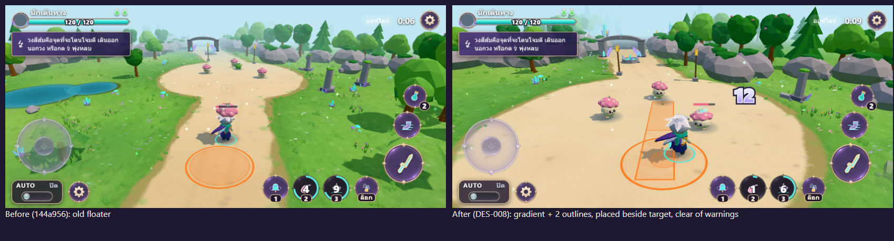
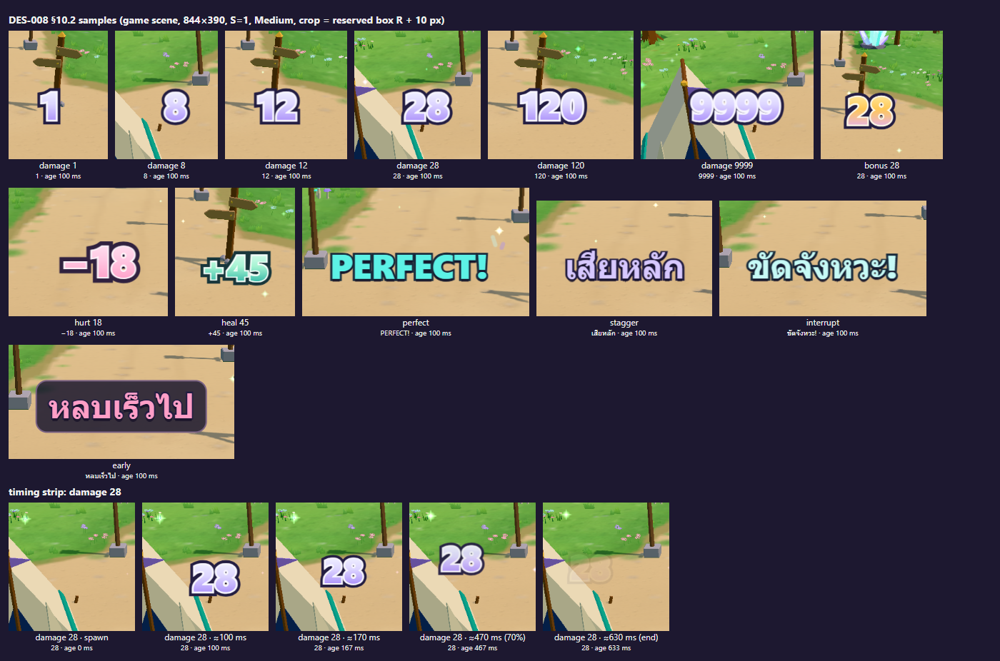

# DES-008 · เลขดาเมจลูเมน — หนา เด้ง อ่านชัด และหลบวงเตือน

**DES-008 ฉบับ 2 · ทีม A (Codex) · 27 พฤศจิกายน 2026 · ตอบ F1–F4 รอบ 1 · สถานะ: ฐานแบบได้รับอนุมัติจากเจ้าของแล้ว / ทีม B นำคำตัดสินฉบับนี้ไปทำรอบ 2**

เจ้าของอนุมัติ DES-008 วันที่ 27 พ.ย. 2026 ว่า “อนุมัติ ลงมือได้” ฉบับ 2 เปลี่ยนเฉพาะการหาช่องวางใน §6.2 และการแยกเกณฑ์ QA/perf ใน §10 ตามผลรอบ 1; คำตอบและเหตุผลอยู่ §13 เก็บรายงาน §12.1 ของทีม B ไว้ตามเดิม ไม่แก้ตัวเลขย้อนหลัง คงสี/ฟอนต์/ขนาด/ขอบ/อายุ/เส้นทาง/merge/caps/พื้นที่ป้องกันเดิม ไม่มี asset ใหม่ ไม่เปลี่ยนกล้องหรือ sim

รอบนี้ออกแบบและเขียนเฉพาะ DES-008 ไม่ผลิต asset ไม่แก้โค้ด/กติกา ไม่ใช้ Blender MCP บัญชีหรือเครดิต และไม่ commit/push ไม่แก้ DES-007 เพราะอ้างผ่านลิงก์ได้

## 1. เป้าหมาย หลักฐาน และขอบเขต

อ่าน `REQ-008-damage-numbers.md`, `CLAUDE.md` ข้อ 0, `PROJECT_SYNES.md` ข้อ 1–3, ขั้นตอน REQ→DES, asset pipeline/contract และ [DES-007](DES-007-hero-ninja.md) โดยเฉพาะ §3.4 แล้ว ตรวจแบบอ่านอย่างเดียวที่ `src/ui/hud.ts` ช่วง event/floater, `src/style.css`, `src/ui/buttonFade.ts` และ `shared/sim/world.ts` ช่วง damageEnemy

**ข้อเท็จจริง:** ของเดิมเป็น DOM เหนือ canvas, ใช้ฟอนต์ระบบ ไม่ฝังฟอนต์; ค่า `hit.amount/crit/byPlayer` มาจาก sim; crit เดิมรวมกรณีโบนัสต่อศัตรูเสียหลักด้วย ไม่ได้แปลว่ามีการสุ่มคริติคอลเสมอ รอบนี้เปลี่ยนภาพของ event เท่านั้น ไม่มีการคำนวณดาเมจ/โอกาสคริติคอลใหม่

**แนวที่เลือก:** เลขหนาไล่สีบนตัวอักษร ขอบสว่างบางกับขอบหมึกเข้มที่หนากว่า เงาเหลื่อมลงสั้น เด้งหนึ่งครั้งแล้วเคลื่อนเป็นโค้งสั้น รูปแบบลูเมนของ Synes ใช้ **CSS + DOM และฟอนต์ระบบเดิม** ไม่ใช้ sprite/canvas ตัวเลขหรือฟอนต์ใหม่

ภาพที่เจ้าของแนบใช้เฉพาะความรู้สึก “ตัวเลขมีน้ำหนัก โผล่ชัด กระแทกแล้วอ่านทัน” ไม่คัดรูป glyph การไล่สี ประกายดาวหรือองค์ประกอบจากภาพ และ **ไม่บันทึก/ฝัง/แนบภาพอ้างอิงจากเกมอื่นใน repo**

ลำดับความสำคัญ: **วงเตือนและการอ่านตัวละคร/ศัตรู > การควบคุม/HUD > ข้อความสำคัญ > เลขโบนัส > เลขปกติ > ประกายตกแต่ง** เลขดาเมจเป็นข้อมูลเสริม เมื่อไม่มีพื้นที่ปลอดภัยให้ละเลขนั้นตาม §6 ไม่วาดทับคำเตือนเพื่อบังคับแสดงให้ครบ

## 2. Q1 — ชนิดที่เปลี่ยนและรูปแบบข้อมูล

เปลี่ยนรูปแบบ floater ทุกชนิดให้เป็นครอบครัวเดียวกัน แต่ **เฉพาะเลขจำนวน** ใช้ขอบสองชั้นและ gradient ข้อความไทย/สถานะใช้สีทึบและขอบบางกว่าเพื่อรักษาวรรณยุกต์ แยกชนิด `interrupt` กับ `stagger` จาก `crit/perfect` ในชั้นแสดงผล ไม่จำเป็นต้องเปลี่ยน sim event ของเก่า

| ชนิดใหม่ใน view | แหล่ง event / ตัวอย่างข้อความ | รูปแบบ/ความหมาย |
|---|---|---|
| `damage` | hit: byPlayer=true, crit=false → `12` | เลขฐานสีเงินอมม่วง ไม่เติมเครื่องหมาย |
| `bonus` | hit: byPlayer=true, crit=true → `28` | เลขใหญ่สีทองอมม่วง ใช้กับโบนัสที่ sim ระบุจริง รวม counter/เสียหลักตาม ruleset ไม่สุ่มเพิ่มเอง |
| `hurt` | hit: byPlayer=false → `−18` | เลขติดเครื่องหมายลบ สี blossom ขอบหมึกเข้ม ไม่เปลี่ยนเป็นสีแดงเตือนแม้ e.crit=true |
| `heal` | heal → `+45` | เลขติดบวก สี mint/teal ใช้ค่ารักษาจริงจาก event |
| `perfect` | perfect → `PERFECT!` | คำสี lumen ไม่ใช่ตัวเลขดาเมจ ไม่แสดงตัวคูณที่ view คาดเดาเอง |
| `stagger` | stun → `เสียหลัก` | คำสี violet; แสดงทั้ง long/short stun ถ้า actor ยังอยู่บนจอ ไม่เพิ่ม banner ซ้ำกับ banner ชนเสาที่มีอยู่ |
| `interrupt` | interrupt → `ขัดจังหวะ!` | คำสี lumen อมขาว ไม่มีสไตล์ crit/ประกายโบนัส หลักฐานว่ามี interrupt ต้องมาจาก sim |
| `early` | dodge-early → `หลบเร็วไป` | ข้อความ blossom บนแคปซูลเข้มขนาดกะทัดรัด คงเงื่อนไขเตือน/ช่วงเว้นของ ruleset เดิม ไม่วินิจฉัยจากภาพหลบเอง |

- แสดง `amount` ที่ sim ส่งตรง ๆ ไม่คูณซ้ำ ไม่ใช้ยอด HP ที่ลดจริงแทน ไม่ clamp ตาม HP ที่เหลือ และไม่เพิ่มคำ MISS/0/คริติคอลที่ไม่มี event จำนวนเป็นเลขอารบิกเต็ม ไม่ย่อ K/M และไม่ใส่ comma ในรุ่นนี้
- ค่า hit/heal ที่เป็น 0 ไม่สร้างเลข; ค่าติดลบ/ไม่เป็นจำนวนเต็ม/ไม่ finite ให้รายงานใน QA และไม่สร้าง label ไม่เดาแก้เป็นเลขอื่น ไม่มีดาเมจศัตรูต่อศัตรูหรือรางวัลเพิ่มในขอบเขตนี้
- `−` เป็นเครื่องหมายลบ U+2212, `+` เป็นบวกปกติ; รวม event ได้ตาม §5 โดยเพิ่มคำกำกับว่า `รวม N` ไม่เขียน `28×3` ซึ่งทำให้เข้าใจผิดว่าแต่ละครั้งเท่ากับ 28
- deduplicate เฉพาะ event ที่ถูกส่งให้ view ซ้ำ ด้วย run/world identity + sim tick + event index ห้าม deduplicate จาก amount/target อย่างเดียว เพราะสอง hit จริงอาจมีค่าเท่ากัน

## 3. Q2/Q3 — สี ฟอนต์ ขอบ เงา และวิธีวาด

### 3.1 ค่าที่จอ 844×390

ทุกค่าต่อไปนี้เป็น **CSS px** หลังหัก safe area, ค่า font-size คือขนาดตัวอักษร ไม่ใช่ความสูง glyph จริง ไม่คูณ devicePixelRatio ซ้ำ

| ชนิด | Font size / weight | Fill gradient บน→กลาง→ล่าง (ตำแหน่ง 0/50/100%) | ขอบนอก / ขอบใน | อายุ Medium |
|---|---|---|---|---|
| damage | **32 px / 900** | `#F8FCFF` → `#DDD5FF` → `#A78BFA` | stroke **8 px** `#231D42` / **3 px** `#F7F5FF` | **650 ms** |
| bonus | **40 px / 900** | `#FFF3B0` → `#FFC857` → `#E4B2F4` | **9 px** `#231D42` / **3 px** `#FFF9E8` | **850 ms** |
| hurt | **30 px / 900** | `#FFE8F4` → `#FFC7E2` → `#FF9EC7` | **8 px** `#30213F` / **2 px** `#FFF5FB` | **800 ms** |
| heal | **28 px / 900** | `#E8FFF5` → `#A5F3D2` → `#2BB3A3` | **7 px** `#18363B` / **2 px** `#F3FFF9` | **750 ms** |
| perfect | **24 px / 800** | ทึบ `#5CF2E6` | stroke **3 px** `#182B3C`, ไม่มีขอบใน | **900 ms** |
| stagger | **22 px / 800** | ทึบ `#D7C8FF` | **3 px** `#231D42`, ไม่มีขอบใน | **900 ms** |
| interrupt | **22 px / 800** | ทึบ `#C6FAF6` | **3 px** `#182B3C`, ไม่มีขอบใน | **800 ms** |
| early | **22 px / 800** | ทึบ `#FF9EC7` | **2 px** `#231D42`, ไม่มีขอบใน | **1,300 ms** |

**stroke width คือความกว้างเต็มที่วาดคร่อมขอบ glyph** ไม่ใช่ความหนาที่เห็นข้างละเท่ากัน เช่น stroke 8 px ขยายออกด้านนอกประมาณ 4 px ขอบในที่วาดทับต้องไม่ทำให้ช่องกลางเลข 8/9 ตัน

ตัวเลขทุกชนิดใช้เงาแข็ง `0 3px 0 #120D24` เฉพาะชั้นขอบนอก ไม่มี blur/glow; ข้อความสถานะใช้ `0 2px 0 rgba(18,13,36,0.65)` ไม่มี blur แคปซูล early ใช้พื้น `rgba(24,21,45,0.84)`, padding แนวนอน 8 px/แนวตั้ง 3 px, radius 8 px และเส้น 1 px `#796183` ข้อความชนิดอื่นไม่มีพื้นทึบ

**ผู้เล่นโดนแยกจากวงเตือน:** ใช้ blossom อ่อน เครื่องหมายลบ และโค้งการเคลื่อนสั้นอยู่ข้าง/เหนือผู้เล่น ไม่ใช้แดงสด สีส้ม พื้นแดง การ pulse เตือน หรือวงบนพื้น ห้าม `#FF3355` และ `#FF7A1A` ใน fill/stroke/shadow/ประกายทุกชนิดของ DES นี้ สีทองของ bonus เป็น `#FFC857` ไม่ไล่ไปส้ม

### 3.2 วิธีวาดที่ทีม B ใช้

- DOM wrapper หนึ่งอันต่อ label, `pointer-events:none`, `user-select:none`, `white-space:nowrap`; ไม่มี hit target/เสียงเพิ่ม/การแย่ง focus ติด `aria-hidden` กับข้อความตกแต่งและชั้นซ้ำ ไม่ทำ live announcement ของแต่ละ hit
- เลขใช้ **3 ชั้นข้อความตำแหน่งและ font ตรงกัน**: ชั้นล่าง fill/stroke สีขอบนอกพร้อมเงา → ชั้นกลาง fill/stroke สีขอบใน → ชั้นบน fill เป็น `linear-gradient(180deg, ...)` clip ที่ text และไม่มี stroke เงาอยู่เฉพาะชั้นล่าง ไม่ใช้ drop-shadow หลายชุด
- ข้อความสถานะใช้ glyph ชั้นเดียว `paint-order: stroke fill` ตามค่าขอบของตัวเอง เพื่อไม่ให้สระ/วรรณยุกต์ดูหนาเกิน; early เพิ่ม wrapper แคปซูล ไม่ใช้พื้นสองแผ่นซ้อน
- ฟอนต์เดิม `system-ui, -apple-system, "Segoe UI", "Noto Sans Thai", "Thonburi", sans-serif`; ตัวเลขใช้ weight 900, ข้อความ 800, letter-spacing 0; เปิด tabular/lining numerals หากฟอนต์รองรับ แต่ต้อง measure ความกว้างจริง ไม่สมมติว่าเครื่องทุกเครื่องได้ glyph เหมือนกัน
- line-height ตัวเลข **1.0**, สถานะไทย/อังกฤษ **1.3**; ขอบกล่องต้องเผื่อ stroke เงา และวรรณยุกต์ ไม่ตัดบน/ล่าง wrapper ของแต่ละ layer ไม่ใช้ overflow hidden ที่ตัดขอบเลข
- หาก gradient clip ไม่รองรับ ใช้สีบนสุดของชนิดนั้นเป็น fill ทึบ; หาก text-stroke ไม่รองรับ สำหรับเลขให้ใช้ text-shadow 8 ทิศรัศมี 4 px สีขอบนอกและ 8 ทิศรัศมี 1 px สีขอบในของชั้นกลาง (แนวนอน/ตั้ง/ทแยง) และคงเงาลง 3 px; สถานะใช้ shadow 8 ทิศรัศมี 1.5 px สีขอบของตัวเอง (early 1 px) แทน stroke ไม่โหลดฟอนต์/ภาพเป็น fallback ต้องผ่านเกณฑ์อ่านออกเช่นกัน
- cache การวัดข้อความตาม font/size/text; measure ใหม่เฉพาะข้อความเปลี่ยน ไม่อ่าน layout ของ label ทุกอันสลับกับเขียน style ต่อเฟรม; pool wrapper/ชั้นข้อความตามจำนวนสูงสุด ไม่สร้าง interval/setTimeout ใหม่ต่อ hit ใช้ UI animation clock ที่ pause ไปกับเกม

### 3.3 การปรับขนาดจอ

กำหนด `S = clamp(0.85, min(safeWidth/844, safeHeight/390), 1.25)` คูณ font/stroke/shadow/path/gap/ประกาย/padding ด้วย S ตัวเลขต่ำสุด **24 px**, สถานะต่ำสุด **18 px** เมื่อย่อจอ; อายุแสดงไม่คูณตามจอ ที่ 844×390, S=1 ได้ค่าตารางตรง ๆ

ความกว้างปกติรวมขอบ/ป้ายรวมไม่เกิน **180×S px** ถ้าเลขยาวให้ลด font เฉพาะ label จนพอดีแต่ไม่ต่ำกว่า 24 px; ห้ามย่อเป็น K/M/ตัดท้าย/ตัดบรรทัด ถ้ายังไม่พอดีให้ละ label ตามข้อจำกัดพื้นที่และเก็บค่า event เดิมไว้ ข้อความสถานะไม่เกิน **170×S px**, ไม่ตัดคำไทย

## 4. Q4 — จังหวะเด้ง เส้นโค้ง และอายุ

ใช้ age จาก clock ของการเล่นภาพ ไม่อิง Date/เวลาเครื่อง, pause แล้วหยุดอายุและการเคลื่อน; resume ไม่ปล่อย backlog จากช่วง pause เป็นพรวน ถ้าเปลี่ยนด่าน/เริ่ม run/retry ให้ clear pool และตัวรวมทั้งหมด

### 4.1 Scale และ opacity

เลข damage/heal: scale **0.72 → 1.14 → 1.00** ที่เวลา **0/80/150 ms**; bonus: **0.68 → 1.18 → 1.00** ที่ **0/90/170 ms**; hurt: **0.80 → 1.10 → 1.00** ที่ **0/70/140 ms**; perfect/stagger/interrupt: **0.94 → 1.04 → 1.00** ที่ **0/80/150 ms**; early scale=1 ตลอด ไม่มี bounce ซ้ำ

ช่วงขยายใช้ `Eout(v)=1−(1−v)^3`; ช่วงคืน scale ใช้ `EinOut(v)=3v²−2v³`; v คือเวลา normalized ในช่วงนั้น หลัง key สุดท้ายคง scale 1 ไม่หมุน ไม่สั่นกล้องและไม่ทำ squash แยกแกน

Opacity: 0→1 แบบ linear ใน **40 ms แรก**, คง 1 จน **70% ของอายุ**, แล้ว fade 1→0 แบบ linear ถึงจบ; early คง 1 ถึง **85%** ก่อน fade จึงอ่านเต็มได้นานกว่า 0.9 s ตามเจตนาเดิม

### 4.2 เส้นทางการเคลื่อน

กำหนด u=clamp(age/life,0,1), x เป็นบวกไปขวา/y บวกลง, ทุกจุดคูณ S ใช้ cubic Bézier **B(u)=(1−u)³P0+3(1−u)²uP1+3(1−u)u²P2+u³P3** ไม่ใส่ ease ซ้ำใน u ของ path เลือกเครื่องหมาย s=−1/+1 สลับตามลำดับ label ของ actor (เริ่มขวา) ไม่มี Math.random

| กลุ่ม | P0 | P1 | P2 | P3 |
|---|---|---|---|---|
| damage | (0,0) | (18s,−30) | (28s,−42) | (32s,−20) |
| bonus | (0,0) | (24s,−44) | (34s,−58) | (38s,−30) |
| hurt | (0,0) | (0,−12) | (12s,−20) | (16s,−8) |
| heal | (0,0) | (0,−14) | (0,−28) | (0,−36) |
| perfect/stagger/interrupt | (0,0) | (0,−6) | (0,−12) | (0,−14) |
| early | (0,0) | (0,−2) | (0,−4) | (0,−6) |

อายุและ path กำหนดแยกกัน เลขจึงโค้งสั้นแล้วยุบจาง ไม่เด้งไกลตาม reference ใช้ transform/opacity กับ wrapper เดียว ห้าม animate left/top หรือ gradient ทุกเฟรมเพื่อความรู้สึกแรงเพิ่ม

## 5. Q4 — การรวม ซ้อน และจำนวนสูงสุด

### 5.1 รวม hit ที่ถี่โดยไม่เปลี่ยนข้อมูล sim

- ตัวรวม keyed ด้วย **target actor + ชนิดเลข + source owner ถ้ามี**; damage กับ bonus แยกกัน, hurt/heal แยกจากกัน, ต่าง actor ไม่รวม ห้ามเอาดาเมจหลายมอนไปรวมบนหัวมอนตัวเดียว
- Medium รวม event ใหม่เข้า label เดิมถ้าอยู่ภายใน **120 ms จาก event แรกของกลุ่ม**; Low ใช้ **160 ms** นับจากแรกเช่นกัน ไม่เลื่อนหน้าต่างต่อไปเรื่อย ๆ แสดงยอดบวกของ amount จริง เมื่อ N≥2 เพิ่มป้าย `รวม N` ขนาด **14 px/weight 700** สี `#F7F5FF` ขอบ 2 px `#231D42` มี gap 5 px อยู่ขวาล่างของเลข ป้ายเป็นส่วนหนึ่งของ bounds
- อัปเดตยอดทัน event ไม่รอ debounce ไม่ restart pop/life ไม่ขยายตัวอีกครั้ง และไม่ใช้ crit style แทนกลุ่มที่ปน normal/bonus เพราะแยกกลุ่มตั้งแต่ต้น ถ้าข้อความกว้างขึ้นต้องทดสอบพื้นที่ใหม่ตาม §6 ก่อนแสดง
- สถานะไม่รวมเป็นตัวเลข dedup ข้อความชนิดเดียว/actor เดียวภายใน **180 ms**; early ยังคง throttle ตาม sim/HUD เดิม, ไม่ลดช่วงเว้นเพื่อให้เห็นข้อความบ่อยขึ้น

### 5.2 เพดานและการเลือกเลข

| รายการ | Medium | Low |
|---|---|---|
| จำนวน label ทั้งจอ | **12** | **8** |
| ในจำนวนนั้นเป็นเลข | **≤8** | **≤6** |
| ในจำนวนนั้นเป็นสถานะ | **≤4** | **≤2** |
| ต่อ actor | **≤2 เลข + 1 สถานะ** | **≤1 เลข + 1 สถานะ** |
| ขนาดตัวเลข/สถานะ | ตาม §3 | **เท่ากัน** ไม่ลดจนอ่านยาก |
| อายุ damage/bonus/hurt/heal | 650/850/800/750 ms | **600/750/750/700 ms** |
| อายุสถานะ | ตาม §3 | **เท่ากัน** |
| Scale | ตาม §4 | peak ทุกเลขไม่เกิน **1.10**, เวลา key เดิม |
| ระยะ path | ตาม §4 | **0.75×** ทุกจุดของเลข; สถานะเท่าเดิม |
| ประกาย CSS | ตาม §7 | **ปิดทั้งหมด** |

ประมวล event ที่เข้าใน tick เดียวเป็น batchก่อนเลือก label เพื่อไม่สร้าง/ไล่ทิ้งตามลำดับมาอย่างไร้เหตุผล ลำดับสำคัญคือ **hurt > perfect > early > heal > stagger > interrupt > bonus > damage** ภายในชนิดเดียวเลือก actor ใกล้ผู้เล่นกว่าในโลก แล้ว actor ID, event index เป็นตัวตัดสินระยะเสมอ

ถ้าถึงเพดาน: รวมเข้ากลุ่มเดิมที่ยังเข้า window ก่อน; หากต้องสร้างใหม่ให้แทน label สำคัญต่ำกว่าที่อายุ ≥**180 ms** โดยเลือกอายุเก่าสุดก่อน ถ้าทุกอันสำคัญเท่ากัน/สูงกว่าและยังอ่านไม่ครบ 180 ms ให้ละ label ใหม่ ไม่มีคิวรอระบายทีหลัง เมื่อเต็มเพดานต่อ actor ใช้เกณฑ์เดียวกันภายใน actor นั้น ก่อนตรวจเพดานรวม กรณี label เดิมครบอายุให้คืน pool ก่อนรับของใหม่

ข้อยกเว้นเดียวที่ลบก่อน 180 ms ได้คือ **การหลีกวงเตือน/ร่าง/HUD ตาม §6**, actor หายหลัง reset หรือข้อมูลไม่ valid ป้าย `รวม N`/ประกายเป็นลูก ไม่เพิ่มจำนวน label ในเพดาน แต่รวมอยู่ใน bounds และงบ DOM

งบ DOM ภายใน overlay ไม่รวม root: Medium **≤52 elements** (12 wrappers + 24 ชั้นเลข + 4 ชั้นสถานะ + 8 ป้ายรวม + 4 ขีดประกาย), Low **≤34** (8+18+2+6) pool ที่ยังไม่ใช้ต้องอยู่ภายในเพดานนี้และไม่ paint ไม่เปิดประกายเพิ่มหลัง cap เต็ม

## 6. Q5 — ตำแหน่งและการไม่บังวงเตือน/ร่าง/HUD

### 6.1 ข้อมูลตำแหน่งที่ทีม B ต้องเตรียม

ไม่ใช้ค่า y=1.6/2.0/2.3 แบบเดียวกับทุกโมเดลอย่างเดิม ให้ view ส่ง **screen rectangle ที่ครอบร่างทั้งหมดซึ่งมองเห็น** ของผู้เล่น/ศัตรู รวมผม/ท่ากางแขน/อาวุธ/ผ้าที่ยังอ่าน silhouette, กับตำแหน่งเหนือหัวและ vis; ใช้ cached render envelope ที่ครอบ pose/clip ได้จริง ไม่ใช้วงชน sim อย่างเดียว ร่างบอสสูงกว่าฮีโร่ต้องได้ตำแหน่งเหนือหัวจริง

ข้อมูลต้องอยู่ใน CSS px ของ viewport เดียวกับ floaters, หลังแปลง canvas rect/camera ปัจจุบันและ safe area; ไม่คูณ DPR ถ้า project ไม่ valid/อยู่หลังกล้อง/นอกจอให้ไม่สร้าง label ไม่ clamp เลขของศัตรูนอกจอมาเกาะขอบจอ

พื้นที่ป้องกันที่คำนวณทุก render frame:

1. **คำเตือนทุกอันที่กำลังวาด** ทั้งช่วงเตรียม/active/ขอบที่ยังไม่จางหมด: ป้องกันเต็มพื้นที่ด้านใน+ขอบ แล้วขยายออก **8×S px** ไม่ป้องกันเฉพาะเส้นวง วิธี baseline คือเอา world bounds ที่ครอบรูปเตือนทั้งวง/กรวย/เส้นจริงและความหนาขอบมาฉายเป็น convex screen polygon แล้วใช้ AABB ของ polygon แบบอนุรักษ์ จึงยอมซ่อนเลขมากกว่าจำเป็นเพื่อไม่ให้เสี่ยงบัง หากใกล้กล้องจน bounds ฉายไม่ได้ให้ถือทั้ง viewport เป็นพื้นที่ป้องกันสำหรับเฟรมนั้น
2. **ร่างผู้เล่นและศัตรูที่ยัง render อยู่** ทุกตัว + **6×S px**, health bar/mark ของเป้าและสัญลักษณ์ ✦ เดิม + **4×S px**; ไม่ให้เลขหนึ่งบังหน้า/คมดาบ/ตัวอีกตัวที่อยู่หลังเป้า
3. HUD ที่มองเห็น: ปุ่มรวม badge/cooldown, จอยที่แสดงจริง, HP/บอส/ข้อความสอน/banner/เมนู/ผลจบและ safe area ขยาย **8×S px** ไม่จองพื้นที่ invisible touch zone ทั้งแผงที่ไม่มีภาพเพราะจะเหลือที่น้อยเกินไป
4. label ที่รับเข้าแล้ว ให้ช่องไฟระหว่าง reserved rectangles อย่างน้อย **6×S px**

กฎนี้เพิ่มการหลบของตัวเลขเอง **ไม่ใช่การสั่งเลื่อน/ซ่อน HUD, คำเตือน, ศัตรู หรือเปลี่ยนกล้อง**; logic ButtonFade เดิมใช้เป็นฐานฉาย/อ่าน shape ได้ แต่ห้ามยืมรอบเช็กทุก 4 เฟรมมาใช้กับเลข เพราะวงเตือนใหม่อาจถูกบังระหว่างเฟรม

### 6.2 กล่องจองและจุดวางที่ไม่ต้องเดา

สร้าง **reserved rect R** ที่ครอบ label ตลอดอายุจากความกว้าง/สูง glyph จริงที่ peak scale + stroke/shadow + ป้ายรวม + ประกาย แล้วรวมขอบเขต control points P0–P3 ทั้งหมด (convex hull ครอบ Bézier ได้) จึงเผื่อเส้นทางล่วงหน้า ไม่ทดสอบเฉพาะขนาดที่กำลังโผล่ 0.72 ให้ขยายจากกล่อง glyph/line box ที่วัดจริงอย่างน้อย **8×S px ทุกด้าน** เพื่อครอบ stroke เงา วรรณยุกต์และ antialias; ถ้าวัดว่าชิ้นใดเกิน padding นี้ ใช้ขอบจริงที่ใหญ่กว่า ห้ามลด R ให้ผ่านช่องว่างปลอม

**ฉบับ 2 แทนช่องสูงเดิม 6 ช่องด้วย 4 รูปแบบวาง** ไม่ลด R หรือพื้นที่ป้องกันเพื่อแก้ F1/F2 ตำแหน่งอ้างจุดกลาง R; a=actorRect ที่ยังไม่ขยาย, cx=(a.left+a.right)/2, g=**10×S px**, w/h=ขนาด R; สำหรับการปัดเศษพิกัดเผื่อ ε=**0.5×S px** เพิ่มในการตรวจขอบ/ชนขั้นสุดท้าย

| ลำดับเลขคี่ / ชื่อรูปแบบ | จุดกลาง R ตั้งต้น |
|---|---|
| 1 เหนือหัว | `(cx, a.top−g−h/2)` คงจุดนี้ ถ้าตกขอบ/ทับให้ข้าม ไม่ดันเข้าหัว |
| 2 ข้างขวาลำตัว | x=`a.right+g+w/2`; y ที่ชอบ=กลางช่วงลำตัวที่มองเห็นใน safe viewport แล้วหาช่วง y ว่างตามวิธีด้านล่าง |
| 3 ข้างซ้ายลำตัว | x=`a.left−g−w/2`; y ที่ชอบเหมือนขวา แล้วหาช่วง y ว่าง |
| 4 ใต้ร่าง | `(cx, a.bottom+g+h/2)` ต้องไม่ทับร่าง/เท้า/พื้นเตือน หากไม่ผ่านให้ข้าม |

เลขลำดับคู่ของ actor ลอง **1→3→2→4** เลขคี่ **1→2→3→4** ชนิดสถานะใช้กฎเดียวกัน ไม่เพิ่มแถบสรุปหรือเส้นชี้เป้า ไม่ย้าย HUD/กล้องเพื่อเปิดช่อง

**เกณฑ์ความใกล้เป้าใหม่:** ยกเลิกเพดานจากจุดเหนือหัว 144×S; ใช้ระยะจาก **ศูนย์ R ถึงจุดใกล้ที่สุดบน a ≤128×S px** แทน โดย `dx=max(a.left−Cx,0,Cx−a.right)`, `dy=max(a.top−Cy,0,Cy−a.bottom)` และ `dx²+dy²≤(128S)²` จึงวางข้างกลางลำตัวบอสได้โดยเลขยังอยู่ใกล้เป้า ไม่ใช่ปล่อยไปทั่วจอ ค่า 128 ใช้ทั้ง Medium/Low

**หาช่วงว่างในแนวข้าง (ทำเฉพาะตอน spawn ไม่ค้นทุกเฟรม):**

1. คง x ของด้านนั้น ห้าม clamp x เข้ามาทับร่าง ถ้า R เกินขอบ safe viewport ที่เว้น **8×S px** หรือ dx>128S ให้ข้ามด้านนั้นทันที
2. สร้างช่วงศูนย์ y ที่ใส่ R ได้ทั้งกล่องใน safe viewport: `[safe.top+8S+h/2+ε, safe.bottom−8S−h/2−ε]`; ถ้าช่วงกลับด้านคือไม่มีที่
3. จำกัดความใกล้เป้าด้วย `v=sqrt((128S)²−dx²)` แล้ว intersect ช่วงนั้นกับ `[a.top−v,a.bottom+v]` อย่าใช้ระยะถึงหัวแทน สูตรใช้เฉพาะ geometry ฝั่ง UI ไม่ส่งกลับ sim
4. สำหรับ protected rect p ทุกชิ้นจาก §6.1 ที่ทับช่วง x ของ R (เผื่อ ε) ให้ตัดช่วงศูนย์ y `(p.top−h/2−ε, p.bottom+h/2+ε)` ออก รวมร่างตัวเป้า/ตัวอื่น วงเตือนเต็มพื้นที่ แถบ HP/mark/✦ และ HUD **ตาม margin เดิมทั้งหมด**; label ที่รับแล้วขยาย 6S เป็นสิ่งกีดขวางแบบเดียวกัน ใช้การทับเมื่อมีพื้นที่ร่วม>0 จุดปลายที่แตะขอบพอดียอมได้ถ้าตรวจขั้นสุดท้ายแล้ว intersection=0
5. เรียงและรวมช่วงต้องห้าม แล้วหาช่วงว่างที่เหลือ เลือก y ที่ใกล้ y ที่ชอบที่สุด (กลางของ a ที่ตัดกับ safe viewport); ถ้าระยะเท่ากันเลือก y น้อยกว่า การตัดช่วงอาจทิ้งช่องแคบไว้ ต้องไม่ใช้เพียงจุด 25/50/75% ของลำตัวแล้วสรุปว่าไม่มีช่อง
6. ตรวจ R+ε ขั้นสุดท้ายกับ safe/ความใกล้เป้า/protected/label อีกครั้งก่อนรับ; จากศูนย์ R ที่ผ่านค่อยคำนวณตำแหน่งเริ่ม wrapper ชดเชย local rect ของ path ใช้ full-life R ตามเดิม ไม่ตรวจเฉพาะ glyph ณ เฟรมโผล่

ตัวอย่างเชิงเรขาคณิตสำหรับ F1 (**เป็น fixture จากช่วงค่ารายงาน ไม่ใช่ผลวัดรอบใหม่**): ถ้า R สูง103px, ขอบล่าง HUD ที่ป้องกัน=67px, ขอบบนวงเตือน=174px และ x ทับทั้งสอง จะเหลือศูนย์ y ระหว่าง **119–122px** หลังเผื่อ ε=0.5; ค่ากลางลำตัวเช่น140pxเลือก y=122px ได้โดยไม่บังทั้งคู่ จุดคงที่ที่สูงใกล้หัวหรืออยู่กึ่งกลางพอดีอาจพลาดช่องนี้

**หลัง spawn ไม่ไล่หาช่องใหม่:** บันทึกด้าน/รูปแบบ, w/h ที่ใช้เลือกช่อง, ตำแหน่ง P0 เทียบศูนย์ R และ deltaY=ตำแหน่งที่เลือก−กลางช่วงลำตัวตอน spawn สำหรับข้างซ้าย/ขวา เฟรมถัดไปตามกลางลำตัวใหม่+deltaY กับ x ด้านเดิม ส่วนเหนือหัว/ใต้ร่างตามสูตรเดิม ใช้ frame ตั้งต้นเดิมเมื่อรวมยอด/ประกายจบ ไม่ย้ายตัวอักษรให้กระโดดกลางอายุ ถ้า R ใหม่กว้างจนไม่ปลอดภัยให้ retire ตามเดิม

ถ้า actor ถูกถอดหลังตายให้ใช้ตำแหน่งร่างสุดท้ายจนหมดอายุตราบใดที่ยังปลอดภัย การ resize/กล้องขยับยังต้องใช้พิกัดปัจจุบันตรวจทุกเฟรม ถ้าจำเป็นต้องเปลี่ยนรูปแบบวางให้รอ label ใหม่ ไม่คืน label ที่ retire แล้วมาอีก

**ศัตรูเล็ก (F3):** ยอมรับว่าเห็นได้เพียง **1 เลข/actor** แม้ Medium อนุญาตสูงสุด2; Lowสูงสุด1ตามเดิม นี่เป็นเพดาน ไม่ใช่จำนวนขั้นต่ำ ไม่ลด font/ขอบ ไม่เพิ่มเวลารวมเกิน120/160ms ไม่เอาเลขต่าง actor หรือ normal/bonusมารวมกัน และไม่เบียดเลขแรกเพื่อบังคับมีสองเลข การแทนที่ยังตามอายุ180ms/ลำดับสำคัญเดิมใน §5

**ไม่มีจุดผ่าน:** ละ label นั้นทันที ไม่มีคิว delayed/แถบเลขใหม่บนพื้นอื่น กรณีพื้นที่เต็มจอเป็นวงเตือน ยอมไม่มีเลขชั่วคราว คงผล HP/แถบบอส/✦/event ตามเดิม นี่เป็นทางเลือกทีม A เพื่อรักษาความชัด ไม่ใช่ให้ทีม B เดาวิธี fallback เอง

**ทุกเฟรมก่อน paint:** ตรวจ R ที่ตาม anchor ปัจจุบันกับพื้นที่ป้องกันใหม่ ถ้ามีวงเตือน/ร่าง/HUD/label สำคัญกว่ามาทับ ให้ retire label ทันทีโดยไม่ fade ทับวงและไม่คืนมา flicker; event ไม่ถูกยกเลิกและไม่ย้อนจำนวนดาเมจ แม้ label อายุไม่ถึง 180 ms กฎความปลอดภัยมีสิทธิเหนืออายุขั้นต่ำเสมอ

การลด opacityเหลือ 0.35 อย่างเดียว **ไม่ถือว่าผ่าน** การไม่บังวงเตือน เพราะ glyph/เงายังอยู่เหนือ canvas; ไม่ใช้ z-index สูงขึ้นเพื่อแก้ และไม่ย้ายวงเตือนเป็น UI ในงานนี้

## 7. Q6 — ประกายต้นฉบับที่เลือก

ใช้ **ขีดแสงคู่ “จังหวะเสียง”** สร้างด้วย CSS แทนดาวแบบภาพอ้างอิง ไม่มีดาวแฉก ลายตรา หรือไฟล์ภาพ:

- ใช้เฉพาะ **bonus และ perfect ใน Medium** ไม่ใช้กับ damage/hurt/heal/ข้อความไทย; ไม่ใส่ประกายให้ทุก hit
- ขีด A ขนาด **3×9 px**, radius 1.5 px, มุม −18°; ขีด B **3×6 px**, radius 1.5 px, มุม +20°; สี `#C6FAF6` กับ `#A78BFA` ตามลำดับ ไม่มี glow/เงา
- วางนอกมุมขวาบนของกล่อง glyph: จุดกลาง A `(right+4, top−1)`, B `(right+10, top+3)` px; อยู่หลังข้อความแต่ขอบไม่ลอดเข้าไปในช่องเลข ระยะ/ขนาดคูณ S
- อายุ **160 ms** จาก spawn, opacity 0→0.85 ที่ 30 ms แล้ว→0 ที่ 160 ms, translate ขึ้น **4×S px** linear ไม่มี scale/หมุนเพิ่ม; จำกัดหนึ่งชุดต่อ actor ต่อ **180 ms** และพร้อมกันทั้งจอ **ไม่เกิน 2 ชุด**
- ใช้พื้นที่ที่จองไว้ใน R เท่านั้น ถ้าประกายทำให้จุดวางไม่ผ่าน ให้ลอง layout รอบเดิมโดยตัดประกายก่อนจะละ label; ประกายไม่สร้าง event/เสียง/ตัวคูณหรือเปลี่ยนขนาดเลข ไม่มี asset ส่งเข้า inbox

## 8. Q7 — ใช้กับสกิลนินจาใน DES-007

เลขเกิดจาก **damage result จริง** ไม่เกิดจากเส้นคม/เข็ม/mark/VFX/เสียง ที่มีอยู่ใน DES-007 ซึ่งยังเป็นแบบรออนุมัติ ทั้งสอง DES ต้องไม่เปิดกติกาใหม่ใน rulesetเก่าโดยพลการ

| เหตุการณ์ DES-007 | เลข/การซ้อนที่ต้องใช้ |
|---|---|
| คอมโบ hit 5/5/9 ของแต่ละ action | หนึ่งเลข/เป้าที่โดนตาม amount จริง; เว้นตามจังหวะ sim ไม่ดีดเลขในช่วงเตรียม |
| เข็มสะท้อน | เลขเมื่อ projectile ชนเป้าทำ damage; ไม่ขึ้นเลขตอนปล่อย tick 5 หรือเมื่อชนฉาก/mark เกิดอย่างเดียว |
| กิน mark +8 / counterEcho / bonusตอน ✦ | แสดง amount สุดท้ายจาก pulse/event เดียว **ไม่แตก +8/+12/×1.5 เป็นเลขเพิ่ม**; ใช้ bonus style เฉพาะ crit/bonus flag จาก sim ถ้าชุดใหม่ยังไม่ส่ง flag ให้ทีม B map semanticsที่ยืนยันกับทีม A ไม่เดาจากสีเอฟเฟกต์ |
| ก้าวเส้นเงา | แสดงเฉพาะ actor ที่ damage sweep โดนจริงหนึ่งครั้ง/action; ไม่มีเลขตามจุดใน trail และไม่มีเลขหลัง blocker |
| ปมคมสะท้อน | เลขเกิด hit tick 14 เท่านั้น; วาดคมตาม DES-007 ไม่เพิ่มประกายใหญ่ซ้อนเลขที่จุดเดียวกัน |
| อัลติร้อยเงารวมคม | รับ damage pulse ที่ tick **9/15/21** แยกกัน; เว้น 200 ms มากกว่า merge window 120/160 จึงไม่รวมข้าม pulse; ใช้ slots/retirement ตาม §5 ไม่สร้างเลขเพิ่มจากเงา |
| perfect / เส้นเสียงเพิ่ม / มิเตอร์เต็ม | perfect แสดงคำหนึ่งครั้งจาก eventสำเร็จ; **ไม่มีเลข +1/+2 มิเตอร์ลอยขึ้น** ใช้ indicatorเดิมของ HUDตาม DES-007 |
| heal/ผู้เล่นโดน/early | แสดงจาก eventเดิมตาม §2; ห้ามสร้าง earlyใหม่จากกฎ perfectของ DES-007 หาก simไม่ส่ง |

DOMเลขไม่เพิ่ม draw calls ของ Three.js แต่มีต้นทุน layout/composite จึงต้องวัดแยก ไม่อ้างว่า “ฟรี” และไม่หักงบ VFX geometry +5/+3 calls ของ DES-007 ให้ครบด้วยการซ่อนเลข แต่กำหนด overlay paint/runtime budget ของตนใน §10

## 9. Asset, license, การเข้าถึง และการส่งต่อ

**ไม่มี asset ที่ต้องผลิตในรอบนี้:** ไม่มี spriteตัวเลข ไม่มีฟอนต์ใหม่ ไม่มีภาพประกาย ไม่มีรายการเจนภาพ/โมเดลให้เจ้าของ และไม่ใช้ quota 3D ชื่อ `ui_*_vNN`/`tex_*_vNN` จึงไม่มีรายการที่ต้องส่ง inbox ส่วนขีดแสงเป็น CSSต้นฉบับตามแบบ ไม่ใช่การคัดภาพ

ใช้ฟอนต์ระบบที่มีบนเครื่องเท่านั้น ไม่ดาวน์โหลด/ฝัง/แจกไฟล์ font จึงไม่เพิ่ม font licenseหรือโหลดหน้าแรกจากเครือข่าย ไม่อนุมัติให้นำ Segoe UI/Thonburi/Notoจากเครื่องมาใส่ repo ถ้าผลมือถือจริงอ่านไม่ได้จนจำเป็นต้องเปลี่ยนฟอนต์ ให้ทีม A เปิด revisionพร้อมชื่อไฟล์/ผู้ผลิต/licenseที่ตรวจจริง (เช่น OFLที่อนุญาตฝังเว็บ) ก่อน ไม่ให้ทีม Bเลือก/ติดตั้งเอง

เมื่อ `prefers-reduced-motion: reduce`: scale=1, path=0, ปิดประกายทุกชนิด, คง fill/ขนาด/ขอบ; อายุ damage/heal **600 ms**, bonus/hurt **750 ms**, สถานะตามเดิม, opacity fade-in40 ms/fade-out20%ท้าย ยังคงกฎ layout/capของ qualityเดิม ไม่ย้ายข้อความไป live regionถี่ ๆ

ขั้นถัดไปของทีม B: Opus 5.5 ตรวจรับแบบ/วางแผน integration, Sonnetลงมือ CSS/DOM pool/projectionตามค่าที่กำหนดและ QA; ทีม Aตรวจภาพจริง หากจำเป็นต้องเปลี่ยนขนาด สี การรวม หรือ policyละเลข ให้ส่งกลับทีม A ก่อน ไม่แก้เลข tuning/simหรือผลิต assetเพื่อเลี่ยงข้อกำหนด

## 10. เกณฑ์ตรวจรับและหลักฐาน

1. **ข้อมูล:** fixtureจาก eventจริงแสดง amount/type/เครื่องหมายตรงตาม §2; critของโบนัสบอสเดิมไม่กลายเป็นการสุ่ม; merge target/type/window/ยอด/จำนวนครบและไม่ resetอายุ; ไม่มีเลขซ้ำหลัง replay/pause/resume/เปลี่ยนด่าน ไม่เปลี่ยน input log/damage/reward
2. **รูปแบบ:** ภาพที่ 844×390/S=1 ตรง font/fill/stroke/shadow/curve/life/peakที่กำหนด ตรวจเฟรม spawn/80–90ms/170ms/70%life/จบ ทั้งกรณีเลข `1, 8, 12, 28, 120, 9999, −18, +45` (ตัวอย่างแยกค่า ไม่มี commaภายในเลข) และข้อความไทยครบวรรณยุกต์; เลข 8/9ไม่ตัน ขอบไม่ตัดหัวท้าย
3. **การอ่านมือถือและการขึ้นเลข (F1/F2/F3):** คง font/ขอบ/ความอ่านง่ายเดิมบน iPhone Safari และ Android Chromeจริง แยกผล; เลข2–3หลักต้องอ่านจากระยะถือปกติได้ ผู้เล่นระบุค่า+แยก damage/bonus/hurt/healถูก≥**9/10 ตัวอย่างที่ไม่ถูก safety retire** และอ่านข้อความไทยถูกครบ เครื่องหมายบวก/ลบยังแยกได้โดยไม่พึ่งสี

   แยกการพิสูจน์พื้นที่จากการเล่นจริง ไม่ใช้ “ทุ่งจริงที่มี2–4มอน/วงเตือน” แทน “ฉากโล่ง” โดยอัตโนมัติ ต้องผ่านชุดควบคุมต่อไปนี้ทั้ง Medium/Low โดยไม่ลด R:

   - **ฉากโล่ง:** 10กลุ่ม hit ต่างเวลากันจน labelก่อนหน้าหมดอายุ มีพื้นที่ปลอดภัยตามgeometryและไม่ชนcap → ต้องเห็นเลข **10/10**
   - **บอส:** 10กลุ่ม hit ที่เปิดชัดว่ามีช่องข้างลำตัวจริงด้วย boundsกล้องเดิม/แถบHPเดิม → **10/10** รวมกรณีheadสูงy52–73และRสูงประมาณ103ที่ช่องเหนือหัวล้มเหลว ต้องใช้ free intervalจริง ไม่เปลี่ยนกล้องเพื่อให้ผ่าน
   - **มอน2–4ตัวใกล้ผู้เล่น:** 10batch เว้นจนlabelหมดอายุก่อนbatchถัดไป ในแต่ละbatchมีอย่างน้อยหนึ่งเป้าที่พิสูจน์ได้ว่ามีช่องและไม่ชนcap → ต้องมีอย่างน้อย **1 label/batchครบ10batch** ไม่บังคับทุกมอนมีเลขถ้าพื้นที่ไม่พอ ส่วนเป้าเดี่ยวกว้าง20–30pxรับเห็นเพียง1เลขได้ ไม่บังคับต้องมี2
   - **ทุกช่องถูกปิดจริง:** fixtureที่telegraph/ร่าง/HUDปิดทุกที่ → ต้องละเลข **10/10** ไม่วาดทับเพื่อเพิ่มอัตราแสดง; actorนอกจอยังไม่สร้างเลข

   คำว่า **เห็นเลข** ในสามชุดแรกหมายถึงมีpaintที่opacity≥0.8ต่อเนื่อง≥**180ms** ในฉากควบคุมที่พื้นที่ไม่เปลี่ยน ไม่ใช่ `stats.made` เพิ่มตอนspawnแล้วretireก่อนเห็น ต้องเก็บcounterแยก created/painted/readable180ms/merged/dropCap/dropPlaceและเหตุ/retiredSafety ถ้าพื้นที่เปลี่ยนระหว่างอายุต้องretireทันทีตาม§6 และรายงานเป็นเหตุการณ์ความปลอดภัย ไม่ใช้เคสนี้ปลอมเป็นcontrolledผ่าน

   การเล่นสดให้รายงานจำนวน/สัดส่วนทุกชนิดตามทุ่งและบอส พร้อมeligible groupจากgeometry/capและเหตุที่ละ แต่ **ไม่ตั้งอัตราขึ้นเลขรวมขั้นต่ำข้ามทุกสถานการณ์** เพราะวงเตือนอาจครอบพื้นที่หมดได้ อัตรา4แสดง/11ละ หรือ0/19ของรอบ1ไม่ใช่ผลผ่านการแก้layout ต้องทำรอบ2กับชุดควบคุมข้างบนก่อน ไม่ใช้การเปลี่ยนตัวหารหรือซ่อนเลขทั้งหมดปิดข้อ F1/F2
4. **ไม่บัง:** QA debugแสดง reserved rect+protected rectในเครื่องทดสอบ ชุดภาพ/คลิปครอบคลุมวงเตือนใหม่โผล่ใต้เลขที่ยังอยู่ วงใหญ่เต็มพื้นที่ กรวย/เส้น/ขอบวง บอสพุ่ง/หันกล้อง/หัวใกล้ขอบจอ/นิ้วลากจอย/สกิล AoEหลายมอน; ผลรวม **intersection area=0** ทุกเฟรมที่ label ถูกpaint กับพื้นที่ป้องกันตาม §6 อนุญาตละเลขตามแบบ ห้ามยอมให้ alphaจางทับเป็นผ่าน ตรวจรวมเงา/ประกาย/ป้ายรวม ไม่ใช่ fillอย่างเดียว
5. **ความเครียด:** สร้าง burst32 hit/10 actorในหนึ่ง tick + hurt/heal/perfect/early และ multi-pulseอัลติ ตรวจ Medium≤12/Low≤8, ต่อactorสูงสุด2/1เลขและ1สถานะ ไม่ใช่จำนวนขั้นต่ำ; รักษา merge120/160msและการแทนที่180msตามเดิม ไม่มีคิวพ่นเลขช้า อัลติสามpulseไม่ถูกรวมเป็นยอดใหม่เพราะ F3 กลุ่ม/labelเก่าจบแล้วคืน poolครบ
6. **ประสิทธิภาพ (F4):** แยก gate ชั่วคราวจากเกณฑ์ผ่านสุดท้าย ไม่ยกเป้าเครื่องจริงเพื่อให้ผ่าน PCซอฟต์แวร์:

   - **PC Edge/SwiftShader สำหรับพัฒนารอบ2:** รับค่า CPU overlay p95≤**1.5ms** ได้ชั่วคราว ทั้ง Medium/Lowต้องวัดแยก ไม่ถือว่า187tests/lifecycleผ่านแล้วทำให้มือถือผ่าน ค่า1.1–1.3msในรอบ1อยู่ในช่วงรับชั่วคราว แต่ยังไม่จบเกณฑ์เพราะวัดเพียง20sและต้นทุนยังไม่ครบ
   - **เกณฑ์สุดท้ายบน Android Chrome/iPhone Safariจริง:** คง overlay CPU p95≤**1.0ms Medium / 0.7ms Low**, p95 frame timeรวมแย่ลง≤**5%**เทียบ baselineเดียวกัน ไม่เปลี่ยนขนาด/สี/การป้องกันเพื่อผ่านperf
   - วัด **60sหลังwarm-up10s** ต่อทุ่ง/บอส/qualityบนกล้อง/seed/hardwareเดียวกันก่อน–หลัง แยกcold/first-hit samplesไว้รายงานด้วย ไม่ลบoutlierเงียบ ๆ บันทึกFPS/จำนวนsample/DOM/p50/p95/max/จำนวนเฟรมoverlay>8ms/long task และช่วง HUDเข้า–ออก เก็บหน่วยความจำหลังclear/รีเซ็ต20รอบ
   - CPU overlayต้องนับงาน **ingestทั้งหมด+การรวบรวม protected/actorRect/HUD+placement+paintต่อ render frame** รวมแม้gatherถูกเรียกจากingestและframe หักเฉพาะต้นทุนเครื่องมือdebug/การcaptureซึ่งต้องรายงานแยก ห้ามอ้าง `qa.ms`ของ `frame()` อย่างเดียวว่าครบ; จากโค้ดรอบ1 `ingest()`ก็เรียกgatherเช่นกัน จึงต้องขยายรายงานก่อนสรุปผล
   - อนุญาตทีม Bลดการอ่านlayoutซ้ำด้วยcache/อ่านHUDเป็นbatch/ใช้กรอบครอบการเคลื่อนHUDทั้งช่วงtransition แต่กรอบต้องยังครอบตำแหน่งที่paintจริงทุกเฟรม ไม่ข้ามการตรวจtelegraphเพื่อประหยัด CPU วิธีEngineeringให้ทีม Bเลือกโดยไม่เปลี่ยนภาพหรือgeometryของกฎนี้
   - peak26–29msที่ยังไม่ทราบเหตุในรอบ1 **ยังเปิดไว้** ต้องระบุcold/จำนวนevent/สถานะHUD/debugที่เกิด ถ้าหลังwarm-upยังเกิดซ้ำโดยไม่ทราบเหตุไม่ปิดเกณฑ์perf; ขีด1.5msเป็นgatep95ชั่วคราว ไม่ใช่อนุญาตละเลยเฟรมกระตุก ไม่มีการติดตั้งเครื่องมือเพิ่มตามคำตัดสินนี้
7. **Compatibility/accessibility:** ทดสอบ gradient/stroke fallback, fontระบบต่างเครื่อง, safe-area/resize/orientation, reduced-motion, pause/resumeและactorถูกถอด; pointerทะลุ overlayไปกด/ลากได้ทั้งหมด ไม่มี focus/live-region spam
8. **Regression/ด่านส่ง:** ทีม Bปรับtestsของslot/distanceตาม§6.2ฉบับ2และเพิ่มfixtureช่องข้างบอส/ช่วงแคบ119–122/ตัวเล็ก/mergeกว้าง/retireบนwarning แล้วรันtest/typecheck/lifecycleตามกฎ คงtestsค่าดาเมจ/merge/cap/ไม่ทับเดิม ส่งภาพ/traceเกมSynesเองกล้อง/seed/tickเดียวกัน พร้อมผลทุ่ง/บอสและLow/Medium หากไม่มีเครื่องมือคลิปเดิมให้ใช้PNGต่อเนื่องพร้อมtick/age/ตำแหน่ง/เหตุละตลอด10–15sได้ในรอบตรวจตำแหน่งนี้ ไม่ต้องติดตั้งffmpeg/ดาวน์โหลดเพิ่ม; ภาพทีละtickไม่แทนbenchmarkสด60s ทีม Aตรวจรอบ2ก่อนปิดงาน การเปลี่ยนกล้อง/เผยแพร่ยังใช้สิทธิ์อนุมัติเดิม ไม่เกิดจากการผ่านmetricนี้

**สถานะฉบับ2:** มีimplementationรอบ1จากทีม Bตาม§12.1แล้ว ทีม Aอ่านโค้ด/tests/QA scriptและตรวจภาพที่ส่ง แต่ไม่ได้รันเกม/testหรือbenchmarkซ้ำเอง ผล187/187/typecheck/lifecycle20/20และCPUเป็นผลที่ทีม Bรายงาน รอบ2/Low/benchmarkครบและAndroid/iPhone **ยังไม่ได้ทดสอบ** ไม่รับผลPCจำลองเป็นผลมือถือ

**การอนุมัติ:** เจ้าของอนุมัติฐานแบบและpolicyละเลขแล้ว ไม่ถามอนุมัติเดิมซ้ำ ทีม Bนำ F1–F4ฉบับ2ไปทำและส่งตรวจได้ ไม่มีassetใหม่/ค่าใช้จ่าย/บัญชีหรือกล้องใหม่ที่ต้องรอ; เฉพาะข้อเสนอเปลี่ยนกล้องDES-003ถ้าจำเป็นภายหลังให้แยกรอเจ้าของตาม§13.4

## 11. บทเรียน

- DOMอยู่เหนือcanvas: ทำขอบสวยหรือจางเลขอย่างเดียวไม่รักษา ADR-005 ต้องตรวจพื้นที่ที่ตัวอักษร+เงาจะใช้จริงและยอมละข้อมูลตกแต่งเมื่อไม่มีที่ว่าง
- bonusจาก simเดิมอาจหมายถึงดาเมจใส่บอสเสียหลักด้วย การรีสกินเลขห้ามแอบแปลว่าเพิ่มระบบคริติคอลสุ่มหรือคูณ damageซ้ำ

## 12. ผลการทำ (ทีม B)

### 12.1 รอบ 1 · 2026-11-27 · Claude Code (Opus 5.5) บนเครื่อง Windows ของเจ้าของ · branch `lane/free-roam` `4585ca4`

**ข้อเท็จจริง: ทำตามดีไซน์แล้ว**
- `src/ui/floatCore.ts` (กติกาไม่แตะ DOM) · `src/ui/floaters.ts` (DOM pool + พื้นที่ป้องกัน) · `src/ui/hud.ts` · `src/main.ts` · `View.actorRect` ใน `src/render/view.ts` · `src/style.css` (ลบ `.floater` เดิม)
- §2 แปลง event เดิม: hit ของผู้เล่น → damage, `crit` → bonus (ไม่สุ่มเพิ่ม), hit ที่ผู้เล่นโดน → hurt `−` (U+2212), heal `+`, perfect → `PERFECT!`, dodge-early (throttle เดิม), interrupt, stun → stagger · sim / input log / ดาเมจ / รางวัล ไม่เปลี่ยน
- §3 เลข 3 ชั้น (ขอบนอก + เงาแข็ง, ขอบใน, ไล่สีด้วย background-clip:text) · สถานะชั้นเดียว · `หลบเร็วไป` อยู่ในแคปซูล · fallback เมื่อไม่มี background-clip/text-stroke
- §4 scale/opacity/Bézier/อายุตามตาราง · reduced-motion ไม่มีเส้นทางและ bounce
- §5 รวม 120/160 ms นับจาก event แรก + ป้าย `รวม N` · dedup สถานะ 180 ms · เพดาน Medium 12/8/4 และ Low 8/6/2 · ต่อ actor · ลำดับสำคัญ · แทนที่เมื่ออายุ ≥180 ms · ไม่มีคิว · pool DOM Medium 52 / Low 34
- §6 กรอบร่างจาก mesh จริงของท่าปัจจุบัน (ไม่ใช่ y คงที่) · พื้นที่ป้องกัน: วงเตือน +8·S (รวม 400 ms หลังจบ), ร่าง +6·S, แถบ HP ศัตรู +4·S, HUD ที่มองเห็น +8·S · ลอง 6 ช่องตามลำดับ (สลับขวา/ซ้ายสำหรับเลขคู่) · retire ทันทีเมื่อไม่ปลอดภัย · label ไม่กระโดดตอนรวมยอด
- §7 ประกายเฉพาะ bonus/perfect ใน Medium
- เครื่องมือ QA: `?floatdebug` (R สีเขียว, พื้นที่ป้องกันสีแดง), `__synesQA.floaters()`, `__synesQA.floatSample()`, `tools/qa/dmg-numbers.mjs`

**ผลทดสอบ** (PC: Edge + SwiftShader จำลอง, 844×390, S=1, Medium, bot `seed=3` ทุ่ง / `seed=5` ลานบอส, 20 วินาที; FPS ระหว่างวัด 16–17 เพราะเป็น GPU ซอฟต์แวร์)
- vitest 187/187 (ใหม่ `floatCore` 22) · typecheck ผ่าน · lifecycle 20/20
- พื้นที่ทับกับพื้นที่ป้องกันตอน paint = **0** · DOM นอก R = **0** · DOM สูงสุด 5 ชิ้นในการเล่นจริง (pool 52)
- ภาพ: `docs/qa/dmg-v01/` → `compare-roam-12.png` (ก่อน/หลัง), `samples-10-2.png` (ค่า 1, 8, 12, 28, 120, 9999, −18, +45, สถานะไทยครบวรรณยุกต์, แถบเวลา 0/100/167/467/633 ms), `debug-boss-no-slot.png`
- ขนาด R ของเลข damage 2 หลักที่ S=1: **กว้าง ≈97–102 px สูง ≈103 px** (glyph+ขอบที่ peak ≈45 + ระยะลอย 42 + pad 8+8) = ประมาณ 26% ของความสูงจอ
- ความกว้างร่างบนจอ (p50, ต่ำสุด–สูงสุด): ผู้เล่น 100 px (42–119) · พัฟแคป 27 (13–78) · ธอร์นลิง 21 (12–88) · ปริซึมแบ็กในลานบอส 169–174 (55–267)
- จำนวนเลข: ทุ่ง **แสดง 4 / ละ 11** (retire เพราะปลอดภัย 3) · ลานบอส **แสดง 0 / ละ 19**
- CPU ของ overlay ต่อเฟรม: ทุ่ง p50 0.1 / **p95 1.3 ms** · ลานบอส p50 0.2 / **p95 1.1 ms** (เป้า §10.6 ≤1.0) · max 26–29 ms หนึ่งเฟรม ยังไม่ทราบสาเหตุ · ก่อนแคชกรอบ HUD p95 1.8–2.3 ms · เฉลี่ยต่อเฟรม: อ่านกรอบ HUD 0.22–0.32, ร่าง 0.08–0.12, วงเตือน 0.01, กติกา 0.01, paint 0.005 ms

**สิ่งที่ขัดกับเกณฑ์ §10: ทีม B ไม่แก้เอง (ADR-007) ขอทีม A ตัดสิน**
- **F1 ลานบอส: ไม่มีช่องผ่านเลย** ระยะประชิดในกล้องลานบอส ขอบบนร่างบอสอยู่ที่ y≈52–73 px ใต้พื้นที่ป้องกันของแถบ HP บอส (ขอบล่าง ≈67 px) ช่อง 1/4 อยู่เหนือหัวจึงหลุดขอบบน ช่อง 2/3/5/6 ใช้ `actorRect.top − h/4` จุดกลางจึงอยู่ที่ y≈34 ทำให้ขอบบนของ R ≈ −17 px (ต้อง ≥8) ทั้ง 19 ครั้งที่ละเพราะ `edge` ทุกช่อง (ดู `debug-boss-no-slot.png`: ข้างตัวบอสระดับกลางลำตัวยังว่าง แต่ไม่มีช่องที่ใช้ตำแหน่งนั้น) → บอสจะไม่มีเลขดาเมจเลย ทีม A ต้องการให้วางที่ไหน หรือยอมรับแบบนี้ (ถ้าต้องเปลี่ยนกล้อง DES-003 ต้องรอเจ้าของ)
- **F2 ทุ่ง: ละเลขมากกว่าแสดง** เมื่อศัตรู 2–4 ตัวอยู่รอบผู้เล่น ช่อง 1 ชนร่างศัตรูข้างเคียง ช่อง 2/3 ชนร่างผู้เล่นหรือวงเตือน ช่อง 4–6 หลุดขอบบนหรือไกลเกิน 144·S (ตัวอย่างจาก log: ศัตรูที่ y≈160–240 ทุกช่องสูงขึ้นหลุดขอบบน) · §10.3 ต้องการ 10/10 ในฉากโล่ง ฉากที่ bot เล่นจริงจึงยังไม่ผ่าน ทีม A จะปรับกติกาส่วนใด หรือยอมรับอัตรานี้
- **F3 ศัตรูตัวเล็ก** พัฟแคป/ธอร์นลิงกว้าง 20–30 px แต่ R กว้าง ~100 px เลขที่สองของตัวเดียวกันจึงต้องการที่ว่าง ~100 px ข้างตัว ส่วนใหญ่จึงเห็นได้ทีละ 1 เลขต่อตัว ยอมรับไหม
- **F4 CPU p95 1.1–1.3 ms สูงกว่าเป้า 1.0** ต้นทุนที่เหลือคือการอ่านกรอบ HUD ตอนที่ HUD กำลังเลื่อนเข้า (`#hint`, `#banner`, `#boss`) ซึ่งบังคับ layout · วัดบน PC จำลองเท่านั้น ยังไม่ทราบค่าบนมือถือ ทีม A จะรับค่านี้ไว้ก่อนจนกว่าจะวัดบนเครื่องจริง หรือกำหนดเป้าใหม่

**ยังไม่ได้ทำ / ยังไม่ทราบ**
- benchmark 60 วินาทีเทียบ frame time รวมระหว่างเก่า-ใหม่, หน่วยความจำหลัง clear, รีเซ็ต 20 รอบ, ตรวจระดับ Low ในเกม
- คลิป 10–15 วินาที: เครื่องนี้ไม่มี ffmpeg (Playwright ต้องดาวน์โหลดเพิ่ม ต้องให้เจ้าของอนุมัติ)
- **Android: ยังไม่ได้ทดสอบ · iPhone: ยังไม่ได้ทดสอบ** · PC: Edge + SwiftShader จำลองเท่านั้น
- เจ้าของยังไม่ได้ดูหน้าตาจริงในเกม

## 13. คำตอบรอบ 1 ของทีม A — DES-008 ฉบับ 2

**วันที่:** 27 พฤศจิกายน 2026 · **ตรวจฐาน:** implementation `4585ca4` และรายงาน `0f9566c` · **ผล:** ให้แก้ layout/การรายงาน QA ตามฉบับ2แล้วส่งรอบ2 ยังไม่ปิดตรวจรับทั้งงาน ไม่แก้โค้ดหรือ commit/pushในรอบตรวจนี้

### 13.1 หลักฐานที่ตรวจและข้อจำกัด

ตรวจ bounded interaction “เลขขึ้นจากhit→เลือกช่อง→เคลื่อน→retire” จากภาพที่ทีม Bส่งให้ในรอบนี้ ร่วมกับ `floatCore.ts`, `floaters.ts`, `View.actorRect`, `floatCore.test.ts` และ `dmg-numbers.mjs` ไม่ได้เปิดเกมสด/จับภาพใหม่หรือรันbenchmarkซ้ำ การอ้างค่าจำนวน/CPUด้านล่างเป็น **ผลทีม Bรายงาน** ไม่ใช่ตัวเลขที่ทีม Aวัดเอง

1. **ลานบอส — ตำแหน่งไม่ผ่าน:** [debug-boss-no-slot.png](../qa/dmg-v01/debug-boss-no-slot.png) เห็น protectedของบอส/HP/วงเตือนและที่ว่างด้านข้าง ข้อเท็จจริงจากโค้ดคือทุกside slotเดิมใช้ yใกล้ขอบบนร่าง และระยะจำกัดวัดถึงหัว จึงไม่เคยลองพื้นที่ข้างกลางลำตัว ผล0สร้าง/19ละไม่ตอบเป้าหมายเลขดาเมจบอส แต่ไม่ใช่เหตุให้ยอมวาดทับวงเตือน

   

2. **ทุ่ง — สไตล์ชัดขึ้น แต่พื้นที่/ความครอบคลุมยังต้องแก้:** [compare-roam-12.png](../qa/dmg-v01/compare-roam-12.png) มีเลขใหม่ข้างเป้าโดยไม่ทับวงในภาพนั้น แต่ภาพก่อน/หลังอยู่คนละเวลา จึงใช้ดูสไตล์/ตำแหน่งเท่านั้น ไม่ใช่หลักฐานเทียบpixelหรือพิสูจน์อัตราแสดง/CPU จำนวน4สร้าง/11ละต้องแยกเหตุและวัดรอบ2

   

3. **แผ่นตัวอย่าง — คงแบบอักษรได้ รอทดสอบการอ่านบนมือถือ:** [samples-10-2.png](../qa/dmg-v01/samples-10-2.png) เลข/ขอบและสถานะไทยมีหลักฐานภาพ จึงไม่มีเหตุให้ลด32/40pxหรือเพิ่มฟอนต์/assetเพื่อแก้ F1–F3; ภาพนิ่งไม่ยืนยันความอ่านง่ายขณะสู้บนAndroid/iPhoneหรือความต่อเนื่อง180msของทุกlabel

   

จากการอ่านตัวนับ `FloatBook.stats.made` นับตอนสร้างlabel ส่วน `frame()`อาจretireก่อนpaint/ก่อนอ่านทัน ดังนั้นคำว่า “แสดง” ในรายงานรอบถัดไปต้องแยก **created / painted / readable180ms** ไม่เอาcreatedมาแทนทั้งสาม การตรวจintersectionและDOMอยู่นอกR=0เป็นหลักฐานดีของแนวป้องกัน แต่ไม่พิสูจน์ว่ามีเลขให้ผู้เล่นเห็นพอแล้ว

### 13.2 คำตัดสิน F1–F4

| ข้อ | มติทีม A / ค่าใหม่หรือค่าที่คง | เหตุผลและผลต่อทีม B |
|---|---|---|
| **F1 บอสไม่มีเลข** | **แก้ ไม่รับ0/19เป็นผลผ่าน** ใช้4รูปแบบ: เหนือหัว→ข้างขวาหาช่วงว่าง→ข้างซ้ายหาช่วงว่าง→ใต้ร่าง; เลขคู่สลับซ้าย/ขวา, g10S, edge8S, ε0.5S; เปลี่ยนระยะจากหัว144Sเป็นศูนย์Rถึงจุดใกล้สุดบนร่าง≤**128S** ตาม§6.2 | fixedจุดสูงทั้งหมดพลาดช่องข้างกลางลำตัว ต้องค้นfree intervalที่มีจริง รวมช่องแคบ ไม่เปลี่ยนกล้องDES-003และไม่ลดprotected rect |
| **F2 ทุ่งละมากกว่าแสดง** | **เปลี่ยนตำแหน่งตามF1 ไม่ยอมรับอัตราเก่าเป็นการปิดงาน** คงRเต็มpath/font32/40pxและการretireทันที; QAฉากโล่ง10/10, บอสที่มีช่อง10/10, กลุ่ม2–4มอนมีช่องอย่างน้อยหนึ่งเป้าต้องเห็น≥1เลขครบ10batch; เมื่อทุกช่องปิดต้องละ10/10 | กฎเดิมไม่ค้นพื้นที่แนวข้าง จึงแก้ตรงนั้น ไม่ซ่อนเลขทั้งหมดให้ผ่านข้อไม่บัง และไม่ผ่อนADR-005เพื่อเพิ่มเปอร์เซ็นต์ อัตราการเล่นสดต้องแยกno-space/cap/retireออกจากความผิดพลาดlayout |
| **F3 ตัวเล็กเห็นทีละ1** | **ยอมรับ** เห็น1เลข/actorได้; cap Medium≤2 / Low≤1เป็นเพดาน ไม่ใช่ขั้นต่ำ คงmerge**120/160ms**, MIN_READ**180ms**, priorityและขนาดเดิมทั้งหมด | ไม่ให้เลขกว้าง~100pxเบียดกันรอบมอน20–30px ถ้ามีช่องจริงจะขึ้น2ในMediumได้ แต่ไม่บังคับ2และไม่ทำยอดรวมข้ามเป้า/ข้ามpulseเพื่อให้ดูเหมือนครบ |
| **F4 p95เกิน1.0บนPC** | **รับชั่วคราวเพื่อเดินงาน ไม่ใช่ผ่านสุดท้าย** PC Edge/SwiftShader p95≤**1.5ms**; เป้าจริงคง **Medium≤1.0ms / Low≤0.7ms**, total frame p95เสื่อม≤5%; วัด60sหลังwarm-up10s พร้อมfull overlay cost | ผล1.1–1.3msเดิมวัดเพียง20sและตัววัดframeยังไม่นับingestครบ จึงต้องวัดใหม่ ไม่ตีเป็นผลมือถือและไม่ปิดpeak26–29msที่ยังไม่รู้เหตุ การcacheHUDทำได้ตราบใดที่geometryยังปลอดภัยทุกเฟรม |

**ไม่เปลี่ยนในฉบับนี้:** sim/input log/ผลdamage/reward, สีแดง #FF3355/ส้ม #FF7A1Aที่สงวนให้วงเตือน, gradient/ฟอนต์ระบบ/ขนาด/ขอบ/เงา, lifetime/Bézier, peak, reduced-motion, จำนวนรวมMedium12/Low8, DOM52/34, merge/dedup/priority, การป้องกันร่าง/HUD/วงเตือนและไม่มีassetใหม่

### 13.3 งานรอบ 2 ที่ส่งกลับ

- แทนช่องเดิม6จุดด้วย4รูปแบบ/free-intervalใน`floatCore`; เก็บanchorที่เลือกเพื่อไม่ค้นซ้ำ/กระโดดกลางอายุ เปลี่ยนtestsที่ผูกหมายเลขslot6ช่อง/ระยะ144ให้ตรงฉบับ2 คงtestsการรวม/cap/retire/ผลเกมเดิม ไม่เขียนtestบังคับว่าตัวเล็กต้องขึ้น1หรือ2เสมอโดยไม่ดูพื้นที่
- เพิ่มfixtureบอส: aประมาณ`{left:330,right:500,top:60,bottom:217}`, R100×103, HUDที่laneนั้นป้องกันถึงy67 และwarningเริ่มy174; ต้องหาศูนย์y119–122ที่ผ่านโดยไม่ทับได้ ตัวเลขชุดนี้เป็นfixtureที่ทีม Aออกแบบจากช่วงรายงาน ไม่ใช่การอ้างผลเกมรอบใหม่ ต้องแนบboundsจริงด้วยในการตรวจภาพรอบ2
- ทดสอบaboveปิดแต่กลางลำตัวว่าง, laneถูกแบ่งเป็นหลายช่วง, ขวาปิดแต่ซ้ายว่าง, ทุกที่ปิด, near-edge/offscreen, เป้าถูกถอด, mergeแล้วRกว้างขึ้น และwarningโผล่ใต้เลข liveแล้วretireในเฟรมเดียว หาค่าคาดหวังจากgeometryอิสระ ไม่กำหนดeligibleว่า“production functionวางได้”หรือใช้madeเป็นตัวหารเพื่อให้ผ่าน
- ส่งraw counts/เหตุละแยกทุ่งและบอส, ภาพจริงที่มีเลขข้างบอส/มอนเล็ก/หลายมอน/กรณีละเลขถูกต้อง, proofR/DOM/protectedไม่ทับ และLow/Medium/reduced-motion; sample sheetรอบ1ใช้เป็นฐานสไตล์ได้ แต่ต้องทดสอบlayoutฉบับใหม่จริง
- วัดfull-cost60s/20resets/หน่วยความจำตาม§10.6และส่งผลเครื่องจริงแยกเมื่อทำได้ ไม่ใช้ผลSwiftShaderประกาศว่าAndroid/iPhoneผ่าน; ไม่ดาวน์โหลด/ติดตั้งเครื่องมือเพิ่ม ถ้าวิดีโอยังทำไม่ได้ใช้ลำดับPNG+traceตาม§10.8

### 13.4 รอเจ้าของ — เฉพาะการเปลี่ยนกล้องถ้าจำเป็นภายหลัง

**F1–F4ไม่มีข้อที่ต้องรอเจ้าของเลือกก่อนทีม Bทำฉบับ2นี้** เจ้าของอนุมัติฐานแบบแล้ว ทีม Aตัดสินตำแหน่ง/QAภายใต้แบบเดิม ไม่ถามอนุมัติเดิมซ้ำ

**ยังไม่เลือกและยังไม่อนุมัติ:** การถอย/ยก/เปลี่ยนFOVหรือframingกล้องลานบอสของDES-003 หากผลรอบ2พิสูจน์ด้วยboundsจริงว่าไม่มีช่องข้างร่างแม้แก้intervalแล้ว และต้องการให้มีเลขในสถานการณ์นั้นเพิ่ม ต้องส่งเป็นเรื่อง **รอเจ้าของ** แยกก่อนลงมือ ผลกระทบคือขนาดบอส/ฮีโร่บนจอ การมองขอบวงเตือน การรับรู้ระยะประชิด และการทับHUD ต้องมีภาพกล้องเดิม/ตัวเลือกพร้อมทดสอบใหม่; ห้ามเปลี่ยนกล้องเงียบ ๆหรือลดmarginคำเตือนเพื่อปิดF1 ขณะนี้ยังใช้กล้องเดิมและละเลขเมื่อไม่มีช่องจริงตามแบบที่อนุมัติ
