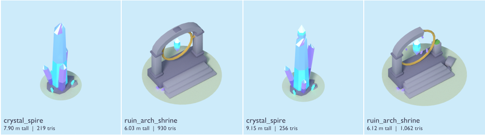

# DES-004 ขั้น 2 (ส่วน Blender): `crystal_spire` + `ruin_arch_shrine` ตัวเลือก A/B

> สถานะ: **ต้นแบบ 2 ตัวเลือก รอทีม A ตรวจและเจ้าของเลือก** · asset ยังไม่ APPROVED (ลงทะเบียนเป็น placeholder ใน `docs/ASSETS.md`)
> branch `exp/stage1-spire-shrine` (แตกจาก `stage1/polish` `eef1be6`) · ทำโดย Claude Opus 5.5 (ทีม B) · 2026-11-21

## สลับดูในเกม
| URL | ภาพ |
|---|---|
| (ไม่ใส่) หรือ `?spire=A` | **ค่าเริ่มต้น = A** โมเดลอยู่ใน `public/assets/models/synes_kit.glb` |
| `?spire=B` | ตัวเลือก B โหลดไฟล์เสริม `public/assets/models/spire_shrine_B.glb` (54.7 KB) ซึ่งมีแค่ 2 node นี้ แล้วใช้แทน node ชื่อเดียวกันใน kit |
| `?spire=0` | ภาพเดิม (ผลึก icosahedron + ศาลกล่อง/torus) ใช้เป็น "ก่อน" ในการเทียบทั้งหมดด้านล่าง |
| `?nokit` | ไม่มี kit จึงกลับไปใช้ภาพเดิมเองโดยอัตโนมัติ |

ใช้คู่กับ `?arena=` ได้: ศาลอยู่ตำแหน่งเดียวกับศาลเดิมของลุคนั้น (ลุค A/B ของลาน: ขวาแกนกล้อง `SHRINE_SIDE` x+5.2 z−15.2 หัน −0.3 rad · `?arena=0`: กลางแกนเดิม)

## สิ่งที่สร้าง (`tools/blender/build_kit.py`)
- `crystal_spire`: แท่งผลึก 7 เหลี่ยมเรียว 3 ชั้น ยอดถูกตัดเฉียงแล้วปิดด้วยเหลี่ยมเตี้ยที่ยอดเยื้องศูนย์ (= "ปลายแตกเป็นเหลี่ยม") บนฐานหิน `stone_dark` ไล่สีจากล่างขึ้นบน lumen/prism_cyan → crystal_mid → ปลาย prism_edge/crystal_violet
  - **A:** ยอดเดียว ~7.9 m + ผลึกข้างสีม่วง 3 แท่ง + ผลึกจิ๋วที่ฐาน 3
  - **B:** ยอดหลัก + ยอดแฝดเอียง (ปลายหักทั้งคู่) + ปลายที่หักลอยอยู่เหนือรอยหัก (สูงรวม ~9.1 m) + ผลึกข้าง 2
- `ruin_arch_shrine`: บันไดด้านหน้า (หันเข้าลาน) → แท่น → เสา 2 ต้น + ซุ้มโค้ง → วงแหวนทอง (palette `gold` #FFC857) → ผลึกลอยปลายแหลมสองด้านกลางวงที่ความสูง 3.65 m (ตรงกับจุด halo เดิม `SHRINE_CRYSTAL_Y` จึงไม่ต้องแก้ atmosphere)
  - **A:** ซุ้มสมบูรณ์ + หินหัวซุ้ม · บันได 3 ขั้น · วงแหวน r 1.75 m อยู่ในซุ้ม มีคานทองยึดกับเสา · มอสบนซุ้ม
  - **B:** ซีกขวาพัง (เสาสั้น 55 %, ซุ้มหักเหลือ 58 %, ก้อนหินหล่น 2) · บันได 4 ขั้น · วงแหวน r 2.2 m เอียง 8° ทะลุแนวซุ้ม · ผลึกลอยใหญ่ขึ้น + เศษผลึกม่วงโคจร 4
- ทั้งสองแบบ: ไม่มี texture, ไม่ใช้ Draco/meshopt, ใช้เฉพาะสีใน palette เดิม (ไม่มีส้ม #FF7A1A / แดง #FF3355), origin ที่พื้นกลางฐาน, ด้านหน้า +Z ใน glTF
- เพิ่ม `span` ให้ `Part.arch()` (ซุ้มหัก) ค่าเริ่มต้นคำนวณแบบเดิม ประตูเดิมได้ geometry เท่าเดิม · เพิ่ม `Part.broken_spire()` · `SYNES_SPIRE_VARIANT=A|B` (หรือ `--spire B`) · `SYNES_KIT_ONLY=...` สำหรับไฟล์เสริม
- `render_preview.py` แถวบนแสดง 2 node ใหม่ด้วย

 ซ้าย A · ขวา B (Cycles, `render_preview.py --only`)

## งบ (kit_stats.py, `kit_stats.md`)
| | tris spire / shrine | รวมเพิ่ม (งบ ≤ +6k) | GLB (งบ ≤ 700 KB) |
|---|---|---|---|
| ก่อน (`stage1/polish`) | — | — | 585.8 KB / 15,988 tris |
| **A** (kit ค่าเริ่มต้น) | 219 / 930 | **+1,149** | **631.8 KB** / 17,137 tris |
| **B** (kit ทั้งชุด `synes_kit_spireB.glb`) | 256 / 1,062 | **+1,318** | **638.1 KB** / 17,306 tris |
| B ไฟล์เสริม `spire_shrine_B.glb` | 256 / 1,062 | — | 54.7 KB |

ในเฟรมเกม (renderer.info, 844 medium): tris 55,399 → 56,729 (A, +1,330) / 57,009 (B, +1,610) เพราะ spire ถูก instance 4 ต้น

## Draw calls (844×390, Chromium headless + SwiftShader, `tools/qa/stage1-shots.mjs --only boss-open,boss-circle --qs spire=…`)
| ช็อต | low ก่อน → A / B | medium ก่อน → A / B |
|---|---|---|
| boss-open-844 | 48 → 49 / 49 | 52 → 53 / 53 |
| boss-circle-844 | 49 → 50 / 50 | 53 → 54 / 54 |
| (1672) boss-open / boss-circle | 47 → 48 / 48 · 47 → 48 / 48 | 51 → 52 / 52 · 51 → 52 / 52 |

**+1 ทุกช็อต** (เกณฑ์ ≤ +2): spire ทั้ง 4 ต้นเป็น InstancedMesh เดียว (+1), ศาลเป็น Mesh เดียว (+1), batch torus เดิมว่างจึงไม่วาด (−1) · โมเดลถูก bake เป็น material เดียว (`bakeKit`) ไม่มีเงา ไม่ใช่วัตถุชนใน sim · ค่า "ก่อน" ตรงกับ `docs/qa/stage1-v01/r1-final` (48/49/52/53)

## ภาพ (`ingame/`, บนลงล่าง = ก่อน `?spire=0` / A / B, seed 1 tick เดียวกัน)
- `boss-open-844-{medium,low}.jpg`, `boss-circle-844-{medium,low}.jpg` (ช็อตมาตรฐาน)
- `boss-circle-844-medium-gray.jpg` (ขาวดำ วงเตือนท่ากระแทก)
- `overview-back-844-medium.jpg`, `overview-right-844-medium.jpg` (ช็อต QA เพิ่ม: ย้ายผู้เล่นไปหลังลาน/ขวาลาน และย้ายบอสออกด้านซ้าย เพื่อให้เห็นศาลและ spire ด้านขวา, สคริปต์อยู่นอก repo)

## วงเตือนยังอ่านได้หรือไม่
- เทียบพิกเซลก่อน/หลังเฟรมเดียวกัน: พิกเซลที่เปลี่ยนอยู่แถว 0–156 ของจอเท่านั้น (ฉากหลัง) · พิกเซล "อุ่นสด" (r>150, r−g>80, s>0.5) ที่เปลี่ยน **0 จุดใต้แถบ HP** ทั้ง low/medium ทั้ง A/B · ที่เปลี่ยน 571 (medium) / 1,578 (low) จุดอยู่ในแถบ HP บอสทั้งหมด (แถว 30–60) เพราะแถบโปร่งแสงทับฉากหลังที่เปลี่ยน ไม่ใช่วงเตือน
- ภาพขาวดำ `boss-circle-844-medium-gray.jpg`: วงแดงอยู่บนพื้นลานซึ่งโมเดลใหม่ไม่บัง ขอบวงไม่เปลี่ยน
- ไม่ได้แตะ `shared/**`, tuning, HUD, การวาดวงเตือน

## ผลทดสอบ
- `verify_kit.py --rebuild-check`: **A ผ่าน 0 คำเตือน** · **B ผ่าน 0 คำเตือน** (`SYNES_SPIRE_VARIANT=B … --glb docs/qa/spire-shrine-v01/synes_kit_spireB.glb`) · build ซ้ำได้ไบต์ตรงกัน (Blender 5.3.0) · 2 node ใหม่ขึ้นเป็น "nodes beyond the contract" (ยังไม่ได้เพิ่มใน ASSET_CONTRACT ดูคำถาม S9)
- node เดิมทุกตัว tris/primitive เท่าเดิม (kit_stats)
- `npm test` 154/154 · `npm run typecheck` ผ่าน · `npm run build` ผ่าน · `node tools/qa/lifecycle.mjs` 20/20 · shots 24 ภาพ error 0
- **Android: ยังไม่ได้ทดสอบ · iPhone: ยังไม่ได้ทดสอบ · PC: headless เท่านั้น** · FPS เครื่องจริง: ยังไม่ทราบ

## เหตุผลที่เลือก (ทีม B)
- แกน A/B = ระดับความ "พัง/ดราม่า" ของ silhouette: A สงบ อ่านง่าย ใกล้ศาลเดิม · B เล่าเรื่องซากมากกว่าแต่รายละเอียดเล็ก (เศษโคจร ปลายลอย) เล็กเกินจะเห็นจากกล้องเล่นจริง
- spire ใช้วัสดุ kit (emissive จาก palette) แทน shader self-lit ของ instanced crystal เพื่อให้เป็น 1 draw call กับ BakedLambert ที่มีอยู่
- ศาลวางที่ตำแหน่งที่ลุคลาน A ย้ายไว้แล้ว (ขวาแกนกล้อง) ตาม DES-004 "ย้ายไปชิดซ้ายหรือขวา" ไม่ได้ย้ายเพิ่ม
- **ข้อเสนอทีม B: A** (งบน้อยกว่า, ศาลสมบูรณ์อ่านเป็น "ศาล" ชัดกว่าเมื่อเห็นแค่ครึ่งล่างจากกล้องต่ำ) แต่ spire ของ B ให้ยอดที่ "แตก" ชัดกว่า

## คำถามถึงทีม A (ทุกข้อเป็นสิ่งที่ DES-004 ไม่ได้ระบุ ทีม B เลือกชั่วคราว ยังไม่ถือเป็นมติ)
- **S1** จำนวนและตำแหน่ง spire: DES-004 เขียน "ผลึกใหญ่" (เอกพจน์) ทีม B แทนผลึกกลางของกลุ่มสูง 2 กลุ่มต่อข้าง = 4 ต้น (สูง 6.4 m ที่ z−12.4 และ 8.2 m ที่ z−6.2) กลุ่มเตี้ยใกล้กล้องยังเป็น icosahedron · ควรเป็นต้นเดียว/สองต้น หรือแทนทุกกลุ่ม?
- **S2** ทิศของรอยหัก: หมุน 2.2 / 2.9 rad (สะท้อนซ้าย-ขวา) ให้เห็นรอยตัดเฉียงจากกล้องต่ำ
- **S3** สีของ spire: ล่าง lumen/cyan บน crystal_mid ปลาย prism_edge/violet ผลึกข้าง violet · ความสว่างเทียบพื้น (DES-006 §3) **ยังไม่ได้วัดด้วย arena-probe** (probe ยังไม่รู้จัก label ของ mesh ใหม่)
- **S4** ขนาดศาล: กว้าง 5.6 m สูง ~6 m วงแหวน A r 1.75 m (เดิม 2.42 m) / B r 2.2 m · จากกล้องต่ำ ช็อตบอสเห็นแค่ครึ่งล่างของศาล (ซุ้มและวงแหวนชนขอบบน/แถบ HP) ควรย่อ ลดความสูง หรือย้ายถอยหลัง?
- **S5** สีทอง: ใช้ palette `gold` #FFC857 ด้าน (เดิม torus ใช้ #B3A27A) อยู่ในงบสีไหม หรือควรใช้ `prism_trim` #DAB381 เหมือนขอบเกราะบอส?
- **S6** จำนวนขั้นบันได (A 3 / B 4) และคานทองยึดวงแหวน (เฉพาะ A)
- **S7** ผลึกลอย: ปลายแหลมสองด้าน, B มีเศษโคจร 4 ชิ้น (ยังไม่หมุน/ลอยขึ้นลง เพราะเป็น mesh เดียวกับศาล) ต้องการ animation หรือไม่?
- **S8** มอสสีใบไม้บนซุ้ม และก้อนหินหล่นใน B
- **S9** ควรเพิ่ม 2 node นี้ใน `docs/art/ASSET_CONTRACT.md` (ขนาดอ้างอิง) หรือรอเจ้าของเลือกก่อน?
- **S10** ไฟล์ B: นอกจาก `docs/qa/spire-shrine-v01/synes_kit_spireB.glb` (ไฟล์เทียบ) ทีม B ใส่ไฟล์เสริม 54.7 KB ไว้ใน `public/assets/models/` เพื่อให้ `?spire=B` เปิดได้จริง (โหลดเฉพาะเมื่อใส่ param) ยอมรับไหม หรือให้ย้ายออกหลังเลือกแล้ว

## สร้างซ้ำ
```bash
PY=tools/blender/.venv/bin/python
$PY tools/blender/build_kit.py                                                          # A -> public/assets/models/synes_kit.glb
SYNES_SPIRE_VARIANT=B SYNES_KIT_OUT=docs/qa/spire-shrine-v01/synes_kit_spireB.glb $PY tools/blender/build_kit.py
SYNES_SPIRE_VARIANT=B SYNES_KIT_ONLY=crystal_spire,ruin_arch_shrine SYNES_KIT_OUT=public/assets/models/spire_shrine_B.glb $PY tools/blender/build_kit.py
$PY tools/blender/verify_kit.py --rebuild-check
SYNES_SPIRE_VARIANT=B $PY tools/blender/verify_kit.py --rebuild-check --glb docs/qa/spire-shrine-v01/synes_kit_spireB.glb
npm run build && node tools/qa/stage1-shots.mjs <out> --tag spireA --only boss-open,boss-circle --qs spire=A
```
ขั้นถัดไปควรใช้: **Opus** ตรวจผล/ตอบคำถาม S1–S10 · ปรับตามมติทีม A ด้วย **Opus** (งานกราฟิก ตามคำสั่งเจ้าของ 2026-11-21)
