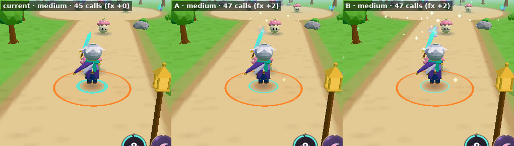
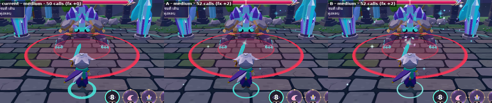
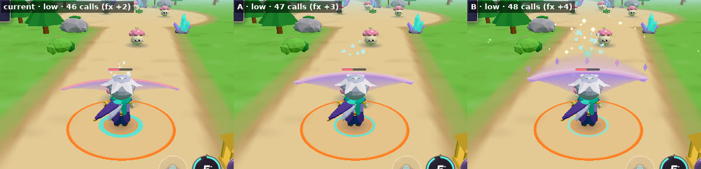
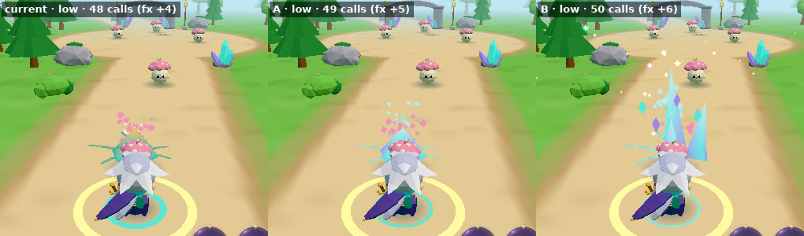
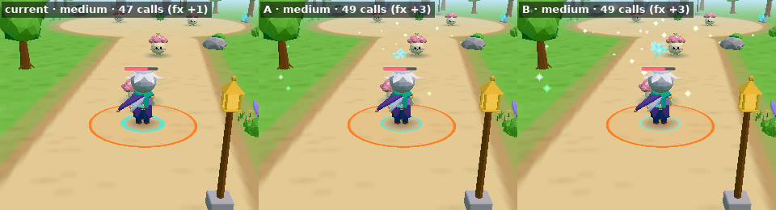
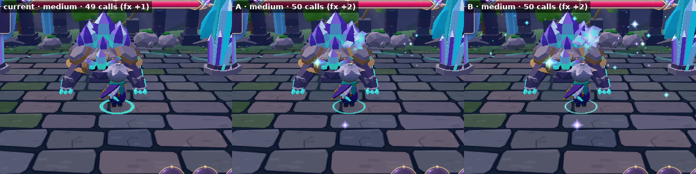
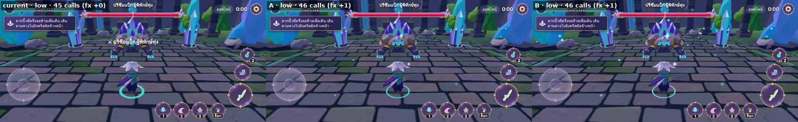
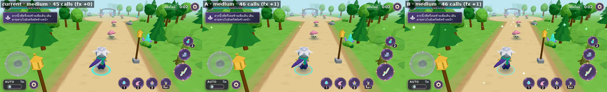

# vfx v01: DES-004 ขั้น 5 + DES-006 Q26/Q27 ตัวเลือก A / B

ผู้ทำ: Claude Code Opus 5.5 · ทีม B · บทบาท Technical Art (VFX) · branch `exp/stage1-vfx` (แตกจาก `origin/stage1/polish` `a31ce02`)
ดีไซน์เป้าหมาย: DES-004 §2 + §3 "ขั้น 5: เอฟเฟกต์" · DES-006 §4 Q25–Q28 · ข้อสังเกตตั้งต้น `docs/qa/stage1-v01/r0-baseline/README.md` (หมวด vfx)
**สถานะ: ต้นแบบ 2 ตัวเลือก รอทีม A ตรวจและเจ้าของเลือก** (ADR-007) · ไม่มี asset ภายนอก ไม่มีไฟล์ texture ใหม่ (ทุกอย่างวาดด้วย shader / vertex color) · **Android / iPhone ยังไม่ได้ทดสอบ**

## สรุป
- สลับด้วย URL: `?vfx=A` หรือ `?vfx=B` · **ไม่ใส่ = ภาพเดิมทุกอย่าง** (โค้ดเดิม `skillfx.ts` และวงเท้าเดิมไม่ถูกแตะ ตัวเลือกอยู่ในไฟล์ใหม่ `src/render/vfx*.ts`) · `?vfx=0` ยังปิด VFX สกิลเหมือนเดิม
  - ตรวจแล้ว: build นี้ไม่ใส่พารามิเตอร์ เทียบ build ก่อนแก้ ที่ tick เดียวกัน 28 ช็อต (canvas WebGL อย่างเดียว) **พิกเซลตรงกันทุกจุด 20/28** ที่เหลือ 8 ช็อตต่างเฉพาะกลุ่มพิกเซล ≤ 60×60 ที่อนุภาคสุ่ม (`Math.random`) อยู่ ซึ่ง build เดิมรันซ้ำ 2 ครั้งก็ต่างแบบเดียวกัน · draw calls / tris เท่ากันทุกช็อต
- **แกนที่ต่างกันมีแกนเดียว: ความแรงของสัญญาณ** (ขนาด × ความสว่าง × ระยะเวลา × จำนวนชิ้น) รูปทรง palette ลำดับการวาด และ draw calls เหมือนกันทั้งสองแบบ
  - **A = เบา:** ใกล้ภาพเดิม แก้ที่สาเหตุ (สี, การบัง, มุมกล้อง) มากกว่าขยายขนาด เอฟเฟกต์ไม่แย่งสายตาจากวงเตือน
  - **B = ชัด:** ชิ้นใหญ่ขึ้น สว่างขึ้น อยู่นานขึ้น มีชิ้นเพิ่ม (ม่านแสงของเสี้ยวจันทร์, วงสะท้อนใน Chime, จุดแสงไหลเข้าดาบ, ผลึก 3 แท่งบน Low, ประกายลอยเป็น 2 เท่า)
- **งบ:** ผ่านทั้งคู่ เทียบปัจจุบันฉากเดียวกันเพิ่มสูงสุด **+2 calls** (เอฟเฟกต์ที่ทำงาน +1, ประกายลอย +1 คงที่; Low แบบ A ประกายเฉพาะในลาน) จากงบ +0–3 / ≤ +1 · ไม่มี texture ใหม่ (0 MB)
- **วงเตือน:** ไม่เปลี่ยน ทุกเอฟเฟกต์ใหม่วาดก่อนวงเตือน (renderOrder ≤ 9) ยกเว้นวงเท้าฮีโร่ซึ่งตั้งใจวาดทับ (ADR-005) · สีขอบวงเตือนที่ถูกเอฟเฟกต์ซ้อนเปลี่ยนไป ΔE00 สูงสุด 3.87 (เกณฑ์ ≲ 5)
- **ข้อเสนอ: A** (เหตุผลในหัวข้อ "ข้อเสนอ") · B เก็บไว้สลับดูบนมือถือจริง

## สิ่งที่ทำ
| จุด | ปัจจุบัน (ไม่ใส่พารามิเตอร์) | A (เบา) | B (ชัด) |
|---|---|---|---|
| **Q26 prep ของ Chime** (tick 0–10) | ไม่มี มีแต่ท่ายกดาบ | แสงห่อใบดาบ (กว้าง 0.10 m) + ดาว 4 แฉกที่ปลายดาบ (รัศมีสูงสุด 0.34 m) มีพื้นม่วงจาง ๆ หลังดาวให้อ่านได้บนทางดินสว่าง · โตตามท่ายก (tick 0–8) สว่างขึ้นตอนฟันลง (8–10) · **ไม่มีวงบนพื้น** | เหมือน A แต่แสง 0.16 m, ดาว 0.46 m + จุดแสง 6 จุดหมุนเข้าหาปลายดาบ (ไม่ใช่วงปิด) |
| Chime ระเบิด | วง lumen ผสมทอง + เศษทอง/lumen 8 ชิ้น (Medium) | วงเดิม ขนาดเดิม ไฮไลต์ lumen-ขาวแทนทอง เศษ lumen/violet 8 ชิ้น | แถบวงกว้างขึ้น 20% + วงสะท้อนสีขาวบาง ๆ ด้านใน + เศษ 12 ชิ้น (Low 4) |
| Crescent Cut (r0: "บางและจาง") | แผ่นราบสูง 0.4 m ขอบ blossom 0.2 m หายใน 8 tick | แผ่นเดิมแต่ **เอียงขึ้นหากล้องต่ำ** (ขอบใน 0.35 m → ขอบนอก 0.7 m) ขอบ orchid + แกนขาว ตัวม่วงทึบขึ้น อยู่ 9 tick | แผ่นเอียงมากขึ้น (0.3 → 0.85 m) หนาขึ้น + **ม่านแสงสูง 0.9 m จากขอบ** จางขึ้นด้านบน อยู่ 11 tick เศษ 14 ชิ้น (Low 5) |
| Crystal Break (r0: "สีใกล้หญ้า") | รอยแตก teal + ผลึก teal ปลายทอง | รอยแตก lumen · ผลึกด้าน lumen สลับด้าน violet ปลาย lumen-ขาว (เหลี่ยมอ่านจากสีสลับ) ขนาดเดิม Low ยังเป็นผลึกเดียว | ผลึก ×1.25 · Low 3 แท่ง · ประกายเล็กที่ปลายรอยแตกตอน prep · เศษ 11 (Low 4) |
| Q27 รอยแตก Crystal | เส้นรัศมี teal | เส้นรัศมี 8 เส้น lumen ไม่มีขอบวง ไม่มีพื้นเติมสี | เหมือน A + ประกายปลายเส้น |
| ตีโดน (r0: "เล็กมากและถูกฮีโร่บัง") | อนุภาคขาว 8 ชิ้นที่ความสูง 0.9 m กลางตัวศัตรู (ทอง ถ้า crit) | แสงดาว 4 แฉก (0.36 m) + อนุภาค lumen-ขาว 10 ชิ้น **ยกขึ้นเหนือเส้นสายตาที่ผ่านหัวฮีโร่ เฉพาะเมื่อฮีโร่บังจุดนั้นบนจอ** (ไม่บัง = ความสูง 1.05 m) crit = ม่วง | แสงดาว 6 แฉก (0.56 m) อยู่ 5 tick อนุภาค 14 ชิ้น ขนาด ×1.4 พุ่งสูงกว่า |
| ดาบโดนผลึก (Prismback) | อนุภาคขาวเหมือนศัตรูอื่น | แสงที่ผิวหน้าเกราะฝั่งมือถือดาบ + **เศษผลึกเหลี่ยม lumen/violet 8 ชิ้น** (แต่ละชิ้นแบ่ง 4 หน้า สว่าง/กลาง/มืด) กระเด็นกลับขึ้นด้านข้าง | เศษ 14 ชิ้น ใหญ่ขึ้น |
| perfect dodge | วงขาว + อนุภาค lumen | เหมือนเดิม | + วงสะท้อน violet + อนุภาค violet 8 |
| ฟันที่ 3 | เส้นโค้งทอง | เส้นโค้ง violet | เหมือน A |
| วงใต้ฮีโร่ | วงทึบ lumen 0.55–0.70 m (กว้าง 0.15 m) | **เส้น lumen กว้าง 0.07 m** ขอบนุ่ม (anti-alias ด้วย shader) | เส้น 0.06 m + เรืองจาง ๆ ไม่เกินแนววงเดิม (0.54–0.70 m) |
| ประกายผลึกลอย (ใหม่) | ไม่มี | point sprite 1 call · 50% ของค่า `particles` ของ tier (Low 45 / Medium 80 / High 110) · ในลานเต็มความแรง ในทุ่ง: Low ปิด, Medium/High 45% | 100% ของ `particles` (90 / 160 / 220) · ทุ่ง Low 60% Medium/High 80% · ใหญ่ ×1.35 สว่าง ×1.35 |

**กติกาสีที่ใช้ทั้ง A/B:** lumen #5CF2E6, violet #A78BFA, lumen-ขาว #C6FAF6 (lumen 35% + ขาว 65%), orchid #D395E2 (blossom:violet 50:50, hue 289°) · **ไม่มีทอง** (#FFC857 hue 41° อยู่ในแถบสีอุ่น) **และไม่มี #FF7A1A / #FF3355**
**ประกายลอย:** จุดแต่ละจุดมีตำแหน่งคงที่ในโลกบนตารางที่ซ้ำทุก 30 m แล้ว shader เลือกชุดที่อยู่ในกล่องรอบเป้ากล้อง (ไม่ไหลตามกล้อง) จางที่ขอบกล่อง ใกล้กล้อง < 2.5 m และไกล · ดาว 4 แฉก + แกนนุ่ม วาดใน shader ไม่มี texture

## ภาพเทียบ (tick เดียวกัน, 844×390 dpr 1, seed 1)
แต่ละภาพ = `ปัจจุบัน | A | B` ครอปรอบเอฟเฟกต์ (ฉาก field/arena ย่อเหลือ 2/3) ป้ายบนภาพบอก draw calls ของเฟรมและส่วนที่เป็นเอฟเฟกต์ (fx) · ไฟล์ใน `shots/` ชื่อ `<ฉาก>-<tier>.jpg`
| ฉาก | สิ่งที่ดู | tick | Low | Medium |
|---|---|---:|---|---|
| chime-prep | Q26 prep cue: กด 1 แล้ว 7 tick (ดาบยกขึ้น) | 8 | [low](shots/chime-prep-low.jpg) | [medium](shots/chime-prep-medium.jpg) |
| chime-burst | Chime ระเบิด: กด 1 + 12 tick (= r0 `vfx-skill1-chime`) | 13 | [low](shots/chime-burst-low.jpg) | [medium](shots/chime-burst-medium.jpg) |
| crescent | Crescent: กด 2 + 8 tick (= r0 `vfx-skill2-crescent`) | 9 | [low](shots/crescent-low.jpg) | [medium](shots/crescent-medium.jpg) |
| crescent-late | Crescent เต็มเสี้ยว: กด 2 + 11 tick | 12 | [low](shots/crescent-late-low.jpg) | [medium](shots/crescent-late-medium.jpg) |
| crystal-prep | Q27 รอยแตก Crystal: กด 3 + 10 tick | 11 | [low](shots/crystal-prep-low.jpg) | [medium](shots/crystal-prep-medium.jpg) |
| crystal-hit | Crystal ระเบิด: กด 3 + 19 tick (= r0 `vfx-skill3-crystal`) | 20 | [low](shots/crystal-hit-low.jpg) | [medium](shots/crystal-hit-medium.jpg) |
| hit-spark | ตีโดนพัฟแคป: ฟันจนโดนครั้งแรก + 1 tick (= r0 `vfx-hit-spark`) | 6 | [low](shots/hit-spark-low.jpg) | [medium](shots/hit-spark-medium.jpg) |
| perfect-dodge | perfect dodge จริง + 2 tick (= r0) | 39 | [low](shots/perfect-dodge-low.jpg) | [medium](shots/perfect-dodge-medium.jpg) |
| field | ทุ่ง: เดิน 60 tick (= r0 `opening-walk2s`) ประกายลอยในทุ่ง + วงเท้า | 60 | [low](shots/field-low.jpg) | [medium](shots/field-medium.jpg) |
| arena | ลานบอส (= r0 `boss-open`) ประกายลอยในลาน + วงเท้า | 16 | [low](shots/arena-low.jpg) | [medium](shots/arena-medium.jpg) |
| boss-hit1 | ดาบโดนเกราะผลึก Prismback + 1 tick | 7 | [low](shots/boss-hit1-low.jpg) | [medium](shots/boss-hit1-medium.jpg) |
| boss-hit4 | เหมือนกัน + 4 tick (เศษผลึกกระเด็น) | 10 | [low](shots/boss-hit4-low.jpg) | [medium](shots/boss-hit4-medium.jpg) |
| slam-chime-prep | วงเตือน slam + 12 tick แล้วกด 1 + 6 tick (prep ใต้วงเตือน) | 86 | [low](shots/slam-chime-prep-low.jpg) | [medium](shots/slam-chime-prep-medium.jpg) |
| slam-chime | เหมือนกัน + 14 tick (= tele-roi `circle-vfx`: วง Chime ตัดขอบ slam) | 94 | [low](shots/slam-chime-low.jpg) | [medium](shots/slam-chime-medium.jpg) |


**Q26 prep cue (Medium)**


**prep cue ใต้วงเตือน slam (Medium)**


**Crescent (Low)**


**Crystal Break (Low)**


**ตีโดนพัฟแคป (Medium)**


**ดาบโดนเกราะผลึก (Medium)**


**ประกายลอยในลาน + วงเท้า (Low)**


**ประกายลอยในทุ่ง (Medium)**


## Draw calls (renderer.info ของเฟรมเกม) รูปแบบ `calls (+fx)`
fx = calls ของเฟรมลบ calls ของเฟรมเดียวกันที่ซ่อนชั้นเอฟเฟกต์ทั้งหมด (อนุภาค, วง/ส่วนโค้ง, mesh สกิล, แสงตีโดน, ประกายลอย; วงเท้าฮีโร่ไม่นับเพราะมีทุกแบบ 1 call)
| ฉาก | Low ปัจจุบัน | Low A | Low B | Medium ปัจจุบัน | Medium A | Medium B |
|---|---|---|---|---|---|---|
| chime-prep | 44 (+0) | 45 (+1) | 46 (+2) | 45 (+0) | 47 (+2) | 47 (+2) |
| chime-burst | 51 (+4) | 52 (+5) | 53 (+6) | 52 (+4) | 54 (+6) | 54 (+6) |
| crescent | 46 (+2) | 47 (+3) | 48 (+4) | 47 (+2) | 49 (+4) | 49 (+4) |
| crescent-late | 46 (+2) | 47 (+3) | 48 (+4) | 47 (+2) | 49 (+4) | 49 (+4) |
| crystal-prep | 45 (+1) | 45 (+1) | 46 (+2) | 46 (+1) | 47 (+2) | 47 (+2) |
| crystal-hit | 48 (+4) | 49 (+5) | 50 (+6) | 49 (+4) | 51 (+6) | 51 (+6) |
| hit-spark | 46 (+1) | 47 (+2) | 48 (+3) | 47 (+1) | 49 (+3) | 49 (+3) |
| perfect-dodge | 51 (+5) | 51 (+5) | 53 (+7) | 52 (+5) | 53 (+6) | 54 (+7) |
| field | 44 (+0) | 44 (+0) | 45 (+1) | 45 (+0) | 46 (+1) | 46 (+1) |
| arena | 45 (+0) | 46 (+1) | 46 (+1) | 49 (+0) | 50 (+1) | 50 (+1) |
| boss-hit1 | 46 (+1) | 47 (+2) | 47 (+2) | 50 (+1) | 51 (+2) | 51 (+2) |
| boss-hit4 | 45 (+1) | 46 (+2) | 46 (+2) | 49 (+1) | 50 (+2) | 50 (+2) |
| slam-chime-prep | 46 (+0) | 48 (+2) | 48 (+2) | 50 (+0) | 52 (+2) | 52 (+2) |
| slam-chime | 48 (+2) | 49 (+3) | 49 (+3) | 52 (+2) | 53 (+3) | 53 (+3) |

- เทียบ "ปัจจุบัน" ฉากเดียวกัน tier เดียวกัน: เพิ่มสูงสุด **+2 (Low) / +2 (Medium)** = เอฟเฟกต์ที่ทำงานอยู่ +1 (prep ของ Chime ใช้ mesh เดียวกับวงระเบิด, แสงตีโดนทุกครั้งรวมใน mesh เดียว, วงสะท้อน perfect ของ B เป็น single-pass) + ประกายลอย +1 (Low แบบ A: เฉพาะในลาน)
- เกณฑ์: เอฟเฟกต์ที่ทำงาน +0–3 ผ่าน · ประกายลอย ≤ +1 ผ่าน · ลานบอส (arena) Low 45 → 46, Medium 49 → 50 (เกณฑ์ PLAN baseline +10) · ทุ่ง 44–54 (เกณฑ์ ≤ 80 / ≤ 100)
- tris (ปัจจุบัน/A/B) arena Low 34951/34889/34889 · Medium 54301/54239/54239 (วงเท้าใหม่เป็น quad 2 tris แทน RingGeometry 64) · ประกายลอยเป็น points (Low 45 / 90, Medium 80 / 160 จุด สำหรับ A / B) ไม่นับใน tris
- texture ใหม่ 0 MB (ดาว/วง/ประกายวาดใน shader) · JS bundle 801.5 → 821.5 KB (gzip 217.4 → 223.5 KB)

## วงเตือน: ROI ขอบ (tele-roi.mjs, วงทับเอฟเฟกต์)
รันด้วย `tools/qa/vfx-roi.mjs` = `tele-roi.mjs` ตัวเดิมที่ patch ในหน่วยความจำ 3 จุด (URL `&vfx=`, ชั้น VFX รวมแสงตีโดน/ประกายลอย, เรนเดอร์ NV = วงเตือนเปิด VFX ปิด) ไม่ได้แก้ไฟล์ tele-roi · ฉาก: slam (circle), sweep (fan), charge (dash), slam + กด Chime แล้ว 6 tick (`circle-vfx6` = prep cue) และ 14 tick (`circle-vfx` = วง Chime ตัดขอบ slam) · 844×390
**vfxShift** = CIEDE2000 ระหว่างพิกเซลขอบที่มีเอฟเฟกต์ซ้อน กับพิกเซลเดียวกันเมื่อปิดเอฟเฟกต์ (เกณฑ์ ≲ 5)
| ฉาก (844×390) | calls Low ปัจจุบัน/A/B | calls Medium ปัจจุบัน/A/B | พิกเซล ROI ขอบ ปัจจุบัน/A/B | ΔE00 ขอบ→hex (ทุกแบบ) | vfxShift สูงสุด ปัจจุบัน / A / B (จำนวนพิกเซล) | ขอบสดสุดในฉาก (ทุกแบบ) |
|---|---|---|---|---|---|---|
| circle | 46/47/47 | 50/51/51 | 2754/2754/2754 | 3.8 | 0 / 0 / 0 | ใช่ |
| fan | 46/47/47 | 50/51/51 | 2666/2683/2674 | 3.5 | 0 / 0 / 0 | ใช่ |
| dash | 52/53/53 | 55/56/56 | 1347/1347/1347 | 1.6 | 0 / 2.24 (3 px, เฉลี่ย 1.14) / 3.87 (7 px, เฉลี่ย 1.18) | ใช่ |
| circle-vfx6 | 46/48/48 | 50/52/52 | 2727/2727/2727 | 3.5 | 0 / 0 / 0 | ใช่ |
| circle-vfx | 47/49/49 | 51/53/53 | 2777/2777/2777 | 1.7 | 2.15 (329 px, เฉลี่ย 0.9) / 2.05 (344 px, เฉลี่ย 0.99) / 2.31 (507 px, เฉลี่ย 1.12) | ใช่ |

- สี ความสด และ ΔE00 ของขอบเทียบ hex เป้าหมาย (#FF3355 / #FF7A1A) **เท่ากับ "ปัจจุบัน" ทุกฉากทุก tier** เพราะเอฟเฟกต์ใหม่ทั้งหมดวาดก่อนวงเตือน (ขอบทึบ 90–100%) ส่วนที่ซ้อนได้มีแค่ ≤ 10% ที่ลอดผ่าน
- vfxShift สูงสุด 3.87 (B, dash: ประกายลอย 7 พิกเซลใต้ขอบ) และวง Chime ตัดขอบ slam เฉลี่ย ≈ 1.0 (ปัจจุบัน 0.9) **ต่ำกว่าเกณฑ์ ≲ 5 ทุกช็อต**
- `circle-vfx6` (prep cue ใต้วง slam): ไม่มีพิกเซลขอบที่เอฟเฟกต์เปลี่ยนเลย
- พิกเซล ROI ของพัด A +17 / B +8 เพราะวงเท้าที่บางลงบังขอบน้อยลง (พิกเซลที่ถูกวาดทับโดยตั้งใจ 480 → 463 / 472)
- "ขอบสดสุดในฉาก" = ใช่ทุกช็อต · ส่วนเกณฑ์ "สดสุดบนจอ (รวม HUD)" เป็น false ใน circle/dash **ทั้งปัจจุบัน A และ B** เพราะพิกเซลอุ่นใน HUD (DOM, S·V 0.773 เท่ากันทุกแบบ) สดกว่าขอบ (0.72–0.77) ไม่ใช่ผลของ VFX (งานสาย HUD)

## สีอุ่นในเอฟเฟกต์
วัดในทุกช็อตของ `vfx-shots` (ปิดวงเตือนก่อนวัด): พิกเซลที่ชั้นเอฟเฟกต์แต่ละกลุ่มเปลี่ยน และในนั้นมีกี่พิกเซลที่ **อุ่น** (hue ≥ 320° หรือ < 50°, รวมทอง) **และสด** (S·V > 0.3) **โดยเอฟเฟกต์เป็นตัวเพิ่มความอุ่น/สด** (ประกายจาง ๆ บนทางดินสีเบจไม่นับ)
| แบบ | mesh สกิล | แสงตีโดน + เศษผลึก | ประกายลอย | วง/ส่วนโค้ง (rings) | อนุภาค (particles) |
|---|---:|---:|---:|---:|---:|
| ปัจจุบัน | 1939 | – | – | 66 | 484 |
| A | 0 | 0 | 0 | 66 | 504 |
| B | 0 | 0 | 0 | 66 | 320 |

(ผลรวม 28 ช็อตต่อแบบ หน่วยพิกเซล) · ปัจจุบัน: ทองของ Chime/Crystal และ blossom ของ Crescent · **A / B: 0 ในทุกกลุ่มที่งานนี้ทำ** · rings 66 = วงตอนวงเตือนพัฟแคปลงพื้น (สีเตือนส้ม ตั้งใจ) · particles = ฝุ่นตาย blossom ของพัฟแคป + อนุภาคสีเตือนตอนท่าศัตรูลง (นอกขอบเขต ดูคำถาม V3) ค่าต่างกันระหว่างแบบเพราะอนุภาคสุ่ม

**พิกเซลที่เอฟเฟกต์ของผู้เล่นครอบบนจอ (Medium; ตัวแทนความ "อ่านได้", ไม่รวมประกายลอย)**
| ฉาก | ปัจจุบัน | A | B |
|---|---:|---:|---:|
| chime-prep | 0 | 242 | 485 |
| crescent | 899 | 1641 | 4586 |
| crescent-late | 2079 | 3539 | 8919 |
| crystal-hit | 6978 | 7231 | 9031 |
| hit-spark | 0 | 178 | 360 |
| boss-hit4 | 0 | 740 | 1338 |
| ประกายลอย: arena / field | 0 / 0 | 784 / 422 | 2460 / 1694 |

hit-spark ของ "ปัจจุบัน" = **0 พิกเซล** (ประกายอยู่หลังฮีโร่ทั้งหมด ตรงกับข้อสังเกต r0) · chime-prep ของปัจจุบัน = 0 (ไม่มี prep cue)

## คลิปความเร็วจริง (`clips/`)
`vfx-cur.webm`, `vfx-A.webm`, `vfx-B.webm` · 7.7 วิ 844×390 30 fps VP9 · cur 0.74 MB / A 0.79 MB / B 0.86 MB (รวม 2.39 MB) · สคริปต์อินพุตเดียวกันทุกแบบ (`tools/qa/vfx-clip.mjs`): ทุ่ง: Chime → Crescent → Crystal → ฟัน 3 ครั้ง · ลานบอส: Chime ใต้วง slam → ฟันเกราะผลึก 4 ครั้ง → Crescent ใส่บอส · เดิน sim ทีละ 1 tick ต่อเฟรม (เวลาเล่น = เวลาจริง) ไม่ใช่การอัดจากมือถือ · page error 0

## เทสต์
- `npm test` 150/150 ผ่าน · `npm run typecheck` ผ่าน · `npm run build` ผ่าน
- `node tools/qa/lifecycle.mjs http://localhost:8791` (หลัง build + `PORT=8791 npm run server`) **20/20 ผ่าน** (URL ของ lifecycle ไม่ใส่ `?vfx` = ทางโค้ดเดิม)
- smoke ตัวเลือก: `?vfx=A|B` × Low/Medium บอทสู้บอสเวลาจริง 8 วิ + WebGL context loss/restore: page error / console error = 0
- `vfx-shots` 84 ช็อต, `vfx-roi` 30 ช็อต, คลิป 3 ไฟล์: error 0
- "ไม่ใส่พารามิเตอร์ = ภาพเดิม": canvas 28 ช็อตเทียบ build ก่อนแก้ (`--canvas`) ตรงทุกพิกเซล 20 ช็อต ที่เหลือต่างเฉพาะกลุ่มอนุภาคสุ่ม (build เดิมรัน 2 ครั้งก็ต่างแบบเดียวกัน)

## ข้อเสนอ (เทียบเกณฑ์ `docs/stage1/PLAN.md`)
**เสนอ A** (B เก็บไว้สลับบนมือถือจริง)
| เกณฑ์ PLAN | A | B |
|---|---|---|
| 1 ความชัด (สำคัญสุด) | ผ่าน: ขอบวงเตือนเท่าปัจจุบัน, vfxShift ≤ 2.24, ไม่มีสีอุ่นในเอฟเฟกต์ใหม่, ไม่มี #FF7A1A/#FF3355, วงเท้าบังขอบน้อยลง | ผ่านเท่ากัน (vfxShift ≤ 3.87) แต่มีชิ้นบนจอมากกว่า: ประกายลอย ≈ 3 เท่าของ A, เสี้ยวจันทร์ ≈ 2.5 เท่า |
| 2 ภาพ (value / silhouette) | ไม่แตะโมเดลหรือแสง ประกายลอยจางพอไม่เปลี่ยนลำดับ value | เหมือนกัน แต่ประกายในลานมืดสว่างกว่า อาจแย่งสายตาจากผลึกใหญ่เล็กน้อย |
| 3 perf | +1/+2 calls, texture 0, ประกาย 45/80 จุด | calls เท่า A, ประกาย 90/160 จุด ใหญ่กว่า (fill มากกว่า) · FPS เครื่องจริงยังไม่ทราบทั้งคู่ |
| 4 regression | ผ่าน | ผ่าน |
| 5 ไม่แตะตัวเลขเกม | ไม่แตะ `shared/**` | เหมือนกัน |
| ข้อสังเกต r0 | แก้ครบที่สาเหตุ: ตีโดน 0 → 178 px, Crescent ×1.7 px, Crystal lumen/violet | แก้ครบแรงกว่า: 0 → 360 px, Crescent ×4.3 |
| มติ Q25/Q26 | ตรง "ไม่เติม particle เพื่อใช้งบ" และ "prep cue เล็กน้อย" | prep cue มีจุดแสงเพิ่ม ใหญ่กว่า "เล็กน้อย" |

เหตุผล: ทั้งสองแบบผ่านเกณฑ์ที่วัดได้เท่ากัน ตัวตัดสินจึงเป็นเกณฑ์ข้อ 1 + มติ Q25/Q26 ซึ่ง A ใกล้กว่า และ A แก้ข้อสังเกต r0 ทั้ง 3 ข้อที่สาเหตุ (การบัง, สี, มุมกล้อง) โดยไม่ต้องเพิ่มชิ้น · **ถ้าบนมือถือจริง A ยังอ่าน Crescent หรือแสงตีโดนไม่ออก** ให้ทีม A พิจารณาใช้ค่าของ B เฉพาะ 2 จุดนั้น (คำถาม V1)

## ข้อจำกัด
- ภาพและตัวเลขทั้งหมดมาจาก Chromium headless + SwiftShader (GPU ซอฟต์แวร์) ในคอนเทนเนอร์ **ไม่ใช่เครื่องจริง** · **Android / iPhone ยังไม่ได้ทดสอบ** · ไม่มีตัวเลข FPS (draw calls / tris เทียบกันได้ ส่วนเวลาเฟรมของ SwiftShader ไม่สะท้อนมือถือ)
- อนุภาค burst ใช้ `Math.random` จึงต่างกันเล็กน้อยทุกครั้งที่รัน · CSS fade ของ HUD ใช้เวลาจริง (ป้ายชื่อบอส, คำแนะนำ) ภาพ screenshot จึงต่างกันตรงนั้นได้ ส่วน VFX ใหม่ (สกิล, แสงตีโดน, เศษผลึก, ประกายลอย) ขึ้นกับ tick / เวลาเกมเท่านั้น
- `vfx-shots` เดิน sim **1 tick ต่อ 1 เฟรมที่วาด** (dt = 1/30 วิ) ต่างจาก r0 baseline ที่เดินหลาย tick แล้ววาดครั้งเดียว ซึ่งทำให้อนุภาคที่ขึ้นกับ dt (ประกายตีโดน) แก่ไปทั้งช่วง: ภาพ "ปัจจุบัน" ในชุดนี้จึงเป็นตัวแทนการเล่นจริงมากกว่า r0
- ความสูงศีรษะฮีโร่ที่ใช้ยกแสงตีโดน (1.95 m รวม scale 1.22) อิงโมเดลแบบ A ของ `exp/stage1-chars` ที่ merge แล้ว ถ้าโมเดลเปลี่ยนต้องปรับค่าใน `vfx.ts`
- ทดสอบเฉพาะ 844×390 (ตามบรีฟ) ไม่ได้ถ่าย 1672×941 และ portrait

## คำถามถึงทีม A
1. **V1** เลือก A หรือ B (ทีม B เสนอ A) หรือให้ใช้ค่า B เฉพาะบางจุด (เช่น ม่านแสง Crescent, ขนาดแสงตีโดน)
2. **V2** สีเสี้ยวจันทร์: เปลี่ยน blossom #FF9EC7 (hue 331° อยู่ในแถบอุ่น) เป็น orchid #D395E2 (blossom:violet 50:50) เพื่อให้ตรง DES-004 "ห้ามสีอุ่นในเอฟเฟกต์" แต่ Q28 เคยรับ blossom+violet: ยอมรับ orchid ไหม (ไอคอนปุ่ม 2 ยังเป็นสีชมพู)
3. **V3** เอฟเฟกต์ที่ยังเป็นสีอุ่นและอยู่นอกขอบเขตรอบนี้: ดาวทอง 3 ดวง (สถานะ ✦ หลัง perfect dodge / ศัตรูมึน), ฝุ่นตาย blossom ของพัฟแคป/ธอร์นลิง, อนุภาคแดง #FF5A6A ตอนผู้เล่นโดนตี, ฝุ่นเบจตอนหลบ/บอสพุ่ง · นับเป็น "เอฟเฟกต์" ที่ต้องเปลี่ยนตาม DES-004 ไหม (อนุภาคแดง #FF5A6A ใกล้สีสงวน #FF3355)
4. **V4** "ดาบโดนผลึก" ทีม B ตีความว่า = ตีโดน Prismback (เกราะผลึก) ถูกไหม หรือหมายถึงผลึกในฉากด้วย (ตอนนี้ผู้เล่นตีผลึกในฉากไม่ได้)
5. **V5** แสงตีโดนที่ยกขึ้นเหนือหัวฮีโร่ เฉพาะเมื่อฮีโร่บังบนจอ (ไม่งั้นมองไม่เห็นเลยเพราะฮีโร่วาดหลังเอฟเฟกต์) ยอมรับตำแหน่งนี้ไหม หรืออยากให้ฮีโร่โปร่งตอนตีโดน
6. **V6** ประกายลอยในทุ่ง: A ปิดบน Low · B เปิด 60% ต้องการบนทุ่งไหม (ภาพเรฟเป็นฉากลาน)
7. **V7** วงเท้าฮีโร่วาดทับวงเตือนตามเดิม (ADR-005) แบบ B มีเรืองจาง ๆ กว้างเท่าวงเดิม: ยอมรับไหม

## วิธีทำซ้ำ
```bash
npm run build
node tools/qa/vfx-shots.mjs tools/qa/out/vfx-shots --compose docs/qa/vfx-v01/shots      # cur/A/B × low/medium, ~10-35 นาทีบน SwiftShader
node tools/qa/vfx-shots.mjs <out> --variants cur --canvas [--dist <build เดิม>]           # เทียบ "ไม่ใส่พารามิเตอร์" กับ build เดิม (canvas ล้วน)
node tools/qa/pixeldiff.mjs <outเดิม> <outใหม่>
for v in cur A B; do node tools/qa/vfx-roi.mjs tools/qa/out/roi-$v --vfx $v --tiers low,medium --sizes 844 --only circle,fan,dash,circle-vfx6,circle-vfx; done
node tools/qa/vfx-clip.mjs docs/qa/vfx-v01/clips --crf 40
node tools/qa/stage1-shots.mjs <out> --only vfx --qs '&vfx=A'                              # ชุด r0 เดิมกับตัวเลือก (เพิ่ม --qs)
```
ข้อมูลดิบ: `data/vfx-shots-report.json`, `data/roi-{cur,A,B}.json`, `data/clips.json`

## ไฟล์ที่เปลี่ยน
- ใหม่: `src/render/vfxstyle.ts` (สวิตช์ URL + ค่า A/B + palette), `src/render/vfxskill.ts` (VFX สกิลของตัวเลือก, prep cue Q26), `src/render/vfx.ts` (วงเท้า, ประกายลอย, แสงตีโดน + เศษผลึก)
- `src/render/view.ts` เฉพาะส่วนวงเท้า / สร้าง VFX สกิล / event hit-swing-perfect / update 1 บรรทัด (ไม่แตะ arena hook)
- `src/render/fx.ts`: `Rings.ring(..., single)` ตัวเลือก 1 draw call (ใช้เฉพาะวงสะท้อนของ B; ค่าเริ่มต้นเหมือนเดิม) · ไม่แตะ `telegraphMaterial`
- QA: `tools/qa/vfx-shots.mjs`, `tools/qa/vfx-roi.mjs`, `tools/qa/vfx-clip.mjs`, `tools/qa/stage1-shots.mjs` (`--qs`)
